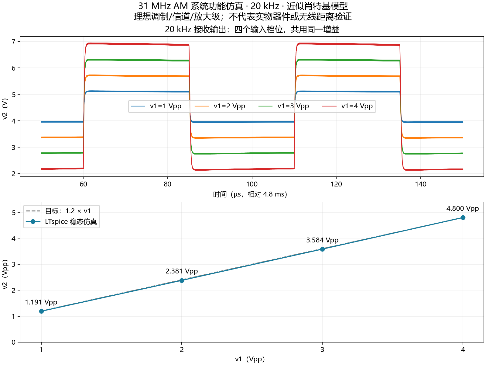
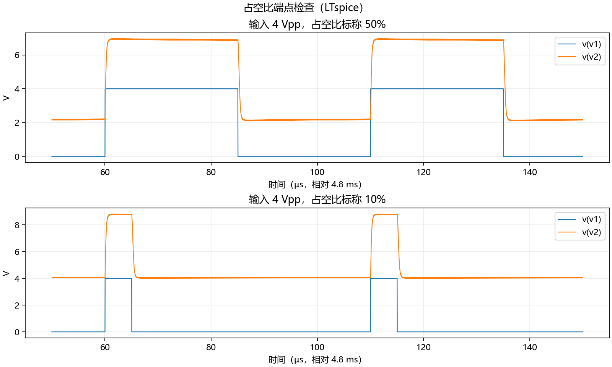

# 20 kHz / 31 MHz AM 功能仿真修改版

## 打开文件

建议先打开 `AM_20k_D50_A4V_V3_quick200us.ms14` 做快速启动检查。主工程 `AM_20k_D50_A4V_V3.ms14` 保留 5 ms 稳态设置，但本机长仿真发生内存不足，详见文末记录。这些都是原生 Multisim 工程，直接“文件 → 打开”，不需要再次导入网表。

其余 `AM_20k_D50_A1V_V3.ms14`、`A2V`、`A3V` 分别用于 1、2、3 Vpp 输入；`AM_20k_D10_A4V_V3.ms14` 用于 10% 占空比端点。每份工程采用相同接收增益，不针对不同幅度分别调节。

原工程 `../system/AM_22k_D50_A4V_debug.ms14` 保留，SHA256 已复核未变。

## 修改内容

- VINPUT：周期 50 µs，标称 50% 档 PW=25 µs；10% 档 PW=5 µs。上升/下降时间仍为 20 ns，因此按半幅交点测得输入占空比分别约 50.04% / 10.04%。
- 载波仍为 31 MHz。
- EBB 电压增益从 15 改为 16.3511；这不是整机增益，整机目标为 v2/v1≈1.2。
- 恢复原 `.cir` 的工程近似肖特基模型。检查发现旧 `.ms14` 的二极管模型实际是 `.model ... D`，没有保留原肖特基参数。只放大原通用二极管输出会造成低幅档明显不线性。
- 恢复模型参数：`D(Is=20n N=1.06 Rs=2 Cjo=2p M=0.33 Vj=0.35 Bv=70 Ibv=10u)`。它不是 BAT85S 厂商模型，不能用它证明 BAT85S 实物指标。
- R/C、连接结构保留；CBB=132.629 pF、RBB=1 kΩ 仍是理想放大级后的滤波网络。

## 仿真方法与结果

下表为 LTspice 对同参数网表的稳态预验证，仿真到 5 ms，统计 4.8–5 ms。幅度采用 98%–2% 分位值减小载波纹波影响；原始 max-min 值也保存在 JSON 中。不是把启动时的最高电压当作 v2 幅度。

| v1 / 标称占空比 | v2 目标 | v2 仿真幅度 | 对目标偏差 | v2 频率 | v2 占空比 |
|---|---:|---:|---:|---:|---:|
| 1 Vpp / 50% | 1.2 Vpp | 1.1914 Vpp | -0.72% | 19999.74 Hz | 50.127% |
| 2 Vpp / 50% | 2.4 Vpp | 2.3806 Vpp | -0.81% | 19999.93 Hz | 50.199% |
| 3 Vpp / 50% | 3.6 Vpp | 3.5842 Vpp | -0.44% | 19999.94 Hz | 50.262% |
| 4 Vpp / 50% | 4.8 Vpp | 4.8000 Vpp | +0.00% | 19999.95 Hz | 50.313% |
| 4 Vpp / 10% | 4.8 Vpp | 4.7724 Vpp | -0.58% | 19999.97 Hz | 10.310% |

四个 50% 档相对 1.2 倍目标的偏差均小于 1%。这是本次模型的数值结果，不是新增的任务书容差要求。10% 档出现约 0.27 个百分点的占空比偏差，来自包络检波和滤波延迟。

## 在 Multisim 中运行

打开主工程后，进入 Simulate → Analyses and Simulation → Transient Analysis → Run。

已保存：TSTART=0，TSTOP=5 ms，TMAX=2 ns，积分方法 Trapezoidal，Maximum number of points=8,000,000。运行结束后放大横轴 4.8–5 ms 区间，观察最后四个周期。点数上限提高，是为了兼顾 5 ms 全程计算的点数，避免旧工程的点数上限故障重现。本机命令接口采用非零 TSTART 时出现异常长耗时，因此交付工程从 0 开始保留波形。

选看 V(v1)、V(v2)、V(tp3)、V(tp6)。波形中 v2 叠加了约 4.5 V 直流偏置，应测峰峰值，不应把最大电压读数当成峰峰值。快速看启动时可改 TSTART=0、TSTOP=200 µs；该窗口尚未稳态，不能用于幅度验收。

五份文件均已由 Multisim 14.3 打开、识别 21 个元件并原生保存。保存后重新解码核对了输入幅度、周期、脉宽、31 MHz、统一增益、二极管参数及瞬态设置，见 `native_verification.json`。

## 本次验证的边界

此版本完成的是原有系统功能模型的频率、检波模型和幅度目标修改。理想信号源尚未替换为 LM393，RF 仍是理想 AM/信道/增益模块，输出仍是无电源限幅的受控电压源。因此还没有验证 7805 损耗、S9013 起振、BAT85S 实物特性、真实运放输出摆幅、发射功耗或 6 m 距离。

BAT85S 实物设计后续应以厂商数据及实测为依据：[Vishay BAT85S](https://www.vishay.com/en/product/85513/)。本次没有将近似模型冒充 BAT85S 官方模型。

复现脚本：`patch_project.py`、`verify_project.py`、`lt_calibrate.py`、`measure.py`；LTspice 日志及原始波形保存在本目录。

## Multisim 引擎复核与已知限制

200 µs 快速检查已完整完成，共 198,461 点，日志无错误。网表与修改工程使用同一组参数。可直接打开 `AM_20k_D50_A4V_V3_quick200us.ms14` 运行，观察 20 kHz、31 MHz AM 和检波响应；此窗口仍处于启动阶段，不能用其最高电压或全窗口峰峰值验收稳态幅度。

0–5 ms 的全程运行尝试明确报 `Out of memory`，没有取得完整波形。非零 TSTART 的尝试也未完成，不列为通过。保留四档 5 ms 工程供继续调试，但不能承诺本机 GUI 可以完成长时间显示。

因此本文四档稳态幅度表是 **LTspice 的同参数网表结果**，不是 Multisim 5 ms 实测结果。本轮 XSPICE 通过项为 200 µs 启动检查；原生工程通过项为打开、保存和参数回读。

日志统一保存到 `../../debug/v3_20k/`：`quick.log` 为成功短仿真，`full_retry.log` 为长仿真内存不足。原始短波形：`D:/ms_xsp/v3_20k/quick_A4.raw`。
