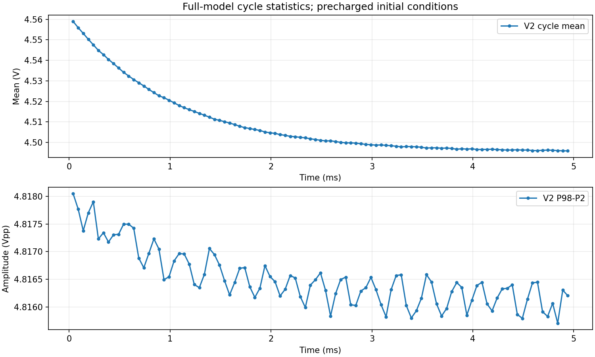

# S03 本轮执行报告

日期：2026-10-12。

> 本文为当时的阶段过程快照，后续结果与有效设置更正以 [S03-06 受限验收报告](s0306_archive_20261015/S03_06_阶段验收报告.md) 和 S03-04 第 6 节为准；本文的旧“未测/下一项”不作为当前任务状态。

本轮完成 S03-01 要求来源核对、S03-02 阶段基线，以及 S03-03 的标称完整功能模型引擎稳定性预检。5 ms 运行结束，末尾周期重复性满足预检判据。整个 S03 尚未验收完成：冷启动、其他输入档位、占空比档位及原生 GUI 长时间复跑仍需继续。

## 1. 指标核对结果

用户提供 [性能指标要求_N31_M50.md](../../../性能指标要求_N31_M50.md) 后，直接核对了其引用的 [评分标准](../../../电子线路实验评分标准-学生.docx) 正文与表格。有效来源已补齐，空的 `设计.docx` 不再阻碍推进。

- N=31、M=50：模拟 AM，基带 20 kHz，载波 31 MHz。
- 输入占空比需检查 10%、30%、50% 三档；频率偏差超过1%开始扣分，输入占空比绝对误差超过5个百分点开始扣分。
- 输入幅度覆盖1～4 Vpp；增加2 Vpp测试，与4 Vpp结果比较，验证输入减半时输出是否减半。比例误差超过10%开始扣分。
- v2 原文要求≥4 Vpp；标称输入档位没有明确写出。当前将4 Vpp输入作为标称幅度测试点，其余点另列数据，不擅自宣称解释已获教师确认。
- 实物需无线接收、6 m距离、天线各≤1 m、发射端电池供电且功耗<0.5 W。当前理想通道、电源不能证明这些实物指标。

摘要与原文的区别已记录：要求(9)没有限定全部直插或两块万能板；9 V、7805及特定三极管/二极管型号属于方案；原文表5为相似度系数表，性能阈值主要来自表3。

详细定义：[S03 指标与测量定义](S03_指标与测量定义.md)。后续按 C1～C7 执行，覆盖原四角点、2 Vpp线性点、30%占空比点和3 Vpp设计点。

## 2. 基线与计算方法

基线：`AM_20k_31MHz_V4_3_REPAIRED.ms14`。阶段副本 [S03_BASELINE_V4_3.ms14](S03_BASELINE_V4_3.ms14) 与基线逐字节相同，GUI分析仍为200 μs；本轮较长运行配置单独保存于 `.cmd`，不能把该副本误称为已经配置好的5 ms GUI工程。

运行使用 GUI 实际导出的完整 [nominal_full.cir](nominal_full.cir)，只追加 `.end`。没有删除31 MHz链路，没有替换OPA197模型或改变元件值。记录V1、BB_IN、BBO、V2四个节点以控制输出数据量。

| 项目 | 设置 |
|---|---|
| 求解器 | 本机 Multisim 14.3 XSPICE 命令接口 |
| 分析范围 | 先0～1 ms，再0～5 ms |
| 初值 | UIC；C111=0.43 V、C115=−4.1 V、CBB=4.5 V |
| 请求步长 | TSTEP/TMAX=2 ns；日志显示仿真器把TMAX进一步调整为约1.00806 ns |
| 数值选项 | RELTOL=0.0001、TRTOL=1、ITL4=100，其他设置见命令文件 |
| 负载 | 当前网表的1 MΩ输出负载与已有滤波网络 |
| 输入 | 当前约4 Vpp、50%占空比的LM393模块 |

这是原生引擎运行，不是新一次GUI长时间运行；也不是冷启动。先前200 μs GUI原始结果继续作为原生工程功能证据单独保留。

## 3. 运行完成情况

| 用例 | 完成时间窗 | 采样点数 | 调用耗时 | 结果 |
|---|---:|---:|---:|---|
| nominal_1ms | 0～1 ms | 1,009,302 | 约97 s | 完整结束，末尾均值仍有明显漂移 |
| nominal_5ms | 0～5 ms | 5,046,113 | 约463 s | 完整结束，无仿真错误，本次未出现内存不足 |

波形数据均通过有限值、时间单调性检查。终点分别确认为0.001和0.005 s，非仅凭结果文件存在判断完成。后续更换模型或增加记录节点后，仍需重新评估内存，不能把本次结果推广到所有长仿真。

## 4. 标称数据

输入及幅度取末尾五个完整输入周期的统计均值，输出频率/占空比取末尾300 μs中的完整输出周期。幅度同时记录原始极差和时间均匀采样后的P98−P2；后者用于与1.2倍设计目标比较，不替代原始极值。

| 指标 | 1 ms运行末段 | 5 ms运行末段 |
|---|---:|---:|
| V1频率 | 19,997.472 Hz | 19,997.923 Hz |
| V1占空比 | 50.0000% | 50.0012% |
| V2频率 | 19,997.403 Hz | 19,997.916 Hz |
| V2占空比 | 50.2245% | 50.2254% |
| V2时间加权均值 | 4.524440 V | 4.496041 V |
| V2幅度 P98−P2 | 4.816890 Vpp | 4.816023 Vpp |
| V2原始极差 | 4.965184 Vpp | 4.964219 Vpp |
| V2/V1，P98−P2口径 | 1.204222 | 1.204005 |

当前4 Vpp/50%标称点的频率、占空比与输出≥4 V数值检查均落在相应阈值内。**这不是幅度线性测试通过**：必须取得同一增益下2 Vpp工况，才能计算输出减半误差。单个标称倍率接近1.2也不能证明全范围线性。

## 5. 末尾周期重复性

按已记录的临时工程筛查判据：末尾五周期V2均值与幅度的跨度分别≤平均输出幅度的0.1%，周期相对跨度≤0.1%。此判据用于数值重复性，不是任务书新增扣分标准。

| 指标 | 1 ms | 5 ms |
|---|---:|---:|
| V2周期均值跨度 | 5.7417 mV | 0.3510 mV |
| V2幅度跨度 | 0.7365 mV | 0.5959 mV |
| 周期相对跨度 | 0.007366% | 0.001818% |
| 筛查结论 | 不满足 | 满足 |

5 ms末尾五周期的均值跨度约为幅度的0.0073%，幅度跨度约0.0124%。仍应表述为“末尾周期重复性满足预检判据”，不能据此保证所有更慢漂移都不存在。

## 6. 本轮尚未完成

- 原生GUI直接5 ms复跑与其 `.gra` 归档。
- 明确电源变化与元件初值的冷启动测试。
- C1～C7中的非标称工况；尤其2 Vpp线性点和30%占空比点。
- 实际射频、真实电源、传播及实物评分项目。

下一项先补原生GUI长窗口复跑以闭合S03-03证据，然后进行S03-04启动测试及S03-05指定工况。本轮不改动已验证的唯一基线文件。

## 7. 证据与复现

- [来源与基线哈希](baseline_manifest.json)
- [1 ms指标](nominal_1ms_metrics.json)、[5 ms指标](nominal_5ms_metrics.json)、[汇总指标](nominal_summary.json)
- [1 ms命令](nominal_1ms.cmd)、[5 ms命令](nominal_5ms.cmd)、[5 ms日志](nominal_5ms.log)
- [测量脚本](measure_stage3.py)、[汇总脚本](summarize_stage3.py)
- 完整数值数组：`nominal_1ms.npz`、`nominal_5ms.npz`，保留原始采样点，无降采样。
- 引擎原始文本波形仍位于 `D:\ms_xsp\stage3_acceptance\nominal_1ms.raw` 和 `nominal_5ms.raw`；5 ms文件约655 MB，项目内NPZ为其双精度数值存档。

后续复现可使用 `run_stage3.ps1` 通过32位PowerShell调用Multisim；应使用新输出名，脚本拒绝复用已有结果文件以避免把旧波形误判为新运行完成。
