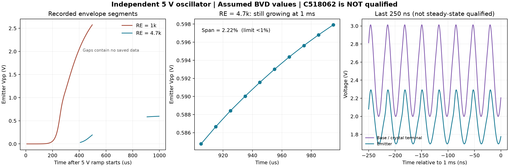

# S04-08 C518062 参数核查与独立振荡器模型

日期：2026-10-17。范围按用户限定为 **C518062 参数核实及振荡器独立模型建立**。

**本报告记录截至 Multisim 1 ms 的探索结果，当时尚未通过稳态检查。后续同一 5 V、RE=4.7 kΩ 模型已在 ngspice 通过稳态、步长与 3 ms 延时筛查，见 [S04-11](S04_11_独立模型交叉验证与延时复核.md)。C518062 的关键参数仍未闭合，不能作为该器件的验收结果。**

## 1. 参数核查结果

候选是 LIMING `49S-31.000-18-10-10/B`，立创 C518062，两脚 HC-49S 无源晶体。
[国内商品页](https://item.szlcsc.com/534599.html)与[国际商品页](https://www.lcsc.com/product-detail/C518062.html)列出 31 MHz、CL=18 pF、初始频差 ±10 ppm、温稳 ±10 ppm、-40～85°C。
10 月 16 日国际站页面列库存 2,000 件，仅代表当时公开快照。

补查的国内附件与原附件 SHA-256 相同，仍是系列手册。**工作模式、ESR 上限/测试条件、Cm/Lm、C0 典型值缺失；驱动功率与温度规格存在冲突。**
已确认值、系列线索、冲突和未知项分栏保存为 [C518062_parameters.json](c518062_model_20261016/C518062_parameters.json)，详细来源见 [S04-05](S04_05_晶体采购与建模核查.md)。
没有把缺失值填成厂家参数，也没有发送供应商询问或采购。

## 2. 已建立的独立电路

可运行输入：[RE=4.7 kΩ 网表](c518062_model_20261016/lowdrive_1ms_tail.cir)、[命令文件](c518062_model_20261016/lowdrive_1ms_tail.cmd)、[参数记录](c518062_model_20261016/lowdrive_1ms_tail.input.json)。
网表内嵌晶体管模型，无外部库路径依赖；`.cmd` 为本机 Multisim 14.3 命令接口输入，**未交付新的原生 `.ms14` 图纸或 GUI 验证**。

| 部位 | 数值与连接 |
|---|---|
| 电源 | 0→5 V，1 μs 线性上升；UIC 零初始储能 |
| 晶体管 | NXP 官方历史 BFR93A 非线性模型，含封装寄生；子电路 C/B/E 顺序 |
| 偏置 | 基极到 5 V/地各 10 kΩ，集电极接 5 V，射极经 **4.7 kΩ** 接地 |
| 反馈 | 基极—射极 CF=33 pF；射极—地 CE=33 pF；基极—地布线假设 1 pF |
| 晶体 | 基极—地：`C0 ∥ (Rm + Lm + Cm)`；动态支路独立测流 |
| 观察点 | 射极高阻观察，100 MΩ 探测电阻；没有后级缓冲或负载模型 |

晶体采用**假设的基频、单模 BVD**：`Cm=10 fF、C0=3 pF、Rm=30 Ω`。
按 `fL=31 MHz @ CL=18 pF` 的无损近似换算：

`fs=fL/sqrt(1+Cm/(C0+CL))=30.992621683 MHz`

`Lm=1/((2πfs)²Cm)=2.637081993 mH`。

频率与 CL 无法唯一反推 Cm/Lm；上面只是显式假设下的自洽模型。
CF、CE 与晶体管寄生共同形成实际负载，不能把两个 33 pF 的串联值直接当成真实 CL。
瞬态电路中没有 31 MHz 激励源或人为 RF 初始能量，振荡由上电扰动建立；未模拟真实器件噪声。
所有用例保留 `c518062_qualified=false`。BFR93A 已被 NXP 标记停产，仅用作参考有源模型，未选为采购 BOM。

## 3. 偏置修改及已取得的瞬态结果

以下均为高阻观察的**非稳态尾窗测量**，晶体耗散按 `Rm × mean(Im²)`，5 V 功率按 `mean(Vsupply × Isupply)`；使用时间加权积分。

| 工况 | RE=1 kΩ / 500 μs | RE=4.7 kΩ / 500 μs | RE=4.7 kΩ / 1 ms |
|---|---:|---:|---:|
| 最大步长 | 0.25 ns | 0.25 ns | 0.25 ns |
| 尾窗输出 Vpp | 2.5747 V | 0.19364 V | 0.59792 V |
| 输出 DC | 2.2470 V | 1.8016 V | 1.9505 V |
| 尾窗频率 | 30.995208 MHz | 30.995633 MHz | 30.993916 MHz |
| 动态支路耗散 | 658.26 μW | 2.041 μW | 58.393 μW |
| 5 V 端平均功率 | 12.413 mW | 3.154 mW | 3.312 mW |
| 稳态结论 | 尚未稳定 | 尚未稳定 | 尚未稳定 |

来源：[原偏置结果](c518062_model_20261016/nominal_500us.result.json)、[500 μs 改偏置结果](c518062_model_20261016/lowdrive_500us_tail.result.json)、[1 ms 改偏置结果](c518062_model_20261016/lowdrive_1ms_tail.result.json)。
相同时刻改偏置结果较小，不能由此推断最终耗散已经低于限值：1 ms 时的激励仍在增长。

旧脚本的“末四个 5 μs 窗相对跨度”只保留为诊断量，不作为判稳。
新筛查要求末尾 **100 μs、连续十个 10 μs 窗**同时满足：

- Vpp 相对跨度 <1%，线性拟合的 100 μs 幅度漂移绝对值 <1%。
- 频率跨度 <10 ppm，输出 DC 跨度 <10 mV。
- 晶体耗散相对跨度 <2%。

RE=4.7 kΩ 的 1 ms 工况：幅度跨度 **2.223%**、拟合漂移 **2.458%/100 μs**、频率跨度 2.147 ppm、晶体耗散跨度 **5.507%**，所以判为未稳态。
这些筛查门限是本次探索模型的数值检查口径，不是晶体规格或整机验收标准。



## 4. 参数敏感性：小信号起振条件

另建立 [AC 端口测试夹具](c518062_model_20261016/lowdrive_port_ac.cir)：移除动态支路，以 1 A 小信号电流测量“有源电路并联 C0”的端口阻抗。
AC 注入只存在于测试夹具，不在瞬态振荡器内。求 `Im(Zport + jωLm + 1/(jωCm))=0`，比较 `-Re(Zport)` 与 Rm。

一次 4,001 点 AC 扫频后，对 **Cm=5/10/20 fF、C0=1/3/7 pF、Rm=10/30/100 Ω** 进行 27 组线性后处理，**不是 27 组独立瞬态验证**。
这些范围只是敏感性假设，不能视为 C518062 的保证边界。

| C0（Cm=10 fF） | 负电阻幅值 | 对假设 Rm=30 Ω 的比值 |
|---|---:|---:|
| 1 pF | 206.06 Ω | 6.87 |
| 3 pF | 161.90 Ω | 5.40 |
| 7 pF | 105.61 Ω | 3.52 |

27 组合均呈正的小信号增长条件，但最弱组合的比值只有 **1.056**，对未知 ESR、寄生和器件变化几乎没有余量。
这不能证明 C518062 必然起振，也不能代替非线性稳态、驱动功率和温度检查。
完整结果：[lowdrive_port_ac.result.json](c518062_model_20261016/lowdrive_port_ac.result.json)。

## 5. 运行边界与历史结论修正

1.5 ms 和 2 ms 各执行两次引擎尝试，均无有效 raw；出现内部仿真错误或 COM 失联，已停止这两组重试。
500 μs 工况的步长减半（0.125 ns）也尝试两次，均内部错误、无 raw，**步长收敛未验证**；因此不把表中频率位数当作精度保证，更不能据此核验晶体的 ±10 ppm。

> **2026-10-17 后续结果**：上述失败仍是 Multisim 的有效记录。ngspice 对同一 DUT 的 1 ms 结果与归档成功记录接近，随后跑通 2 ms 的四档步长 **0.25/0.125/0.0625/0.03125 ns**；第三组相邻步长对照通过筛查，并完成相同步长的 3 ms 延时复核。
> 先前约 −199 ppm 的偏差主要是数值步长误差，末档实际测得约 −4.24 ppm。约 −1.15 ppm 是假设二阶误差下的条件外推，不是实测或实物结论。
> 初次更正中的步长十倍笔误已修正；完整记录见 [S04-11](S04_11_独立模型交叉验证与延时复核.md)。**晶体参数未闭合、不能作器件验收** 的边界不变。

另一次日志锁导致的驱动脚本中止单列为工具失败；已修复运行期间读取日志锁的处理，并保留尝试记录。
这些失败不构成电路不能收敛的证据，也不能据此确定失败由仿真时长或内存导致。
逐次状态与输入见 [evidence_manifest.json](c518062_model_20261016/evidence_manifest.json)、[attempt_notes.json](c518062_model_20261016/attempt_notes.json)。

对 S04-07 的解释作以下限定：

- 包络单调趋近并不排斥最终稳态；是否已稳态应由足够长窗口内的漂移量决定。
- 现有数据不足以断言“问题不在仿真时长”，也不足以保证改用饱和限幅会使波形更正弦。
- Q 与 Rm 本身不能唯一预测增长时间常数，还需要有源环路增益/负电阻。
- 超过手册“典型”驱动值不等于违反已确认最大额定值；本料号限值仍有冲突。

本报告 1 ms 输出含约 1.95 V DC，且当时未通过稳态检查；后续稳态输出仍约 1.96 V DC、0.614 Vpp，**不能直接替代原 TP2 的 0 V DC、1 V 峰值理想载波**。
数值只描述探索模型的观察窗；没有通过晶体驱动限值、负载能力、输出幅度或整机电池功耗验收。

## 6. 文件与复现

- 参数核查：[C518062_parameters.json](c518062_model_20261016/C518062_parameters.json)。
- 瞬态生成与测量：[verify_oscillator.py](verify_oscillator.py)；AC 敏感性：[verify_oscillator_ac.py](verify_oscillator_ac.py)。
- 引擎驱动：[run_s04.ps1](run_s04.ps1)；汇总/绘图：[summarize_oscillator.py](summarize_oscillator.py)。
- 原始波形保留本机、按现有策略不入 Git；可迁移的输入、结果和原始文件哈希已保存。

复现 1 ms 结果使用**新名字**，保留既有尝试：

```powershell
# 在 stage4_rf_oscillator 目录；$py 指向本机可用的 Python + numpy
& $py verify_oscillator.py prepare reproduce_1ms --re 4700 --step-ns .25 --stop-us 1000 --save-from-us 900
& C:\Windows\SysWOW64\WindowsPowerShell\v1.0\powershell.exe -NoProfile -ExecutionPolicy Bypass -File .\run_s04.ps1 -BasePath D:\ms_xsp\s04_c518062_20261016\reproduce_1ms
& $py verify_oscillator.py measure reproduce_1ms
```

`.cir`、`.cmd`、输入 JSON 按新名字生成并复制到 ASCII 路径；保存起点只是减少记录，积分仍从 t=0 开始。
实际使用 Multisim 14.3 默认求解设置，不声明网表 `.OPTIONS` 改变了求解器容差。
S03 主工程及实际网表哈希继续保持冻结值。数值收敛与步长证据现见 S04-11；进入器件和系统验收仍须补型号级数据及实际接口验证。
