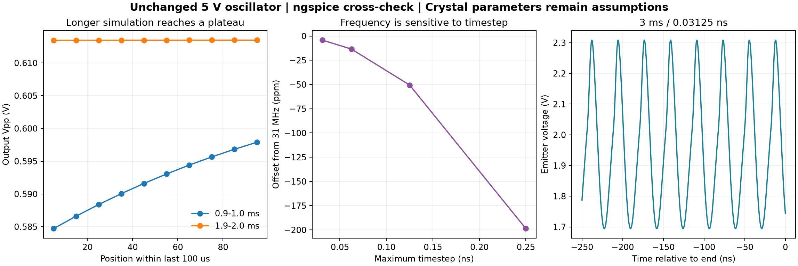

# S04-11 独立振荡器：同网表交叉验证与延时复核

日期：2026-10-17。范围：C518062 公开参数核查与独立振荡器模型；保持 5 V、RE=4.7 kΩ。

**探索模型已通过末 100 μs 稳态筛查、相邻步长数值筛查和 2→3 ms 延时复核。C518062 的型号级参数仍未闭合，`c518062_qualified=false`。**

## 1. 型号核查与草稿状态

[立创商品页](https://www.lcsc.com/product-detail/C518062.html)对应 LIMING `49S-31.000-18-10-10/B`、两脚 HC-49S 无源晶体，列 31 MHz、CL=18 pF、初始频差 ±10 ppm、温稳 ±10 ppm、−40～85°C。2026-10-17 快照仍列库存 2,000 件；这是页面库存记录，不是预留或交付保证。

ESR 字段仍为 `-`。重新下载的系列附件与先前附件 SHA-256 相同：`17b32fc2063b64eeb8dc3c523ba3cd36dc997609d4481c7acc30d949e621a516`。未获得本料号的基频/泛音模式、ESR 定义及上限、Cm/Lm、C0 典型值；驱动值和温度编码冲突也未解除。逐项边界见 [S04-05](S04_05_晶体采购与建模核查.md)，本次快照见 [C518062_recheck.json](crosscheck_20261017/C518062_recheck.json)。

用户已明确选择**“仅保留草稿，暂不发送”**。[型号参数确认函](crosscheck_20261017/C518062_型号参数确认函_待发送.md)留在本地，未对外发送，也没有采购或供应商答复。公开参数核查已完成；型号级参数确认仍待资料或测量。

## 2. 同一电路，改用独立求解器

本轮使用已成功运行过的 [lowdrive_1ms_tail.cir](c518062_model_20261016/lowdrive_1ms_tail.cir) 作为 DUT，所有元件、BFR93A 模型及封装寄生保持不变。变化仅为分析控制与明确的数值选项。

- 电源 0→5 V / 1 μs；UIC 零初始储能，无 RF 强迫信号。
- 基极分压 10 kΩ / 10 kΩ，RE=4.7 kΩ，CF=CE=33 pF，基极对地寄生假设 1 pF，射极观察电阻 100 MΩ。
- 晶体仍是假设的基频单模 BVD：Cm=10 fF、C0=3 pF、Rm=30 Ω；Lm=2.637081993 mH。
- BFR93A 仅为历史参考模型，不是本轮确定的在售 BOM。

从 [ngspice 官方下载目录](https://sourceforge.net/projects/ngspice/files/ng-spice-rework/47/)取得 47 版 64 位便携运行包；SHA-256 与发布页一致：`59225971bd68cdd1199443649aa4615a9e6d684933f205ab49006a3942518f5a`。只解压到 `D:\ms_xsp\s04_crosscheck_20261017`，没有修改系统 PATH 或用户初始化文件。

实际日志使用 **SPARSE 1.3**，不能因为构建支持 KLU 就写成使用 KLU。选项为 `method=trap maxord=2 reltol=1e-3 trtol=7 temp=27 tnom=27`；单线程、`-n`、二进制 raw。版本、路径与可执行文件哈希见 [runtime_provenance.json](crosscheck_20261017/runtime_provenance.json)。

### 2.1 先复现已成功的 1 ms 基线

同为 1 ms、最大步长 0.25 ns、保存 0.9～1.0 ms，ngspice 与归档 Multisim 成功记录比较：

| 项目 | ngspice 相对 Multisim 的差值 |
|---|---:|
| 频率 | +0.9413 Hz / +0.03037 ppm |
| 输出 Vpp | −0.004289% |
| 晶体动态支路耗散 | −0.001764% |
| 5 V 轨功率 | +0.000123% |

两者末 100 μs 幅度跨度均约 2.23%，仍未稳态。跨求解器一致性支持此次模型移植和测量对应正确，不代表未知晶体参数正确，也不能单独保证频率精度。

### 2.2 Multisim 故障证据的边界

本轮仅重试一次逐字节相同的 1 ms 网表，`reproduce_1ms_20261017_a` 报内部错误、无有效 raw，保留失败状态后停止重复尝试。ngspice 成功不等于 Multisim 已修复。

只读提取的 [Windows 事件记录](crosscheck_20261017/multisim_windows_events.json)中，02:03:38 的 multisim.exe 异常代码为 `0xc0000374`，与先前 1.5 ms 尝试失联时间对应。该代码在 [Microsoft MS-ERREF](https://winprotocoldoc.z19.web.core.windows.net/MS-ERREF/%5BMS-ERREF%5D.pdf) 定义为 `STATUS_HEAP_CORRUPTION`。故障模块列 ntdll.dll，只说明异常报告位置；不能据此定位写坏堆的模块、认定全部内部错误同因，或断言内存不足。

## 3. 数值筛查口径与 2 ms 步长结果

沿用运行前 [execution_plan.json](crosscheck_20261017/execution_plan.json) 的口径，不根据结果调整阈值：

1. 末 100 μs 分成十个连续 10 μs 窗：Vpp 相对跨度 <1%，线性拟合 100 μs 幅度漂移绝对值 <1%，频率跨度 <10 ppm，DC 跨度 <10 mV，晶体耗散相对跨度 <2%。
2. 相邻减半步长的尾窗结果：频率相对差 <10 ppm，Vpp 与晶体耗散相对差各 <1%。
3. 在所选步长下延长至 3 ms，对照末尾结果；两次均须通过第 1 项，差值满足第 2 项。

这些是探索模型的数值筛查，不是晶体规格、绝对误差保证或硬件验收。输出 Vpp 取最后 20 μs 最大值减最小值，频率由均值上穿时刻估计；均值和功率用时间加权积分。这里没有套用 S03 的 P98−P2 幅度验收口径。

| 最大步长 / ns | 终点 / ms | 输出 Vpp / V | 频率 / MHz | 相对 31 MHz / ppm | 晶体耗散 / μW | 5 V 功率 / mW | 稳态筛查 |
|---:|---:|---:|---:|---:|---:|---:|---|
| 0.25 | 2 | 0.613484 | 30.993841 | −198.673 | 62.363 | 3.319315 | 通过 |
| 0.125 | 2 | 0.613539 | 30.998433 | −50.550 | 62.349 | 3.319071 | 通过 |
| 0.0625 | 2 | 0.613953 | 30.999581 | −13.502 | 62.426 | 3.319794 | 通过 |
| 0.03125 | 2 | 0.613920 | 30.999869 | −4.238 | 62.422 | 3.319742 | 通过 |
| 0.03125 | 3 | 0.613936 | 30.999869 | −4.240 | 62.427 | 3.319748 | 通过 |

相邻步长频率差依次为 **148.15、37.05、9.26 ppm**，最后一组通过；最后一组 Vpp 差 −0.00552%，耗散差 −0.00633%。所有网表均通过 DUT 前缀逐字一致断言。

这说明先前约 −199 ppm 的偏差主要来自时间离散。已测范围内的频率增量近似按 1/4 缩小，符合二阶趋势；在 p=2 假设下外推约 −1.15 ppm。**外推不是实测、两对共享数据不是独立验证，不能据此外推真实 C518062 的 ±10 ppm 符合性。**旧 [S04-09](S04_09_步长收敛第三档通过.md) 已修正十倍步长笔误和过强表述。

## 4. 3 ms 延时复核

`ng_3ms_003125ns` 独立从 t=0 积分至 3 ms，仅保存 2.9～3.0 ms；没有从 2 ms 状态续算。用时 252.375 s，退出码 0，日志无错误，3,200,001 点。0.03125 ns 下的 2 ms 基线用时 164.984 s。

| 末尾结果 | 2 ms | 3 ms | 相对变化 |
|---|---:|---:|---:|
| 输出 Vpp | 0.6139195 V | 0.6139362 V | +0.002722% |
| 输出 DC | 1.9577476 V | 1.9577546 V | +6.955 μV（绝对差） |
| 频率 | 30,999,868.613 Hz | 30,999,868.551 Hz | −0.002019 ppm |
| 晶体动态支路耗散 | 62.42230 μW | 62.42654 μW | +0.006779% |
| 5 V 轨功率 | 3.31974196 mW | 3.31974819 mW | +0.000188% |

3 ms 最后 100 μs：Vpp 相对跨度 **0.00000280%**、拟合幅度漂移 **0.00000303% / 100 μs**、频率跨度 **0.001789 ppm**、DC 跨度 **0.436 μV**、晶体耗散跨度 **0.000175%**。五项均通过；2→3 ms 对照也通过。

因此当前模型可以按既定数值口径判稳，不再沿用“1 ms 尚未稳态”作为当前状态。尾段仍可存在极小单调变化，判据是变化量，而不是要求每个短窗上下抖动。该结论针对一套偏置、温度、上电斜坡和假设参数，不证明所有实物或扰动下均起振。



## 5. 功耗与可用范围

晶体动态支路耗散采用 `Rm × mean(Im²)`；5 V 轨功率采用 `mean(Vsupply × Isupply)`，包括此独立电路的偏置支路。约 62.4 μW 和 3.32 mW 只描述当前假设模型。晶体型号级激励限值仍未确认，不能据此标为“驱动合格”。

输出约 0.614 Vpp、1.96 V DC，不能直接替代主工程 TP2 的 0 V DC、1 V 峰值载波。负载能力、隔直/缓冲、温度与器件容差不在本轮已验证范围。全发射机电池端功耗仍需包含所有模块与稳压损耗；本结果不构成 <0.5 W 的整机结论。

## 6. 复现与归档

可运行网表：[3 ms / 0.03125 ns](crosscheck_20261017/ng_3ms_003125ns.cir)；脚本：[crosscheck_oscillator.py](crosscheck_oscillator.py)、[summarize_crosscheck.py](summarize_crosscheck.py)。`.cmd` 是 ngspice 控制语句副本，不是 PowerShell 或 Multisim 驱动命令。

在 `stage4_rf_oscillator` 目录，使用新名字复现以保留既有证据：

```powershell
$oscPython = 'C:\Users\86139\.cache\codex-runtimes\codex-primary-runtime\dependencies\python\python.exe'
& $oscPython .\crosscheck_oscillator.py repeat_3ms_fine --stop-us 3000 --save-from-us 2900 --step-ns .03125 --timeout-s 600
& $oscPython .\summarize_crosscheck.py
```

积分从 t=0 开始，`save-from-us` 只减少保存记录。脚本读取任务目录中的便携 ngspice；另一台机器需按运行时记录准备同版运行包和 Python/numpy。汇总绘图另需 matplotlib（本机任务目录 `D:\ms_xsp\s04_plot_runtime`）。

逐次 `.cir/.cmd/.input.json/.log/.status.json/.result.json`、原始 raw 与脚本哈希见 [evidence_manifest.json](crosscheck_20261017/evidence_manifest.json)；比较见 [comparison.json](crosscheck_20261017/comparison.json)。raw 按现有策略仅保存在本机、不入 Git；迁移完整证据时须另带 raw，不能只拷 Git 仓库。

S03 主工程 SHA-256 仍为 `99dffd203eb501498e8884ce02005a977b9f295d380ad3c7afea227f26296394`；实际网表仍为 `d9aba8eff74e679f709bc6a680bf569e6dab87a00303b6ff138f19d4964ccaaf`。S03 受限状态与 U01～U03 保持原结论。

后续若取得型号级资料，先更新晶体模型再复跑同一验证流程；若确认是泛音晶体，须补多模参数和选频设计。当前可以交付数值稳定的探索模型，不能交付已经验证的 C518062 器件方案。
