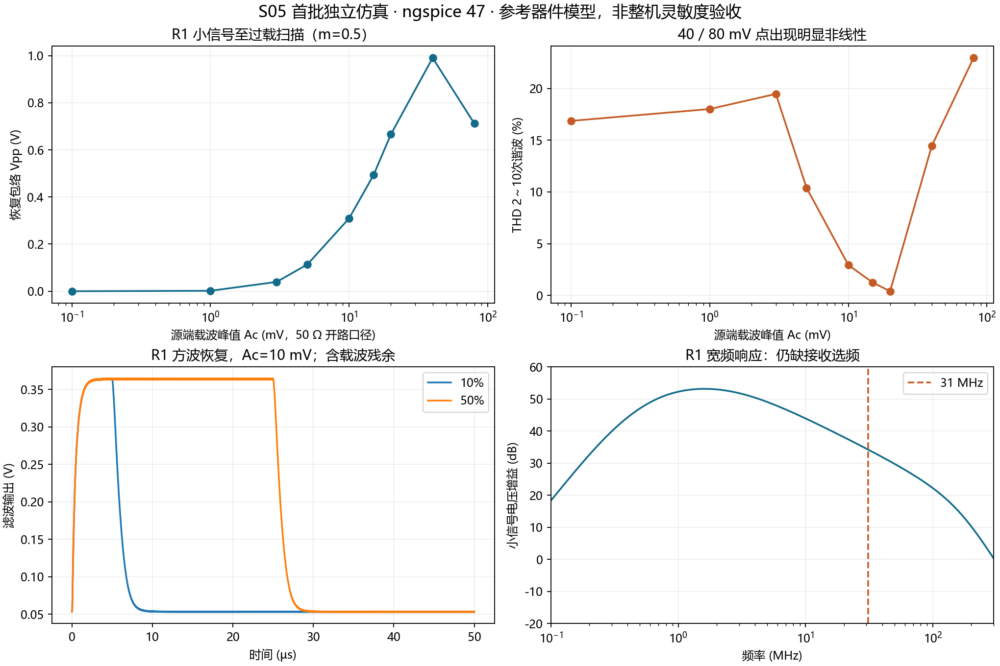

# S05-01：31 MHz AM、器件检波及接收放大首批独立仿真

日期：2026-10-29。状态：**首批独立仿真完成，S05 部分完成；未接回冻结主工程，未作整机灵敏度或无线距离验收。**

已按“可控 AM → 二极管与滤波 → 据此确定接收增益 → 候选电路与备料”执行。共留存 137 个求解结果：117 个瞬态、10 个 AC、10 个噪声分析，其中包含失败电路及未采用的选频探索，不表示 137 项通过。原始数据、网表和日志均有 SHA-256。主工程与冻结网表哈希仍分别为 `99dffd20…296394`、`d9aba8ef…4ccaaf`。

交付：[R1 可运行候选网表](S05_R1_candidate.cir)、[接收端补购清单](S05_02_接收候选与补购清单.md)、[测量汇总](measurements.csv)、[摘要](summary.json)、[证据索引](evidence_manifest.json)。



## 1. 信号定义与仿真条件

可控源为 `vsrc=Ac×[1+m×q(t)]×sin(2π×31MHz×t)`。`Ac` 是 **50 Ω 串联电阻之前的开路载波峰值**，不是射频峰峰值、匹配负载电压或天线接收幅度；实际二极管阳极载波另测。`m` 为调制度，首批覆盖 0.125/0.25/0.5/0.75/0.9，没有把改变 Ac 当作改变调制度。

- 正弦模式：q(t)=sin(2π×20kHz×t)，用于 THD 与幅度线性探索。
- 方波模式：q(t)=-1/+1，20 kHz、10%/30%/50%，边沿 50 ns；PULSE 平台宽度扣除一个边沿时间，使中点交越占空比等于设定值。
- 非 50% 方波的 Ac 仍为高低包络中点，不是包络时间均值；高低电平为 Ac(1±m)。
- 检波独立扫描：Ac=10 mV～2 V，源阻抗 50/200/1000 Ω；接收候选扫描：Ac=0.1～80 mV。
- ngspice 47 独立批处理；trap、reltol=1e-4、trtol=3、abstol=1 pA、vntol=1 µV，通常 27℃。**不是 Multisim GUI 验收。**
- 常规计算 0～300 µs、保存 100～300 µs，TMAX=TSTEP=0.5 ns；候选同终点复核 0.25 ns，另保持 0.5 ns 延长至 600 µs、保存 400～600 µs。
- 从 DC 工作点开始，未使用 UIC 或电容预充电；接收电源为理想恒定 9 V，未验证电源上升、真实参考源或上电启动。

首批统计窗有四个完整调制周期，不冒充 S03 的末五周期正式口径。将自适应数组线性插值为每载波 64 点，对每个载波周期求均值得恢复包络；按这个统一网格求 20 kHz 的 2～10 次谐波 THD。方波不报 THD，用自身 2%/98% 电平中点的插值交越测占空比、周期及交越数。raw 极值、robust 幅度、周期均值与幅度跨度均另存。

载波残余定义为原输出减去载波周期均值插值后的残差，报告 RMS 与逐载波周期最大峰峰值；它不是噪声，也不严格等于单一 31 MHz 谱线。源端/阳极端载波幅度由逐周期基波拟合测得。功耗用时间积分平均。低信号端未完成专项精度扫描，不把微伏级输出或其 THD 用作灵敏度结论。

## 2. 器件模型与采购型号必须区分

检波使用 [Nexperia 官方 BAT85 SPICE 模型](https://assets.nexperia.com/documents/spice-model/BAT85.txt)，包含指数结、Rs=2.326 Ω、Cjo=12.1 pF 及电压相关结电容，绝非理想二极管/数学取绝对值。直接 Python 下载返回 403，电气语句从 web 工具读出的官方文本逐字转录，原链接、转录说明与哈希存于 `sources/`；原文件注释未声称逐字复制。子电路引脚 1=阳极、2=阴极，不能照搬封装编号。

但 **Nexperia BAT85,113 已停产，不列入新增采购**。厂家停产通知中有 BAT85，参见 [Nexperia 通知原件](https://mm.digikey.com/Volume0/opasdata/d220001/medias/docus/6296/CN-202405011DN.pdf) 及 [分销状态](https://www.digikey.ca/en/products/detail/nexperia-usa-inc/BAT85-113/763221)。本轮模型仅作真实器件参考。

原采购候选为 **Vishay BAT85S-TAP（DO-35）**，[Vishay 资料](https://www.vishay.com/docs/85513/bat85s.pdf)与 [DigiKey 产品页](https://www.digikey.com/en/products/detail/vishay-general-semiconductor-diodes-division/BAT85S-TAP/3104127) 可查，后者本次读取标为 Active。未取得 BAT85S 对应的厂家电气模型，**不能把 Nexperia BAT85 模型改个名字就当成 BAT85S**。`bat85s_qualified=false`。下述幅度、温度和噪声结论均不构成 BAT85S 批次保证。

2N3904 沿用 [UNCG 教学模型](https://home.uncg.edu/~ehhellen/spice_stuff.html)，不是用户到货批次的已核实模型。电阻电容为标称集中参数，未提取万能板、电源回路、探头和互耦寄生。

## 3. 检波与滤波：从失败连接到 F1 候选

第一版在二极管前串 1 nF，但缺少有效输入直流回路，电容逐渐充电形成负偏置，使幅度与占空比严重失真。原 `det_*`（22）、`square_a*`（9）、`square_converge_025ns`（1）、`rx_a*`（8）、`rx_square*`（3）、`rx_m*`（4）和 `rx_converge_025ns`（1）共 **48 个瞬态**保留为失败对照（判据：`config.dc_return != 'direct'`），不用于工作范围结论；相关网表和数组不删除、不重写。

修正后的独立夹具直接由零直流、明确 50 Ω 内阻的 AM 源驱动二极管（0.1 Ω 仅为连接/测点电阻）。接收候选则在射随输出隔直电容后加 **1 kΩ 对地直流回路**，其负载与整流偏置已纳入后续器件仿真。

初始滤波 RDET=10 kΩ、CDET=100 pF、RFILT=1 kΩ、CFILT=470 pF，0.5 V/50% 调制的 10% 方波恢复为 15.145%；后级滤波电容参与放电，不能只用 RDET×CDET 估算下降时间。

选用 F1：**RDET=4.7 kΩ、CDET=100 pF；串 RFILT=4.7 kΩ，输出 CFILT=100 pF；负载 100 kΩ。**

| 独立源 Ac（峰值） | F1 恢复包络 Vpp | 正弦 THD | 滤后载波残余 RMS |
|---:|---:|---:|---:|
| 0.10 V | 0.01217 V | 23.62% | 0.0887 mV |
| 0.30 V | 0.16391 V | 8.80% | 0.242 mV |
| 0.50 V | 0.34014 V | 3.46% | 0.363 mV |
| 0.80 V | 0.59285 V | 1.57% | 0.518 mV |
| 1.20 V | 0.92310 V | 0.90% | 0.700 mV |
| 2.00 V | 1.57981 V | 0.51% | 1.023 mV |

条件均为 m=0.5、27℃、50 Ω。F1 在 Ac=0.5 V 时把 10% 方波恢复到 **10.892%**。F2（RDET 降至 2.2 kΩ）的 10% 方波可到 10.399%，但同一方波用例的恢复幅度降到 0.31554 Vpp（正弦用例 0.31495 Vpp）；F3（CDET=47 pF）方波幅度 0.30159 Vpp（正弦 0.30090 Vpp）、滤后载波残余由 0.363 mV 升到 0.718 mV。**此处两个幅度取自方波用例，与上表正弦口径不可直接混比**，故并列给出。选择 F1 是首批折中，尚未冻结。

因此建议下一批以检波前约 **0.5～1.0 V 载波峰值**为目标带，先避免小信号结非线性；这是从有限扫描选出的设计工作点，不是正式灵敏度门槛，也不是连续全范围保证。负载、源阻抗、m 和具体型号均会改变它。原 v2 夹具单变量扫描中，50→1000 Ω 源阻抗使 0.5 V 源的恢复幅度从 0.364 V 降到 0.0899 V，明确需要较低输出阻抗的驱动。

## 4. 据检波需要建立 R1 接收放大候选

以 **10 mV 开路源峰值 × 约 50 倍 → 检波处约 0.5 V 峰值**作为独立设计工作点；没有无线链路预算证明天线一定能提供 10 mV。

R1 为两个 2N3904 共射级加一个 2N3904 射随器，理想 9 V 实验室供电。每个共射级：上/下偏置 22 kΩ/4.7 kΩ，RC=1 kΩ，射极 22 Ω 不旁路 + 220 Ω 由 10 nF 旁路；级间 1 nF。射随器：偏置 10 kΩ/10 kΩ、RE=470 Ω、输入输出耦合各 1 nF。输出 1 kΩ 回路后接参考 BAT85 与 F1。全数值和接线以 [候选网表](S05_R1_candidate.cir) 为准。

### 噪声与带宽

AC 试验保留输出 1 kΩ，并额外并接 2 kΩ∥10 pF 测试负载；该负载不同于瞬态中随电平变化的二极管阻抗。31 MHz 增益为 **51.49 倍（34.23 dB）**；30.8/31.2 MHz 分别 51.84/51.15 倍，±200 kHz 相对 31 MHz 约 +0.67%/−0.67%。

全频响应峰值却在约 1.60 MHz，峰值约 455.9 倍，峰值 −3 dB 采样区间约 0.700～4.169 MHz。**这不是以 31 MHz 为中心的合格选频接收机**，强带外信号可能先让前级过载。仅能说局部 AM 边带附近增益变化小；完整选择性仍待设计。六种 680 nH 集电极谐振尝试出现很尖的峰及边带不均，未作为 R1 采用，也未完成稳定性验证；不据此采购整套谐振电感。

线性小信号 `.noise`：31 MHz 源端等效噪声约 **1.263 nV/√Hz**，含 50 Ω 源热噪声；以 4kTR 归一得到模型噪声系数约 **2.84 dB**。仅积分 30.5～31.5 MHz 得 **1.263 µV RMS**。**这个 1 MHz 是指定积分区间，不是该宽带接收机的实际等效噪声带宽。** 未含天线/环境噪声、供电噪声、非线性检波后的噪声转换、干扰与实物参数，因此没有解调 SNR/SINAD 灵敏度结果。

### 接上实际非线性检波负载后的扫描

| 源 Ac | 滤波后恢复 Vpp | 正弦 THD | 说明 |
|---:|---:|---:|---|
| 0.1 mV | 0.0000106 V | 16.87% | 低端数值精度未专项收敛，不用于灵敏度判断 |
| 1 mV | 0.001827 V | 18.02% | 明显非线性区 |
| 3 mV | 0.03953 V | 19.48% | 明显非线性区 |
| 5 mV | 0.11387 V | 10.38% | 低输入失真较大 |
| 10 mV | 0.30962 V | 2.94% | 首批标称设计点 |
| 15 mV | 0.49328 V | 1.24% | 中间扫描点 |
| 20 mV | 0.66591 V | 0.40% | 低 THD 可能含级间失真抵消，不能外推 |
| 40 mV | 0.99059 V | 14.47% | 增益压缩明显 |
| 80 mV | 0.71171 V | 22.96% | 输出反降；Q2 最低 VCE 约 0.221 V |

这支持下一批优先围绕 **10～20 mV 源端峰值**开展，而不是把它宣布为接收灵敏度/动态范围已验收。标称时阳极实际载波峰值随包络为 0.258～0.769 V，均衡中心约 0.513 V；阳极平均约 −47.5 mV，整流导致的偏置没有被理想源隐藏。

10 mV、m=0.5 时滤后载波残余 RMS=**0.370 mV**，最大逐载波残余约 **1.369 mVpp**（相对 0.30962 Vpp 为 0.442%）；raw 输出 0.31061 Vpp、robust 输出 0.30904 Vpp。9 V 端平均功率约 **137.8 mW**，仅为接收 RF 级模型功耗，未含后续基带且与 TX 电池端功耗无关。

10%/30%/50% 方波的恢复占空比分别 **11.0089%/31.0078%/51.0077%**，约 20 kHz，各有三组完整上升沿到上升沿周期可测；窄脉冲未丢失。上述为 Ac=10 mV、m=0.5 的单点结果，不替代所有输入下的方波扫描。

保持同一电路，仅把正弦 m 从 0.5 减半至 0.25，恢复幅度为 0.15805 Vpp，相对理想减半误差 **+2.09%**；m=0.125 时为 0.07935 Vpp、相对四分之一误差 +2.51%。这是调制度代理测试，尚未建立真实 TX 中 v1→m 的关系，不能写成整机 4/2 Vpp 线性验收。m=0.75/0.9 时 THD 升到 6.73%/10.57%。

### 负载、参数与数值复核

- 输出负载 100 kΩ→10 kΩ，幅度从 0.30962 降至 0.20917 Vpp（−32.44%），需要高输入阻抗基带级，不能直接接低阻负载。
- 源阻抗 50→200 Ω，幅度降至 0.21034 Vpp，THD=5.07%；天线源阻抗/匹配不能留空。
- 模型温度 0/50℃分别输出 0.31695/0.30193 Vpp；只是两个温度点，不是全容差验证。
- 人为联合压力：二极管 Is 减半、Rs/Cjo 加倍、TT=2 ns，输出 0.26862 Vpp（−13.24%）、THD=4.47%。**不是 BAT85S 模型、厂家最坏条件或型号差异的完整包络。**
- 固定 300 µs 终点，0.5→0.25 ns：幅度改变 **+0.08553%**，THD 2.93649→2.93417%，方波占空比差 −0.000113 个百分点；支持首批精度，未宣称所有工况已收敛。
- 固定 0.5 ns，300→600 µs：标称幅度差约 −0.00000079%，后窗没有显著继续变化。理想供电/DC 工作点下的重复性不等于实物稳定或冷启动验收。

## 5. 基带接口与下一步

标称方波输出约 0.31034 Vpp，要到 4.8 Vpp 需后续基带增益约 **15.47 倍**。OPA197 仍可作候选：9 V 供电，输出围绕 4.5 V，Rg=10 kΩ、Rf=140 kΩ+10 kΩ 微调可覆盖局部增益 15～16；输入隔直/100 kΩ 偏置、参考与启动另行验证。**该基带级仅设计估算，未接入本次 R1 仿真，不能声称已经得到 ≥4 Vpp。**

下一批优先级：BAT85S 模型或实测 I-V/C-V 与 31 MHz 检波对照 → 输入选频/匹配及带外阻塞 → 高阻基带级接入/4.8 Vpp/冷启动 → 方波全输入范围、供电/器差/布局反馈 → 连接真实 TX 与无线实测。已有温度/人为模型压力不能取代这些任务。

S04 继续保留：载波放大与隔离、振荡器接入负载后的起振/牵引/激励、2N3904 版固定时长频率收敛、晶体 C518062 参数、实际 AM 调制/发射级、整机电池端功耗。S03 U01～U03 亦不关闭。

## 6. 复现与证据位置

在项目根目录以本机 Python 3.13 执行：

```powershell
py -3.13 simulation/v4_hardware/stage5_receiver/run_s05.py detector
py -3.13 simulation/v4_hardware/stage5_receiver/run_amplifier.py
py -3.13 simulation/v4_hardware/stage5_receiver/run_corrected.py
py -3.13 simulation/v4_hardware/stage5_receiver/run_filter.py
py -3.13 simulation/v4_hardware/stage5_receiver/run_candidate.py
py -3.13 simulation/v4_hardware/stage5_receiver/summarize_s05.py
```

前两个命令重现失败对照；选型看 corrected/filter/candidate。所有 137 个实际网表还独立保存在 `netlists/`，包含额外 AC 和 F1 幅度探索，按 `evidence_manifest.json` 可逐个运行。已有结果用哈希核对后复用，修改参数须用新用例名；若需在新环境完全重算，可使用新输出目录并重生成，不覆盖旧证据。

本机求解器路径与依赖见脚本；依赖 numpy、matplotlib。已保存结果按 `net_sha256`+`raw_sha256` 复核后复用，改参数须换新用例名；`run_net` 的缓存比对按行尾归一化，避免 Windows CRLF 导致误报 `config changed`（2026-10-29 收尾修复）。大型 raw 在 `D:/ms_xsp/s05_receiver_20261029/`，按仓库约定不提交；仅克隆仓库不包含原始数组。网表为 ASCII、报告为 UTF-8。S03 主工程保持原样。
