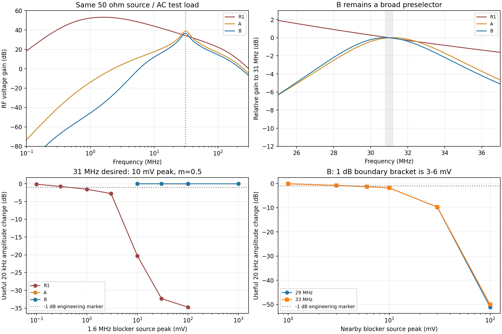
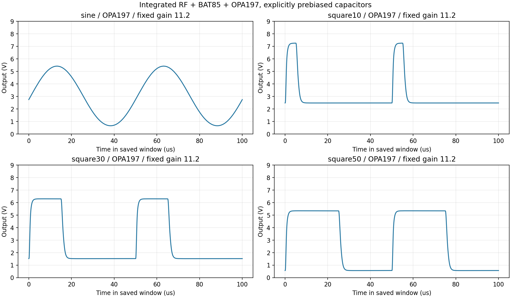

# S05-03：输入选频、阻塞与 OPA197 基带验证

日期：2026-10-29。承接 [首批报告](S05_01_首批独立仿真报告.md)，保留 R1 和首批 137 份证据。本批在 [独立目录](selectivity_20261029/) 执行，不改冻结 Multisim 工程，不关闭 S04 或 S03 的 U01～U03。

## 1. 结论与边界

选择 **B 作为下一版 R2 独立接收实验候选**：输入 LC 预选，加上两级共射的旁路、耦合和射极电阻调整。它解决了 R1 的突出低频增益峰；实际接入 BAT85/F1 和 TI OPA197 宏模型后，标称 10 mV 输入的方波输出约 4.78 Vpp。

**R2 仍未成为整机验收版本**。29/33 MHz 的邻近干扰只有 3～6 mV 开路峰值，就跨过本批设定的 1 dB 有用基波下降标记。它是宽带预选候选，仍需更强的邻近频率抑制/增益分配；实际天线、BAT85S 型号模型、全上电启动与完整 TX 联调均未闭合。没有整机灵敏度、噪声限制最小输入或 6 m 距离结论。

## 2. 固定条件与测量口径

- 期望信号：31 MHz AM，20 kHz 正弦或方波调制；默认调制度 m=0.5。输入和干扰幅度均指 **50 Ω 源的开路峰值**，不能直接当作端口电压、天线电压或 dBm；两信号先相加，再经过同一个 50 Ω 内阻。
- RF 供电 9 V，27 °C；两级 2N3904 共射、射随、原 F1（4.7 kΩ/100 pF 两节）。实际检波用首批 Nexperia BAT85 电气模型，非理想二极管，**仍非 Vishay BAT85S 的型号资格证明**。
- AC 比较采用同一线性测试负载：RF 测点原 1 kΩ 回路另并 2 kΩ∥10 pF。AC 增益均为源开路电压至 RF 测点的电压增益；实际二极管负载另用瞬态验证。
- 电感模型包含串联有效损耗与并联自电容：标称 470 nH、Q=50@31 MHz 对应 Rloss≈1.831 Ω、Cp=1 pF。**Q 与 Cp 是设计假设**；恒定 ESR 不等于厂家全频损耗模型，未建完整布线、引脚、探头和电源寄生。
- RF 瞬态默认最大步长 0.5 ns、0～400 µs 积分、保存 150～400 µs（5 个完整调制周期）。B 的无干扰和代表性邻近阻塞另做 0.25 ns；无干扰延至 650 µs、取末 250 µs。
- 阻塞主指标是 **20 kHz 傅里叶基波相对无干扰用例的变化**。检波输出的总 Vpp 会混入拍频/纹波，不能用它证明有用信号仍在。正弦 THD 使用 2～10 次谐波；方波不套用正弦 THD。
- RF/检波报告 Vpp 为每载波周期平均后包络的极差，占空比取包络 2%/98% 分位中点交叉。OPA 输出单独以末 250 µs、10 ns 插值采样的波形极差与同类中点交叉测量，不能把两种 Vpp 口径混比。方波窗口有 4 个完整上升沿间周期。
- “1 dB”是扫描前写入脚本的**工程边界标记**，不是课设既有合格阈值，也不是 RF 放大器单独的 P1dB。

## 3. 三个固定候选与宽频筛查

| 项目 | R1 基准 | A：只加输入 LC | B：LC＋放大级调整 |
|---|---:|---:|---:|
| 输入串联 CSEL | 无 | 22 pF | 27 pF |
| 对地 L / CTUNE | 无 | 470 nH / 15 pF | 470 nH / 15 pF |
| 两级未旁路射极电阻 | 22 Ω | 22 Ω | 33 Ω |
| 两级射极旁路 CEB | 10 nF | 10 nF | 330 pF |
| CIN2 / CBUF | 1 nF / 1 nF | 1 nF / 1 nF | 100 pF / 100 pF |
| 31 MHz 增益 | 51.491 | 89.483 | **68.445** |
| 全频峰值位置 | 1.606 MHz | 31.190 MHz | **30.833 MHz** |
| 峰值增益 | 455.85 | 89.63 | 68.53 |
| 1.60 MHz 相对 31 MHz 响应 | +18.94 dB | −44.65 dB | **−72.39 dB** |
| 31 MHz 输入阻抗 | 112.9−j250.3 Ω | 74.45−j38.81 Ω | **46.12−j4.56 Ω** |
| 50 Ω 参考回波损耗 | 1.27 dB | 9.07 dB | **24.12 dB** |

B 的采样 −3 dB 边界约 **27.48～34.80 MHz**，带宽约 7.32 MHz；这解释了其邻近干扰缺口。31 MHz±200 kHz 两端相对增益 +0.0085/−0.0339 dB，31 MHz 群时延约 47.46 ns，该小带内群时延变化约 1.05 ns。±200 kHz 检查不能代表方波全部边带；另以 10% 实际方波检查恢复。

选 B 的依据是源阻抗适配、低频抑制和噪声折中，并非增益最大。早期 680 nH 与多种电容组合的偏频筛查也保留在台账，未删去不利结果。



## 4. 真实二极管接载后的联合阻塞

期望源固定 10 mV、m=0.5；干扰为单个 CW，初相位 0。以下变化量来自有用基波，不是总 Vpp。

| 用例 | 有用基波峰值 | 相对本候选无干扰 | 含义 |
|---|---:|---:|---|
| R1 无干扰 | 155.911 mV | 0 dB | 基准 |
| R1＋1.6 MHz / 10 mV | 15.091 mV | 约 −20.28 dB | 总 Vpp 仍有 0.284 V，不能据此说恢复正常；Q2 VCE 最小 0.352 V |
| B 无干扰 | 214.514 mV | 0 dB | 基准 |
| B＋1.6 MHz / 100 mV | 214.520 mV | 约 +0.00024 dB | 未见有用幅度损失 |
| B＋1.6 MHz / 1 V | 214.349 mV | 约 −0.00669 dB | 本扫描上限仍未跨过 1 dB；不能外推任意干扰 |
| B＋29 MHz / 10 mV | 174.545 mV | 约 −1.79 dB | 邻近阻塞未解决 |
| B＋33 MHz / 10 mV | 174.100 mV | 约 −1.81 dB | 邻近阻塞未解决 |

R1 的 1.6 MHz、1 dB 边界落在 **0.3～1 mV**；B 的 29/33 MHz、1 dB 边界均落在 **3～6 mV**。这些是离散扫描给出的区间，没有伪造精确插值阈值。A 在 1.6 MHz/100 mV 下仅约 −0.051 dB，但 29/33 MHz、10 mV 时已经约 −2.15/−2.35 dB。

邻近干扰较小时，基波下降可先于晶体管饱和，包络检波非线性本身也参与干扰混合；因此后续不能只检查 VCE 或只增加前级增益。

## 5. 噪声、输入范围与元件压力

| 指标 | R1 | A | B |
|---|---:|---:|---:|
| 31 MHz 输入等效噪声密度（含源电阻） | 1.263 nV/√Hz | 1.500 nV/√Hz | 1.352 nV/√Hz |
| 31 MHz NF | 2.843 dB | 4.340 dB | 3.438 dB |
| 0.1～300 MHz 输出噪声积分 | 1.364 mVrms | 1.064 mVrms | 0.463 mVrms |
| ∫\|G\|²df / \|G(31M)\|² | 423.45 MHz | 11.60 MHz | 11.24 MHz |

最后一行以 31 MHz 增益归一化，R1 在带外增益远高于 31 MHz，所以积分值可大于积分区间宽度；它不是 R1 的 31 MHz 通道带宽。这些是 **DC 线性化、测试负载下的有限频段模型计算**，没有检波输出噪声、天线外部噪声或无线链路预算。不得由此宣布灵敏度达标。

B 在 50 Ω 源、m=0.5 正弦、100 kΩ 检波负载时：

| 输入峰值 | 检波包络 Vpp | THD（2～10 次） |
|---:|---:|---:|
| 5 mV | 0.17863 V | 6.22% |
| 10 mV | 0.42708 V | 1.56% |
| 20 mV | 0.83904 V | 2.49% |
| 40 mV | 0.81805 V | 29.14% |

RF/检波可继续以 **10～20 mV 的已测点**为设计参考，但这不是连续保证范围，也不是固定 OPA 增益后的全链路范围。40 mV 已明显非线性。标称 RF/检波支路约 135.53 mW，不含 OPA、参考和实物电源损耗。

| 单因素变化（其余为 B 标称） | 观测 |
|---|---|
| 源阻抗 200 Ω | 31 MHz 增益 26.76；10 mV 输入检波 0.12126 Vpp、THD 9.65%；未知天线不能套 50 Ω 结论 |
| Q=20 / Q=100 | 31 MHz 增益 60.74 / 71.48；Q=20 瞬态 0.37352 Vpp、THD 2.05% |
| L −20% / +20%，不调 CTUNE | 峰值约 34.60 / 28.12 MHz；必须调谐 |
| 上述两种 L，CTUNE 改 30 / 5 pF | 31 MHz 增益回到 67.13 / 69.13；支持预留约 5～30 pF 调谐范围，非所有寄生组合保证 |
| CSEL 与 CTUNE 同向 ±5% | 峰值约 31.37 / 30.30 MHz；不是独立容差全组合或 Monte Carlo |
| Cp=2 pF | 峰值约 30.48 MHz；布线寄生会移动中心 |
| 检波负载 47 kΩ / 1 MΩ | 0.40290 / 0.44861 Vpp |
| 温度 0 / 60 °C | 0.43831 / 0.35389 Vpp；不是全温器件资格 |
| 供电 8 / 10 V | 0.38889 / 0.45716 Vpp；不能把供电变化当作不影响幅度 |

0.25 ns 相对 0.5 ns：B 无干扰 Vpp 约 +0.095%，有用基波约 +0.091%；29 MHz/10 mV 阻塞基波约 +0.086%。延长保存窗后无干扰幅度变化小于 0.00001%。这些核验支持本批 RF 对比，不覆盖未测试的布线、宏模型误差和全上电行为。

## 6. OPA197 实际接入

采用仓库中的 **TI OPAx197 Final 1.3（23JUN2022）原始宏模型**，没有改内部参数；通过 ngspice 的 PSpice 兼容模式在读入前转换。模型文件及运行依赖均入哈希清单。

- 9 V 单电源；20 kΩ/10 kΩ 分压，10 µF 对地，形成约 3 V 参考。该参考为本次新增电阻/电容实现，不是理想 3 V 源；9 V 电源本身仍理想。
- 检波输出经 100 nF 隔直，100 kΩ 偏置至参考；不重复并接先前的 100 kΩ 测试负载。10 kΩ 接参考、102 kΩ 反馈，同相标称增益 11.2；各占空比和半调制度用例保持相同增益。
- 输出串 100 Ω；默认负载 1 MΩ∥100 pF，另测 10 kΩ∥1 nF。
- 短窗完整 RF→二极管→OPA 联合仿真，明确设置外部电容的预偏置：参考、基带输入为 3 V；检波节点取同一激励无直流负载用例的均值。这样只测正常工作状态，**不声称冷启动已完成**。

| 联合输入，10 mV、m=0.5 | 最终输出 Vpp | 恢复占空比 | 输出范围 |
|---|---:|---:|---|
| 20 kHz 正弦 | 4.7663 V | 不作方波判定 | 0.658～5.424 V；THD 1.69% |
| 10% 方波 | 4.7835 V | 10.8328% | 2.477～7.261 V |
| 30% 方波 | 4.7827 V | 30.8370% | 1.522～6.305 V |
| 50% 方波 | 4.7790 V | 50.8431% | 0.569～5.348 V |
| 50% 方波，10 kΩ∥1 nF | 4.8289 V | 50.7355% | 0.564～5.393 V |

末五周期的均值和 Vpp 跨周期变化均小于 0.4 mV。负载加重后的极差略大，包含边沿过冲；有用基波从 3.02983 降至 3.00236 V 峰值，不能把 Vpp 增加解释为增益改善。相同载波、m 从 0.5 改 0.25 后得到 **2.4240 Vpp**，相对 4.7790 Vpp 的一半误差约 **1.44%**。这只证明测试源调制度的对应关系，不能替代尚未完成的实际 TX 输入 1～4 Vpp 传递验证。



**大输入过载**：相同 50% 方波、固定 11.2 倍增益，源峰值升到 20 mV 后最终输出范围变为 **0.0305～7.6329 V**，已削底，Vpp 为 7.6024 V。这不是线性放大到更高输出的成功用例；标称 10 mV 的 4.78 Vpp 不能外推整个输入范围。需增益切换/控制或重新分配工作点后复验。

**启动未完成**：三次尝试分别为 0→9 V、1 ms 电源爬升且 `uic` 的 400 ms 测试；9 V 已建立、外部参考/耦合电容未充电的 400 ms 测试；后一条件缩短为 20 ms 的诊断。均采用独立基带夹具（理想 0.11/0.56 V、20 kHz/50% 方波及 4.7 kΩ 源阻抗），不是完整 RF 启动。**三次各在 240 s 上限超时，均没有 raw 数组，成功 0 次**；没有任何启动时长、启动后稳态或削顶解除时间可报。停止本批重试，保留 [失败记录](selectivity_20261029/failures.json)。不能据超时判定电路必然不能启动、条件不可计算或求解器就是根因，后续需要单独诊断。

第一次 OPA 尝试因 RLOAD 重名未解析，保留失败网表和日志；修正后另立用例。曾用 0.4 V 检波预偏置得到削底和跨周期漂移，作为初始化反例保留，未计入正常工作结论。

## 7. 复现与证据

本批保存 **154 份成功求解的数组与指标**：75 AC、3 噪声、76 瞬态（68 RF/检波、8 含 OPA 的联合用例）。成功求解不等于指标通过，其中含过载/阻塞失败及初始化反例。另有 **4 次无有效瞬态证据的失败尝试**（1 次重名解析错误、3 次启动超时）。154 份成功网表已从配置逐字节重新生成；清单内网表、数组、日志、脚本与结果 JSON 的 SHA-256 核验全部通过，关键基波另以正余弦投影复算一致。两个冻结哈希保持 `99DFFD20…296394` / `D9ABA8EF…4CCAAF`。

脚本固定使用 `py -3.13`，本机 NumPy 2.3.5 / matplotlib 3.10.8；ngspice-47 可执行文件路径在脚本中明确。原始数组保存在 `D:/ms_xsp/s05_selectivity_20261029/`，按原策略不进 Git；迁移需同时带齐 raw。模型库路径及 ASCII 工作目录用于避开外部求解器的中文路径限制。

在仓库根目录执行：

```powershell
py -3.13 simulation/v4_hardware/stage5_receiver/selectivity_20261029/run_validation.py
py -3.13 simulation/v4_hardware/stage5_receiver/selectivity_20261029/run_stress.py
py -3.13 simulation/v4_hardware/stage5_receiver/selectivity_20261029/run_trim.py
py -3.13 simulation/v4_hardware/stage5_receiver/selectivity_20261029/run_output_validation.py
py -3.13 simulation/v4_hardware/stage5_receiver/selectivity_20261029/run_output_limits.py
py -3.13 simulation/v4_hardware/stage5_receiver/selectivity_20261029/run_startup.py
py -3.13 simulation/v4_hardware/stage5_receiver/selectivity_20261029/summarize.py
py -3.13 simulation/v4_hardware/stage5_receiver/selectivity_20261029/check_cache.py
py -3.13 simulation/v4_hardware/stage5_receiver/selectivity_20261029/audit.py
```

已有结果先核对实际磁盘网表 SHA-256、归一化内容及 raw 哈希后复用；配置改变必须另起用例名。OPA 的依赖源文件也先比较内容，不能先覆盖再报错。失败启动不自动循环重试：`run_startup.py` 对已归档失败只报告 `success=false`，不会假称重新跑通。`audit.py` 不启动求解器：检查哈希、从配置重新生成成功用例网表逐字节比较，并独立复算关键傅里叶基波。探索用例的参数也保存在 JSON，全部网表同样参与生成核验。

- [完整测量摘要](selectivity_20261029/summary.json)
- [平面数据表](selectivity_20261029/measurements.csv)
- [证据与哈希清单](selectivity_20261029/evidence_manifest.json)
- [R2 候选逐值连接网表](S05_R2_candidate.cir)
- [更新后的 R2 接收补购清单](S05_04_R2接收候选与补购清单.md)

## 8. 后续优先级

1. 在 R2 前端上设计更有选择性的网络，优先对准已经测出的 **29/33 MHz 阻塞缺口**；带宽收窄后必须重验 10% 方波边沿、占空比和群时延，不能只追求滤波曲线尖锐。
2. 用实际电感 Q/SRF、布局寄生、已知天线/信号源阻抗重算并调谐；补齐 BAT85S 模型或 I-V/C-V/检波实测。接收板先做可调小批实验。
3. 处理固定基带增益的大输入过载和启动；补齐所有幅度、占空比、负载组合，再接真实 TX。S04 的晶体/LC、缓冲与真实调制欠项原样保留。

新元件依据：[Vishay IRF-24 数据手册](https://www.vishay.com/docs/34056/irf24.pdf)、[BAT85S 数据手册](https://www.vishay.com/docs/85513/bat85s.pdf)、[TI OPA197 产品与模型](https://www.ti.com/product/OPA197)。厂家数据不替代本报告明确列出的模型假设。
