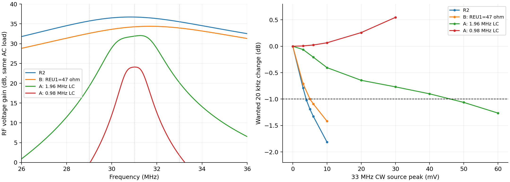
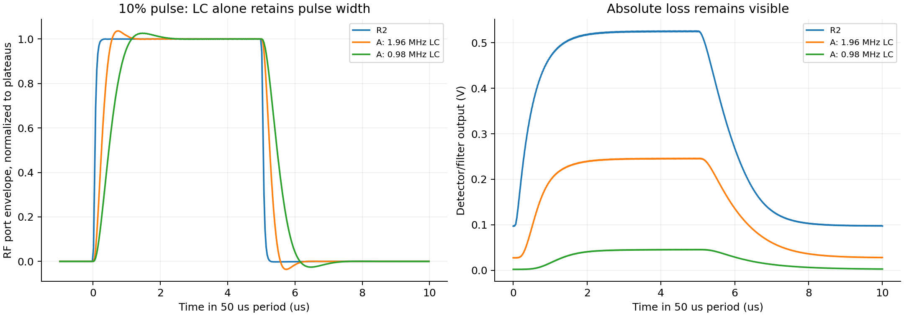
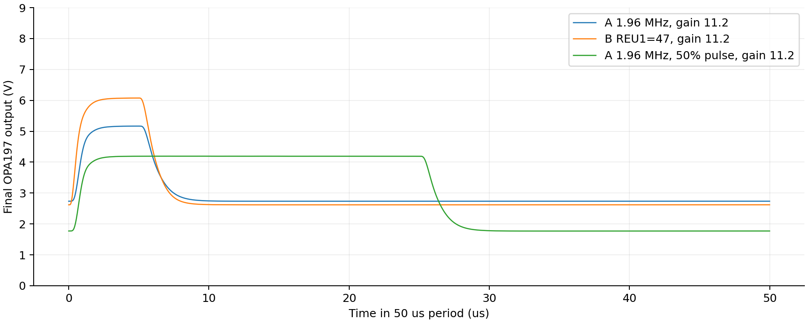

# S05-05：R2 邻近阻塞诊断、线性度与选频决策

执行日期：2026-10-29～30（Asia/Shanghai）。承接 [S05-03](S05_03_选频阻塞与基带验证.md) 和 [R2 网表](S05_R2_candidate.cir)。起点 Git：`7de494a7fc47f31afcf1fe4ef345781273e0d416`。全部新夹具位于 [blocker_20261029](blocker_20261029/)，未改 R2、冻结主工程、旧报告、旧数组；未推送 Git。

## 1. 技术决策

**下一阶段选择 A：约 2 MHz 的有损双调谐前端，保留 R2 的 Q1/Q2 参数；配套重新校准基带固定增益。暂不采用本轮 B 修改，不上 AGC。** 这是有仿真依据的下一阶段实验方案，尚非整机或实物验收版本。

主要瓶颈是邻近 CW 穿过宽通带后，**二极管包络检波及其 RC 充放电对合成 RF 的非线性响应**，使有用基带分量下降。Q1/Q2 存在小量增益变化，但在 10 mV 有用信号、单个 3～10 mV 邻近 CW 的已测范围内，不是 1 dB 边界的主导来源。不能把结论扩展到任意强干扰，也不能由此断言某个 BAT85S 型号不合适。

B 中最有利的 REU1=47 Ω 对照，在 6 mV CW 下仅改善约 0.24～0.33 dB，却使无干扰检波基波下降 2.79 dB、OPA 固定增益输出降至约 3.45 Vpp。A2 实际元件拓扑仿真将 10 mV 单干扰下的下降降至约 0.37/0.40 dB；代价是 RF 增益损失约 4.82 dB。基带增益补偿需下一阶段闭合：G=22 的探索没有获得可信的正常工作预偏置结果，本轮不予验收，也不关闭全输入范围过载。

## 2. 条件、定义与基线审计

- 31 MHz 有用载波源幅度 Ac=10 mV 开路峰值；m=0.5、20 kHz。正弦 AM 的包络为 5～15 mV；方波边沿 50 ns、10%/50%。CW 的 mV 同样指开路峰值。各信号相加后共用 50 Ω，双干扰幅度为**每个** CW 的幅度，默认相位均 0。
- 9 V 理想电源、27 °C；沿用教育用 2N3904 模型和厂家 Nexperia BAT85 模型。`bat85s_qualified=false`。电感 Q=50@31 MHz、每个 Cp=1 pF 为设计假设，ESR=1.8309202 Ω；不代表已采购器件。
- 默认 ngspice-47，trap、reltol=1e-4、trtol=3，0～200 µs 积分，保存 100～200 µs（2 个完整调制周期），最大步长 0.5 ns。典型 RF 用例仅数秒。代表点另测 0.25 ns、延迟窗口。无启动长窗测试。
- **阻塞量**：ΔBB=20log10(|C20k,blocked|/|C20k,clean|)，同一候选、同一负载、同一增益比较。1 dB 为既有工程标记，不是课设硬指标，也不是晶体管 P1dB。总 Vpp、31 MHz 载波与 31 MHz±20 kHz 边带分别记录。基波增强同样报告，不据此判优。
- 原报告的 7.32 MHz 是源至 RF 测点、附加 2 kΩ∥10 pF 线性负载的**整段 AC 响应采样带宽**，不能严格称孤立 LC 的固有带宽。本轮更密的 10 kHz AC 网格约 7.41 MHz，属于测量分辨率差异，未修改 R2。31 MHz 增益 68.449 与旧值 68.445 一致。
- RF/检波阶段输出仍接 100 kΩ，以载波周期平均后的包络测量 Vpp；OPA 阶段用 RBIAS=100 kΩ 接参考代替该负载，不重复并联。OPA 表中 Vpp 为 0.5 ns 均匀插值原波形极差；占空比用载波周期平均后的 2%/98% 分位中点。正弦不作占空比/交越频率判定，JSON 的通用交越字段不可用于正弦或强拍频验收。
- R2 的现有 S05 交付是逐值连接 `.cir`，未发现单独 R2 `.ms14` 图纸；以该网表和生成脚本核对拓扑，不冒称读取了不存在的 R2 原生图纸。

## 3. 基线复现与逐级定位

| 输入工况 | 检波20k基波/mV峰值 | ΔBB/dB | RF载波变化/dB | RF上边带变化/dB | Q2最小VCE/V |
|---|---|---|---|---|---|
| 无干扰 | 214.514 | 0.000 | 0.000 | 0.000 | 3.876 |
| 29 MHz / 3 mV | 195.522 | -0.805 | -0.011 | 0.002 | 3.682 |
| 29 MHz / 6 mV | 184.175 | -1.325 | -0.037 | -0.020 | 3.487 |
| 29 MHz / 10 mV | 174.544 | -1.791 | -0.089 | -0.076 | 3.232 |
| 33 MHz / 3 mV | 195.851 | -0.791 | -0.018 | -0.001 | 3.686 |
| 33 MHz / 6 mV | 184.112 | -1.327 | -0.054 | -0.025 | 3.500 |
| 33 MHz / 10 mV | 174.099 | -1.813 | -0.121 | -0.084 | 3.255 |
| 双干扰，各 3 mV | 185.260 | -1.273 | -0.039 | -0.014 | 3.494 |
| 双干扰，各 6 mV | 173.630 | -1.837 | -0.121 | -0.094 | 3.120 |
| 双干扰，各 10 mV | 151.416 | -3.026 | -0.318 | -0.330 | 2.644 |

单干扰 10 mV 时：检波基波损失约 1.8 dB，而 RF 有用载波仅损失 0.09～0.12 dB，上边带不足 0.09 dB；Q2 VCE≥3.23 V，VBC 最大仍约 −2.52 V，未出现饱和削底。Q1、Q2、射随前后的载波与边带全部保存在各 JSON `nodes` 中。双干扰各 10 mV 已出现更大 RF 压缩（载波约 −0.32 dB），仍不能外推单干扰结论到更大总输入。

| 节点 | 无干扰31M/mV峰值 | 29M/10mV时31M变化/dB | 33M/10mV时31M变化/dB | 29M干扰分量/mV峰值 | 33M干扰分量/mV峰值 |
|---|---|---|---|---|---|
| src | 9.992 | 0.000 | 0.000 | 9.994 | 9.992 |
| input | 4.831 | 0.027 | 0.044 | 6.049 | 6.537 |
| port | 19.794 | -0.017 | -0.033 | 16.690 | 18.162 |
| c1 | 69.105 | 0.036 | 0.048 | 61.776 | 61.009 |
| c2 | 716.244 | -0.086 | -0.122 | 632.960 | 616.976 |
| rf | 680.211 | -0.089 | -0.121 | 601.059 | 585.564 |

新增 4/5 mV 点将原 3～6 mV 区间缩到 **29/33 MHz 均为3～4 mV**，没有用插值伪造精确阈值。双干扰各10 mV、33 MHz 初相位改90°时，R2 ΔBB为 -3.918 dB，A2M为 -0.715 dB；相位均0时分别 -3.026/-0.591 dB，说明双干扰结论需要注明相位。

原完整 OPA 链路的新仿真：无干扰最终 20 kHz 基波 2.39454 V峰值；29/33 MHz、10 mV 时分别变化 -1.778/-1.801 dB，输出范围仍约 1～5.1 V，未触电源轨。说明该小输入阻塞不是旧报告的 20 mV 固定基带增益削底问题。

### 3.1 独立检波因果对照

用无干扰 R2 的 31 MHz 及 ±20 kHz 三个复数傅里叶分量构造固定有用 RF 源，再按已测 RF 干扰分量加入 CW，仅接原 BAT85/F1。0 Ω 源（数值连接为 1 µΩ）保证端口有用频谱固定；另加 50 Ω 作源阻抗敏感性对照。保留真正二极管模型，去掉晶体管非线性。

| 诊断源阻抗/干扰频率 | 3mV对应ΔBB/dB | 6mV对应ΔBB/dB | 10mV对应ΔBB/dB |
|---|---|---|---|
| 0 Ω / 29 MHz | -0.788 | -1.228 | -1.508 |
| 0 Ω / 33 MHz | -0.767 | -1.212 | -1.488 |
| 50 Ω / 29 MHz | -0.762 | -1.298 | -1.643 |
| 50 Ω / 33 MHz | -0.736 | -1.277 | -1.619 |

在不可能发生 Q1/Q2 压缩的 0 Ω 对照中仍出现约 1.49～1.51 dB 损失，因此检波机制足以解释主要现象。50 Ω 对照约 1.62～1.64 dB。它们是**诊断干预**，不是可实现接收机；源阻抗不是实测射随输出阻抗，三频重构未保留全部高阶产物，绝对幅度也不同，不能用差值精确拆分各元件的百分比责任。

机制说明：带内 CW 与期望 AM 合成后，二极管和电容跟随的是合成 RF 峰值，低通去掉 2 MHz 拍频并不会自动恢复原来的 20 kHz 幅度。此因果结论来自本项目对照；基本充放电原理可参看 [ADI 包络检波实验](https://ez.analog.com/adiacademy/university-program/a/studentzone-articles/c/modulation-demodulation/SA1029/adalm2000-activity-envelope-detector)。

## 4. B：单因素线性度扫描

每项仅改变原 R2 一处：B_E1/B_E2 为对应 REU 33→47 Ω；B_bias1/B_bias2 为对应偏置上臂 22→27 kΩ；B_gain1/B_gain2 为对应 RC 1000→820 Ω。未同时大改多个器件。偏置电流来自独立 DC OP；功耗为 RF+检波 9 V 轨，不含 OPA，也不是电池端功耗。

| 方案 | AC G31 | 无干扰ΔBB/dB | 29M/6mV ΔBB | 33M/6mV ΔBB | 功耗/mW | Q1/Q2 Ic/mA |
|---|---|---|---|---|---|---|
| R2 | 68.45 | 0.000 | -1.325 | -1.327 | 135.53 | 3.19 / 3.19 |
| B_E1 | 51.57 | -2.794 | -0.996 | -1.091 | 134.17 | 3.04 / 3.19 |
| B_E2 | 63.20 | -0.818 | -1.300 | -1.249 | 134.18 | 3.19 / 3.04 |
| B_bias1 | 66.56 | -0.267 | -1.283 | -1.321 | 127.17 | 2.31 / 3.19 |
| B_bias2 | 69.07 | -0.169 | -1.648 | -1.640 | 127.20 | 3.19 / 2.31 |
| B_gain1 | 69.65 | 0.168 | -1.332 | -1.340 | 135.56 | 3.19 / 3.19 |
| B_gain2 | 64.96 | -0.560 | -1.339 | -1.337 | 135.56 | 3.19 / 3.19 |

降低 RC 不保证总增益下降，因为级间带载和频响同时变化；表中报告实际测量而非按 RC 比例估算。B_E1 是小样本中阻塞指标最有利的对照，但其频响也被改变（29/33 MHz 相对响应约 −1.65/−0.30 dB），收益不能全归因于线性度。降低 Q2 偏置反而恶化邻近阻塞。

**不采用 B_E1 为新主电路。** 它的 RF AC 增益损失约 2.46 dB、检波基波损失 2.79 dB，功耗只减少约 1.36 mW；方波与最终输出见后表。没有出现“只要把放大器偏置调好就能解决阻塞”的证据。

B_E1 的29 MHz点在6 mV为−0.996 dB、10 mV为−1.272 dB，33 MHz在5/6 mV为−0.997/−1.091 dB。名义边界分别6～10、5～6 mV，但临界点距−1 dB仅约0.004 dB；只称小幅改善，不按6 mV一档宣称可靠翻倍。29 MHz的0.25 ns同条件比值仍约−0.997 dB。

## 5. A：理想参考与真实元件拓扑分开

### 5.1 理想带宽参考

另用单位中心增益、二阶 Butterworth 复包络模型（相当于双谐振 RF 的窄带近似）对总 RF 带宽 7.32/2/1 MHz 计算。±2 MHz 的理论抑制分别约 0.37/12.30/24.10 dB；50 ns 输入边沿变为约 0.099/0.343/0.704 µs，10%/50% 的半幅占空比保持约原值。该理想族与 R2 原响应阶数不同，不能把其 7.32 MHz 曲线等同 R2。

以上为 **频域理论计算**，没有电感损耗、二极管或晶体管；只说明 5 µs 宽的 10% 脉冲并不会因为总 RF 带宽约 2 MHz 就必然无法恢复。实际结论必须看下述 SPICE。

### 5.2 两个有损 LC 独立夹具

拓扑：50 Ω 源 → CSEL → 并联谐振器1 → CK → 并联谐振器2 → COUT → 原 CIN1/Q1。每个谐振器含 470 nH、串联 ESR、Cp=1 pF、CTUNE；中间输出 port 用 1 MΩ 定义直流电位。Q1/Q2、射随、检波不变。原文件 `S05_R2_candidate.cir` 不变。

| 夹具 | CSEL | COUT | CK | CTUNE1 | CTUNE2 | L1/L2 |
|---|---:|---:|---:|---:|---:|---:|
| A2M_r1M | 14.529 pF | 10.810 pF | 2.485 pF | 39.590 pF | 45.830 pF | 各470 nH |
| A1M_r1M | 5.610 pF | 4.626 pF | 1.253 pF | 48.329 pF | 50.345 pF | 各470 nH |

这些小数为仿真调谐值，**不是已有标准器件完整 BOM**。实物要固定 C0G 加微调或组合，并测量加载后的带宽；CK 与寄生同量级，尤其 1 MHz 方案调试要求更高。相比 R2 多一个 RF 电感及几只小电容，未增加有源级或 AGC。Q/SRF、线圈公差、板上寄生和源阻抗留到下一阶段，不能把名义元件仿真标为器件资格通过。

| 方案 | 插值总BW/MHz | AC G31 | 对R2增益/dB | 29/33相对抑制/dB | 单10mV ΔBB 29/33 | 无干扰正弦THD/% |
|---|---|---|---|---|---|---|
| R2 | 7.415 | 68.45 | 0.000 | -1.00 / -1.19 | -1.791 / -1.813 | 1.56 |
| A2M_r1M | 1.959 | 39.28 | -4.823 | -12.68 / -11.74 | -0.372 / -0.404 | 4.80 |
| A1M_r1M | 0.982 | 16.00 | -12.627 | -24.49 / -22.30 | 0.045 / 0.066 | 18.81 |

幅度损失包含负载变换与有限 Q；对 R2 的电压增益比并非独立 50 Ω 两端口 S21 插入损耗。A1M 的检波输出约 43 mVpp，正弦 THD 约 18.8%，其干扰下基波小幅**增加**属于非线性传递变化，不能称改善；1 dB 衰减标记在 30 mV 内未触发也不能证明优于 A2M。A2M 仍有约 4.8% 正弦 THD，需带着这个代价推进，不称全链路线性度已验收。

| 工程1 dB边界 | R2 | B_E1对照 | A2M有损LC | A1M有损LC |
|---|---|---|---|---|
| 29 MHz CW | 3～4 mV | 名义6～10 mV，6mV临界 | **50～60 mV** | 扫至30mV未发生1dB下降，检波增益非线性上升 |
| 33 MHz CW | 3～4 mV | 名义5～6 mV，5mV临界 | **40～50 mV** | 同上，不作优选依据 |

A2M的29 MHz在50/60 mV为−0.974/−1.141 dB，33 MHz在40/50 mV为−0.900/−1.063 dB；29 MHz/50 mV用0.25 ns、同档无干扰归一后为−0.957 dB，区间不变。这里只是名义模型、固定相位、固定10mV期望源的离散边界，不能外推成真实天线抗干扰规格。



### 5.3 实际 20 kHz 方波

| 方案 | LC口10%上升沿/µs | LC口过冲/%平台跨度 | 检波10% Vpp/V | 检波恢复占空比10/50/% | 检波10%上升/下降沿/µs |
|---|---|---|---|---|---|
| R2 | 0.110 | 0.01 | 0.428 | 10.848 / 50.847 | 0.997 / 1.614 |
| B_E1 | 0.100 | 0.08 | 0.309 | 10.917 / 50.916 | 1.008 / 1.778 |
| A2M_r1M | 0.350 | 3.62 | 0.218 | 10.673 / 50.671 | 1.028 / 1.971 |
| A1M_r1M | 0.711 | 2.62 | 0.043 | 10.091 / 50.079 | 1.336 / 2.480 |

A2M 的 LC 口上升沿约 0.35 µs，过冲约 3.6%，10% 脉冲没有消失或明显变窄；检波后仍有约 0.67 个百分点的占空比偏差。A1M 边沿约 0.71 µs，滤波本身仍能传递 5 µs 脉冲，但低输出电平导致检波非线性明显。**本轮否定“2 MHz 必然损坏 10% 方波”的推断，同时不把任何带宽称为无失真。**

同一33 MHz/10 mV干扰下，继续直接仿真方波（同100 kΩ检波负载，未把理想低通结果当成真实输出）：

| 方案 | 输入占空比 | 20k基波相对该方波无干扰/dB | 检波包络Vpp/V | 恢复占空比/% | 频率/kHz |
|---|---|---|---|---|---|
| R2 | 10% | -2.170 | 0.393 | 10.368 | 20.0000 |
| R2 | 50% | -1.789 | 0.393 | 50.299 | 20.0000 |
| B_E1 | 10% | -1.849 | 0.298 | 10.353 | 20.0000 |
| B_E1 | 50% | -1.366 | 0.298 | 50.288 | 20.0000 |
| A2M_r1M | 10% | -0.503 | 0.219 | 10.531 | 20.0000 |
| A2M_r1M | 50% | -0.346 | 0.219 | 50.484 | 20.0000 |

尤其A2M的10%方波，总Vpp从0.21808增至0.21880 V，但有用20 kHz基波仍下降0.503 dB；这正说明不能以Vpp变大判优化成功。表中的频率和占空比仅覆盖该相位/强度组合，不替代完整阻塞条件下的OPA输出验证。



## 6. 实际 OPA197 与增益代价

沿用原 TI OPAx197 1.3 宏模型、9 V、20k/10k/10µF 参考、100nF 耦合、100k 偏置、100 Ω 输出隔离、1 MΩ∥100 pF 负载。每个用例先测相同激励下的开路检波均值作为电容初值；这是**正常工作预偏置**，不作启动证据。

G=11.2 保持 102 kΩ/10 kΩ 反馈；A2M 的 G=22 仅把反馈改 210 kΩ（可用固定电阻组合）。同一增益同时测 10% 和 50%，没有逐占空比调增益。比较以有用基波、占空比和轨余量为主，Vpp 只作补充。

| 完整链路 | 最终Vpp/V | 20k基波/V峰值 | 恢复占空比/% | 包络输出范围/V |
|---|---|---|---|---|
| B E1 / 10% | 3.456 | 0.743 | 10.901 | 2.619～6.075 |
| B E1 / 50% | 3.448 | 2.185 | 50.910 | 1.244～4.692 |
| A2 / 10% / G=11.2 | 2.433 | 0.517 | 10.666 | 2.735～5.167 |
| A2 / 50% / G=11.2 | 2.423 | 1.534 | 50.670 | 1.770～4.194 |

原 R2 的历史同模型预偏置输出为约 4.78 Vpp。本轮 A2M 的 G=11.2 仅约 2.43 Vpp，不能满足标称 ≥4 V 的目标；理想线性比例估算需 G≥18.5 才能回到 4 V，G=22 约为 4.77 Vpp，**仅为估算**。G=22 两个联合用例虽出现约 4.8 Vpp，但求解器转瞬态 OP 后参考初值实际约 2.314 V，未保持声明的3 V；末两周期均值仍变化11～13 mV。因此不能记为标称预偏置通过。加 nodeset 对照仍未修复；双干扰原始尝试在52.518 µs报步长过小、无数组。追加输出/反馈显式初值后10%尝试在90 s预算超时，随后主动停止同类50%尝试，未重试。下一阶段可先用理想运放隔离宏模型初始化，再核验真实OPA；本轮只推荐A方向，不把幅度补偿写成已通过。



## 7. 可信度、失败记录与复现

本目录共有 165 份完成登记的求解结果，142 份纳入有效比较；成功求解不代表电路通过。另有一份中止期间落盘的`A1M_29_20.raw`未完成指标登记、不纳入比较。存在旧版 A 夹具 port 悬浮的错误探索结果和G=22初始化未达条件的3份数组，全部保留并从合格对照中排除。AC 日志曾出现 singular matrix、gmin/source stepping 失败后转瞬态工作点，导致 AC 增益 35.13 与线性网络计算 39.29 不一致；加直流回路后两者一致。发现后停止该批，另立 `_dc` 诊断和 `_r1M` 可实现版本，没有覆盖旧网表或数组。被中止用例的日志/部分文件见审计清单。此问题是新夹具连线错误，不能归咎于 R2。

| 核验用例 | 20k基波相对变化/% | 检波Vpp相对变化/% |
|---|---|---|
| R2_33_10_h025 | -0.0181 | -0.0007 |
| B_E1_29_6_h025 | -0.0354 | -0.0332 |
| A2M_r1M_33_10_h025 | -0.2669 | -0.1746 |
| A2M_r1M_square10_h025 | -0.1320 | -0.1394 |
| A2M_r1M_square10_long | 0.0003 | 0.0000 |

0.25 ns 复核与延长窗口用于判断数值变化是否足以影响结论；B_E1/29M/6mV 接近 −1 dB，不能用小数点后的微小差异宣布边界提升一倍。完整 DC、各级频谱、AC 群时延、实际网表、模型依赖和功耗详见 JSON。失败/不利结果不删除。

复现（工程根目录，Python 3.13；原始 raw 在 `D:/ms_xsp/s05_blocker_20261029/`，约数 GB，不入 Git）：

```powershell
py -3.13 simulation/v4_hardware/stage5_receiver/blocker_20261029/run_diagnosis.py baseline
py -3.13 simulation/v4_hardware/stage5_receiver/blocker_20261029/run_diagnosis.py b
py -3.13 simulation/v4_hardware/stage5_receiver/blocker_20261029/isolate_detector.py
py -3.13 simulation/v4_hardware/stage5_receiver/blocker_20261029/run_a.py
py -3.13 simulation/v4_hardware/stage5_receiver/blocker_20261029/run_final.py
py -3.13 simulation/v4_hardware/stage5_receiver/blocker_20261029/run_checks.py
py -3.13 simulation/v4_hardware/stage5_receiver/blocker_20261029/audit.py
```

既有结果复用前校验网表、raw、日志哈希与配置。新参数必须另起用例名。滤波器设计脚本只是生成理论起点，正式运行使用已保存的 `_r1M.cir`。不需要重跑被排除的悬浮节点批次，也不运行旧启动脚本。

- [完整摘要](blocker_20261029/summary.json) · [平面测量表](blocker_20261029/measurements.csv)
- [证据与哈希审计](blocker_20261029/audit.json) · [清单](blocker_20261029/evidence_manifest.json)
- [原始版本快照](blocker_20261029/baseline_snapshot.json) · [悬浮节点错误记录](blocker_20261029/invalid_floating_port.json)
- [A2M 元件连接](blocker_20261029/filters/A2M_r1M.cir) · [A1M 元件连接](blocker_20261029/filters/A1M_r1M.cir)

## 8. 下一阶段及保留事项

1. 按 **A2M＋原 Q1/Q2，另行验证基带增益补偿（估算约19～22）** 建立可调独立接收样机/下一版工程；先核准线圈与小电容的实际值、加载带宽和中心频率。不要直接把仿真小数值作为采购料号。
2. 以本轮边界区间为起点验证实际匹配、寄生/器差及 10%/50% 方波；必要时才追加 RF 线性度调整。A+B 尚无必须同时采用的证据。
3. BAT85S 型号资格未闭合；仍为 `false`。1 MHz 在当前 RF 增益下不推荐，不为追求更窄曲线牺牲检波工作区。
4. 固定增益大输入过载、启动超时和全幅度线性度继续保留；本轮不以预偏置结果关闭启动，也不重复旧超时条件。
5. S04 TP2=2.04 Vpp/2 kΩ 与接收源 Ac=10 mV 开路峰值口径不同；天线、传播和阻抗尚未核验，不能直接作接口接受/拒绝结论。未进行真实 TX 联调、整机灵敏度或 6 m 验收；S03 U01～U03 与 S04 未完成项保留。
