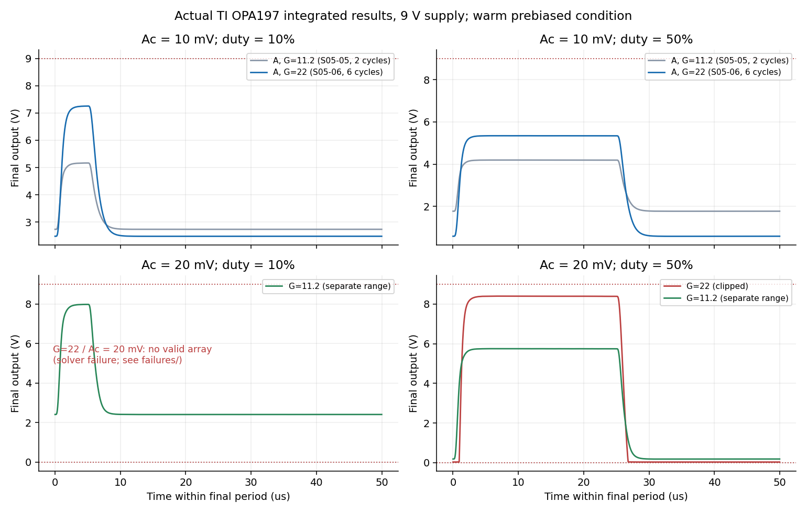
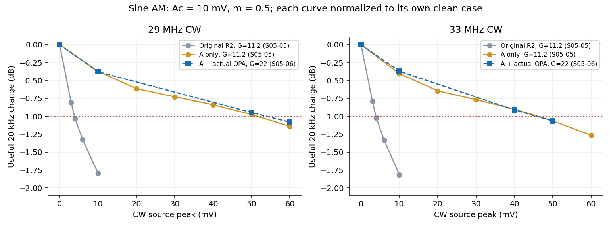
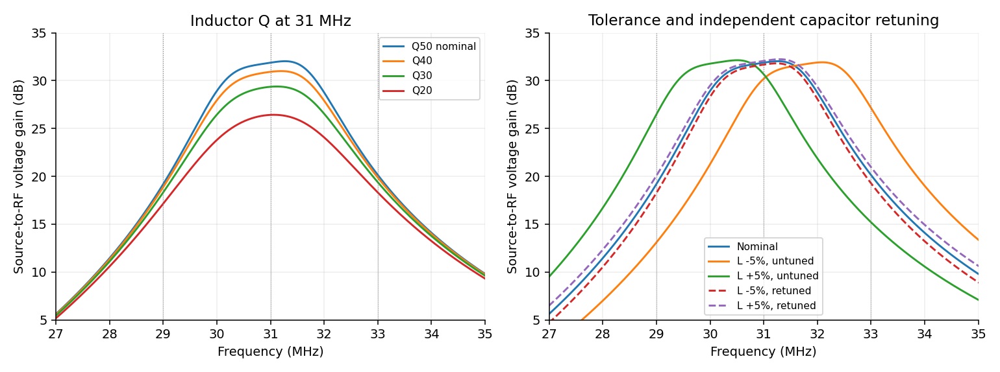

# S05-06：A 方案基带增益补偿与阻塞复验

执行日期：2026-10-30（Asia/Shanghai）。起点 Git `94ca0492db917b7956776512086dabecc0781bbc`。承接 [S05-05](S05_05_R2邻近阻塞诊断与AB决策.md)，新证据全部位于 [gain_20261030](gain_20261030/)。原 R2、S05-05 及其证据未改动；未推送 Git。

> **结论分级：** 标称 10 mV / 50 Ω 条件下“恢复幅度 + 保留邻近阻塞改善”成立；20 mV 输入过载成立（不合格）；电感 Q、容差与输入匹配尚未收敛。因此本方案是**待进一步验证的 A+G22 候选**，不是验收通过的接收机。

## 1. 决策与验证边界

**保留约 2 MHz 双调谐 A 前端和原 Q1/Q2，只把检波后 OPA197 固定增益由 11.2 调到 22。** 唯一改动是 RFB=102 kΩ→210 kΩ（可由 200 kΩ+10 kΩ 串联实现）；RG=10 kΩ、3 V 参考、9 V 供电、100 Ω 输出隔离、1 MΩ∥100 pF 负载均不变。候选连接见 [S05_A2_G22_candidate.cir](S05_A2_G22_candidate.cir)，该文件不含测试夹具的预充电/初始化元件。

本轮**不**优化 B、不改 Q1/Q2、不改 LC、不引入 AGC、不做真实 TX 联调、不重跑已完成仿真。全部结论受“9 V 理想电源、27 °C、教育用 2N3904、Nexperia BAT85 模型、TI OPAx197 v1.3 宏模型”约束；`bat85s_qualified=false` 未变。

## 2. 定义与 S05-05 数据复核

阻塞定义沿用 S05-05：`ΔBB = 20log10(|C20k,blocked| / |C20k,clean|)`，即**有用 20 kHz 傅里叶分量**相对同方案无干扰值的变化。1 dB 是工程比较标记，不是课程硬指标、不是 RF P1dB，也不是总 Vpp 下降 1 dB。原 R2 边界由正弦 AM 得到，不能当作所有占空比方波的通用边界。

条件：有用载波源 Ac=10 mV 开路峰值、31 MHz、m=0.5、20 kHz；CW 幅度同为开路峰值，各源相加后共用 50 Ω；单 CW 初相 0；双 CW 各为标注幅度、相位均 0。

对 S05-05 的 14 组原始数组重新做时间加权傅里叶积分，网表/日志/raw 三处哈希全部一致：

| S05-05 原始记录独立复核 | Δ20k/dB | 重算相对误差 |
|---|---|---|
| R2_clean | 0.000 | 2.17e-06 |
| R2_29_3 | -0.805 | 3.14e-06 |
| R2_29_4 | -1.030 | 5.22e-07 |
| R2_33_3 | -0.791 | 5.25e-06 |
| R2_33_4 | -1.022 | 5.62e-06 |
| A2M_r1M_clean | 0.000 | 3.53e-06 |
| A2M_r1M_29_40 | -0.839 | 1.97e-06 |
| A2M_r1M_29_50 | -0.974 | 3.89e-06 |
| A2M_r1M_29_60 | -1.141 | 3.03e-06 |
| A2M_r1M_33_40 | -0.900 | 2.35e-06 |
| A2M_r1M_33_50 | -1.063 | 5.75e-07 |
| A2M_r1M_33_60 | -1.265 | 5.80e-06 |
| A2M_r1M_clean_h025 | 0.000 | 6.53e-07 |
| A2M_r1M_29_50_h025 | -0.957 | 2.03e-06 |


由此复核：原 R2 的 29 MHz 边界在 3～4 mV（3 mV 为 -0.805 dB，4 mV 为 -1.030 dB），33 MHz 边界同样在 3～4 mV（-0.791 / -1.022 dB）。A 记录中 29 MHz/50 mV 为 -0.974 dB（未达 −1 dB）、60 mV 为 -1.141 dB；33 MHz/40 mV 为 -0.900 dB、50 mV 为 -1.063 dB。**因此“29 MHz 约 50～60 mV、33 MHz 约 40～50 mV”是离散区间的表述，不是精确阈值。**

补偿后再做 0.25 ns、100～400 µs 六周期独立复核（不经过 OPA 基带归一化，直接看检波节点）：

| A+G22 六周期复核（0.25 ns、100～400 µs） | Δ20k/dB |
|---|---|
| clean | 0.0000 |
| 29_50 | -0.9569 |
| 29_60 | -1.1153 |
| 33_40 | -0.9027 |
| 33_50 | -1.0664 |


两条独立路径落在同一区间，说明 40～60 mV 的量级不是总 Vpp 假象或两周期取样假象。29 MHz/50 mV 这一点为 -0.957 dB，与 S05-05 的 -0.974 dB 相差约 0.017 dB，属临界点，只报区间。

## 3. 所需增益与标称输出

[正式指标](../../../性能指标要求_N31_M50.md)要求 v2 ≥ 4 Vpp（设计目标 4.5～4.8 Vpp）、频率 19.80～20.20 kHz、占空比 10%/50% 各允许 ±5 个百分点。旧 A/G11.2 输出 2.433/2.423 Vpp；若只按线性比例，10% 档需 G≈18.4 才到 4 Vpp、G≈22.1 才到 4.8 Vpp。该比例只用于选测试点，判定一律用实际 OPA 联合结果。

| 输入占空比 | 旧 A/G11.2 Vpp | G22 原始/稳健 Vpp | 输出范围/V | 占空比/% | 频率/Hz | 20k 峰值/V | 窗口重复性 |
|---|---|---|---|---|---|---|---|
| 10% | 2.433 | 4.7770 / 4.7704 | 2.480～7.257 | 10.7008 | 19999.996 | 1.01548 | 通过 |
| 50% | 2.423 | 4.7594 / 4.7585 | 0.585～5.344 | 50.7031 | 19999.996 | 3.01291 | 通过 |


独立无强制初值 DC 求解：ref≈3.000013 V、bbin≈3.000013 V、bbo≈3.000439 V，供电电流约 1.303 mA。联合标称用例参考电压 3.000006/3.000015 V；10% 输出 2.480～7.257 V，50% 输出 0.585～5.344 V，均有轨余量。最大输出斜率 4.74/4.72 V/µs；RF+检波+基带 9 V 端功耗 147.3/147.4 mW（不等于整机电池功耗）。Q1/Q2 最低 VCE 约 4.93 V / 4.33 V，未见削顶。

两个标称用例各含 6 个完整调制周期、5 个完整交越周期；每周期均值跨度 0.0021%、稳健 Vpp 跨度 0.0199%、周期跨度 0.0002%，判定窗口可重复。0.25 ns/100 µs 短测与 0.5 ns 同窗相比，Vpp 变化 -0.0836%、20k 分量变化 -0.0707%，不改变结论。这是**预偏置工作窗口的重复性**，不是冷启动证明。



## 4. 补偿后的阻塞与方波

完整链路正弦阻塞统一采用 Gear 积分器、0.5 ns 步长、100～200 µs 窗口，并与各自无干扰基准归一化；nominal 与阻塞对照都使用真实 BAT85 与真实 OPA197 宏模型，没有用理想运放替代。

| CW | 最终 20k 峰值/V | ΔBB/dB | 原始 Vpp/V | 输出范围/V | 20k 基带级增益 |
|---|---|---|---|---|---|
| 29 MHz / 10 mV | 2.29112 | -0.378 | 4.594 | 0.811～5.405 | 21.991 |
| 29 MHz / 50 mV | 2.14611 | -0.946 | 4.395 | 0.999～5.394 | 21.994 |
| 29 MHz / 60 mV | 2.11304 | -1.081 | 4.339 | 1.066～5.406 | 21.994 |
| 33 MHz / 10 mV | 2.29295 | -0.371 | 4.598 | 0.770～5.368 | 21.990 |
| 33 MHz / 40 mV | 2.15502 | -0.910 | 4.407 | 0.716～5.124 | 21.989 |
| 33 MHz / 50 mV | 2.11694 | -1.065 | 4.337 | 0.715～5.052 | 21.988 |


20k 基带级增益全表恒为约 21.99，说明补偿后**没有**因增益变化或轨限幅改变阻塞读数；检波端损失也没有被基带增益“消除”，只是被等比例放大。

方波单独用各自 10%/50% 无干扰基准归一化，不与正弦混用。下表只列出能确认归一化口径的行：

| 输入占空比 | 干扰 | 原始/稳健 Vpp | Δ20k/dB | 恢复占空比/% | 频率/kHz | 归一化来源 |
|---|---|---|---|---|---|---|
| 10% | 29 MHz / 10 mV | 4.638 / 4.599 | -0.476 | 10.602 | 20.0001 | 直接同条件 |
| 10% | 33 MHz / 10 mV | 4.625 / 4.585 | -0.508 | 10.605 | 20.0000 | 直接同条件 |
| 10% | 双 CW 各 10 mV | 4.561 / 4.505 | -0.854 | 10.430 | 20.0000 | 直接同条件 |
| 10% | 33 MHz / 40 mV | 4.421 / 4.351 | -1.395 | 10.207 | 20.0000 | Gear 同条件配对 |
| 50% | 29 MHz / 10 mV | 4.629 / 4.625 | -0.303 | 50.583 | 20.0000 | 直接同条件 |
| 50% | 33 MHz / 10 mV | 4.617 / 4.613 | -0.328 | 50.585 | 20.0000 | 直接同条件 |
| 50% | 双 CW 各 10 mV | 4.560 / 4.555 | -0.477 | 50.399 | 20.0000 | 直接同条件 |
| 50% | 33 MHz / 40 mV | 4.425 / 4.418 | -0.780 | 50.169 | 20.0001 | Gear 同条件配对 |


- 前 6 行为 Trap 用例，积分器与步长（trap、0.5 ns）与 400 µs 六周期基准相同，但保存窗口为 100～200 µs。窗口长度的影响可单独量化：同为 0.25 ns 时，100 µs 与 400 µs 的 20k 分量只差 -0.0061 dB。因此这批配对是“同方法、短窗口”，窗口因素可忽略。
- 真正会移动 Δ 的是积分器：把基准换成同窗口的 Gear 结果，Δ 整体偏移 -0.030 dB（10%）/ -0.025 dB（50%）。这是数值方法差异，不是电路差异，也不改变“单个 10 mV 干扰下 10% 方波损失大于正弦”的排序。
- 后 2 行为 Gear 用例，基准即同积分器无干扰 Gear 结果，**不能**与 Trap 六周期结果作小数位比较。
- 33 MHz/40 mV 的六周期尝试没有取得完整数组（见第 8 节），该点方波结论只有 200 µs（两个周期）的 Gear 短窗，属**已测周期**证据，不足以单独声称满足五周期稳定性要求。

阻塞下总 Vpp 与有用基波可能反向变化，本表不以 Vpp 变大作为成功判据。单 10 mV 与双各 10 mV 只代表规定的 0 相位；S05-05 已发现双干扰相位敏感，本轮不向其他相位外推。**强干扰下 10% 方波的 20k 损失先于正弦到达 1 dB（33 MHz/40 mV：方波 -1.395 dB vs 正弦 -0.910 dB），因此正弦的 40～60 mV 边界不能写成方波通用保证。**



## 5. 10/20 mV 动态范围与幅度比例

下表的 Ac=20 mV 是接收端有用载波源加倍，与“发射基带幅度减半”不是同一测试。主候选所有工况固定 G22；G11.2 是明确切换的手动低增益对照，不参与 G22 通过率，也不是 AGC。

| 占空比 | 固定增益 | 20 mV 时原始/稳健 Vpp | 输出范围/V | 恢复占空比/% | 距 0/9 V 轨 <0.1 V 占比 |
|---|---|---|---|---|---|
| 10% | 22 | 无有效数组（求解未完成） | — | — | — |
| 10% | 11.2 | 5.573 / 5.568 | 2.403～7.977 | 10.537 | 0.00% |
| 50% | 22 | 8.367 / 8.367 | 0.031～8.398 | 49.571 | 48.33% |
| 50% | 11.2 | 5.570 / 5.569 | 0.177～5.748 | 50.547 | 0.00% |


G22/20 mV/50% 的有效数组：低端仅 30.5 mV，距 0 V 轨 0.1 V 以内占 48.33%，实际 20k 基带增益从 21.99 降到 16.85，属**削底**。总 Vpp 从 4.759 涨到 8.367 V 不能解释为性能提升。9 V 供电、3 V 平均偏置下，理想 50% 方波向下最多约 3 V 余量，因此输入加倍时仅靠固定基带增益无法同时覆盖两种占空比的摆幅。G11.2 对照为 5.570 Vpp，但 50% 低端仅 0.177 V，仍缺器件公差余量，且未做阻塞/六周期联合验证，**不升级为已验收的手动或自动增益方案**。

G22/20 mV/10% 方波**没有有效数组**（求解未完成，见第 8 节）。这是一个**未完成**项，不是“性能不合格”的结论，两者必须分开记录。

另在 Ac=10 mV 不变时把 m 由 0.5 减到 0.25，作为“发射调制幅度减半”的局部理想 AM 代理：

| 占空比 | m=0.25 原始/稳健 Vpp | 稳健 Vpp 比值 | 相对理想 0.5 误差 | 恢复占空比/% |
|---|---|---|---|---|
| 10% | 2.4667 / 2.4634 | 0.51639 | +3.28% | 10.305 |
| 50% | 2.4659 / 2.4648 | 0.51799 | +3.60% | 50.304 |


比例误差按 `(Vpp_half/Vpp_full)/0.5−1` 计算（同用稳健 Vpp），10%/50% 分别为 +3.28% / +3.60%。该代理未经过真实 TX、天线或传播链路，不能关闭正式无线接口的幅度比例验收，也不改变 S04 TP2 2.04 Vpp 与 S05 源端 10 mV 的口径差异登记。

## 6. OPA197 带宽、摆幅与稳定性

同一 9 V、G22、100 Ω 隔离、1 MΩ∥100 pF 局部真实宏模型：20 kHz 小信号增益 21.991；相对 20 kHz 的上端 −3 dB 点约 670.9 kHz。保留直流反馈、在反相输入串联注入的返回比交越约 387.1 kHz，相位裕量约 83.7°。负载电容增至 1 nF 的压力点约 301.5 kHz、59.7°，阶跃振铃增加；该压力点不是新负载规格。

局部阶跃夹具的耦合电容均值仍在调整，其短窗均值筛查不通过，只保留为边沿/振铃诊断。这里的稳定性是**名义宏模型、规定负载**下的结果，未覆盖布局、温度、器件公差或外接长线。

[TI 官方电气表](https://www.ti.com/document-viewer/OPA197/datasheet/electrical-characteristics-vs-4-v-to-18-v-vs-8-v-to-36-v-sbos5111222)给出 4.5～36 V 供电、10 MHz GBW、20 V/µs 典型转换率及随负载变化的摆幅条件；“轨到轨”不等于能无误差到达 0/9 V。[稳定性章节](https://www.ti.com/document-viewer/OPA197/datasheet/capacitive-load-and-stability-sbos6205243)强调布局、增益与负载的作用，输出隔离电阻本身也带来负载分压。本轮保留现有 100 Ω，不追加补偿级。

## 7. A 网络的实际可实现性

主候选沿用 S05-05 A2：L1/L2 各 470 nH，CSEL 14.529 pF、CK 2.485 pF、COUT 10.81 pF、CTUNE1/2 为 39.59/45.83 pF、port 直流回路 1 MΩ；电感以 Q50@31 MHz 串联 ESR 1.831 Ω 与并联 Cp 1 pF 建模。以下均为**实际 LC 拓扑的单因素 SPICE 灵敏度**，既不是理想滤波器，也不是器件型号资格。

| 单项变化 | 31M 增益/dB | 插值 3dB 带宽/MHz | 29/33M 相对抑制/dB |
|---|---|---|---|
| Q20 | 20.96 | 2.195 | -9.27 / -8.11 |
| Q30 | 29.39 | 2.036 | -11.03 / -9.98 |
| Q40 | 35.19 | 1.984 | -12.04 / -11.05 |
| Q50 | 39.28 | 1.959 | -12.68 / -11.74 |
| Q80 | 46.36 | 1.919 | -13.68 / -12.81 |
| Lboth0p95 | 32.36 | 2.002 | -17.10 / -3.04 |
| Lboth1p05 | 34.15 | 1.918 | -4.18 / -15.46 |
| retuneL0p95 | 38.38 | 1.866 | -13.40 / -12.40 |
| retuneL1p05 | 40.12 | 2.051 | -11.98 / -11.10 |
| CK2p185 | 38.27 | 1.771 | -14.32 / -12.09 |
| CK2p785 | 39.69 | 2.148 | -10.98 / -11.35 |
| RS200 | 20.99 | 1.635 | -12.79 / -8.27 |
| rounded_C | 38.97 | 1.908 | -13.20 / -11.77 |


| L 同向偏差并在电容侧重调 | 带宽/MHz | 29/33M 抑制/dB | CTUNE1/CTUNE2 pF |
|---|---|---|---|
| retuneL0p95 | 1.86 | -13.40 / -12.40 | 42.54 / 48.78 |
| retuneL1p05 | 2.04 | -11.98 / -11.10 | 36.92 / 43.16 |
| retuneL0p8 | 1.58 | -15.74 / -14.55 | 53.61 / 59.85 |
| retuneL1p2 | 2.32 | -10.05 / -9.33 | 30.24 / 36.48 |


- **Q/损耗：** Q20～80 是敏感性范围，不是已测分布。Q40 的 RF 增益 35.19 dB，低于名义 39.28 dB；更低 Q 会同时降低检波幅度，“带宽接近 2 MHz”不足以判合格。
- **SRF 与寄生：** Cp 1 pF、470 nH 对应理想自谐振约 232 MHz；SRF 200 MHz 折合约 1.347 pF 等效并联电容。Cp 0.5～2 pF、CK ±0.3 pF 的独立扫描已保存。CK 仅约 2.5 pF，焊盘/走线/器件互容不可忽略。
- **器件线索：** [Vishay IRF-24 规格表](https://www.vishay.com/docs/34056/irf24.pdf)的 0.47 µH 行是 ±20%、Q≥40@25.2 MHz、SRF≥200 MHz、DCR≤0.17 Ω。**不能**据此宣称 Q≥50@31 MHz，DCR 也不能替代本模型的 RF 等效串联损耗。实际线圈料号、Q 曲线与实测 S 参数均未确认。
- **调谐必要性：** 两只 L 同向 ±5% 且不重调电容时，一侧抑制可恶化到 -3.04 dB（L −5%）/ -4.18 dB（L +5%）。只重调 CTUNE1/2 后，±5% 恢复到约 1.86～2.04 MHz、两侧抑制约 11～13 dB；±20% 时所需 CTUNE1 约 30.24～53.61 pF、CTUNE2 约 36.48～59.85 pF，带宽仍为 1.58～2.32 MHz，加载带宽仍须复测。建议固定 C0G 加合适范围微调或分档选配；这些数值**不是**采购 BOM。
- **输入匹配：** 名义 31 MHz 看入约 119.78 + j22.57 Ω，对 50 Ω 参考回波损耗约 7.37 dB、VSWR 约 2.50，**不能称 50 Ω 匹配已通过**。源阻抗 50→200 Ω 时 RF 增益 39.28→20.99 dB。真实天线阻抗须下一阶段实测后再决定匹配网络；本轮没有关闭 S04→S05 无线接口。
- **源阻抗敏感性：** 把源阻抗由 50 Ω 换成 200 Ω（RS200）后整链只有 1.702 Vpp（稳健 1.701 Vpp），比 50 Ω 名义 4.759 Vpp 低 8.93 dB；真实天线源阻抗未测，这是尚未收敛的风险。
- Q40：本轮未取得完整数组（见第 8 节），只有 AC 网络层面的 Q40 曲线，不与方波指标混用。
- **标准值近似：** 14.5/10.8/2.4/39.6/45.8 pF 组合的 AC 结果接近名义，但仍需 C0G/NP0 介质、适当容差与实际布局；未做实物验收。



## 8. 求解方法、未完成项与复现

所有完整链路先测相同激励下 RF+检波开路均值，再用它给耦合电容预偏置；独立 OPA 电路先做无强制节点初值的正常 DC 求解，内部节点电压仅作 `.nodeset` 初始猜测，只对 detector out、bbin、ref 保留正常工作预偏置。模型文件未改，增益未针对单个用例调整。

未完成项按下表登记，**均不构成性能结论**：

| 用例 | 状态 | 原因类别 | 耗时/s | 说明 |
|---|---|---|---|---|
| F22_seed_sq10 | incomplete | timeout | 90.01 | compute budget of 90 s expired; no complete array |
| F22_seed_sq10_h1 | incomplete | timeout | 90.01 | compute budget of 90 s expired; no complete array |
| F22_sine_clean_partial | incomplete | partial | — | Timestep too small at 135.895755us; partial array excluded, measurement completeness assertion correctly rejected it |
| F22_sq10_33_40_sixcycles | incomplete | timeout | 180.02 | compute budget of 180 s expired; no complete array |
| F22_sq10_Ac20 | incomplete | timestep | 34.82 | solver timestep too small; no complete array |
| F22_sq10_Ac20_gear | incomplete | no_raw | 11.02 | process ended without a raw file (log ends after the operating-point dump); cause not established by the retained evidence |
| F22_sq10_Ac20_h025_short | incomplete | timeout | 120.01 | compute budget of 120 s expired; no complete array |
| F22_sq10_pre | incomplete | timeout | 90.01 | compute budget of 90 s expired; no complete array |
| F22_sq10_pre_gear | incomplete | timeout | 90.01 | compute budget of 90 s expired; no complete array |
| F22_sq10_warm | incomplete | timeout | 90.00 | compute budget of 90 s expired; no complete array |
| F22_sq50_33_40_sixcycles_partial | incomplete | partial | — | Incomplete transient; not accepted even if ngspice exit code is 0 |
| F22_sq50_Ac20_gear | incomplete | no_raw | 10.86 | process ended without a raw file (log ends after the operating-point dump); cause not established by the retained evidence |
| F22_sq50_Q40 | incomplete | no_raw | 38.28 | process ended without a raw file (log ends after the operating-point dump); cause not established by the retained evidence |
| T_sq10 | incomplete | timeout | 90.01 | compute budget of 90 s expired; no complete array |


其中两项必须单独说明：

- **F22_sq10_Ac20（G22、20 mV、10% 方波）**：Trap 与 Gear 两种配置都没有完整数组，0.25 ns 短窗也在 120 s 预算内未完成。因此“G22 在 20 mV/10% 下是否削顶”本轮**未测得**，不得由 50% 的结果外推，也不得写成“不合格”。
- **F22_sq50_Q40（Q40 电感、G22、50% 方波）**：仅在 38.3 s 后进程结束且未产生 raw，日志停在直流工作点转储之后，保留证据不足以判定原因；本轮不重跑、不改名重试。

已排除的历史失败同样保留：正弦 Trap 在 135.896 µs 出现 step too small，虽 ngspice 退出码为 0 并写出部分数组，完整窗口断言将其拒绝；另一份 33 MHz/40 mV 六周期数组止于 298.891 µs，同样剔除。**退出码 0 与存在 raw 都不作为有效性充分条件。**

绘图脚本本轮改为**不静默替换**：缺失的有效数组会在图中原位标注。本次运行跳过的曲线：`F22_sq10_Ac20`（FileNotFoundError: F22_sq10_Ac20）。

核验结果：登记求解结果 112 份，历史快照 560 个文件哈希一致，独立傅里叶复算最大相对误差 5.74e-05，错误数 0，审计通过=true。

- [完整摘要](gain_20261030/summary.json) · [平面测量表](gain_20261030/measurements.csv) · [未完成登记](gain_20261030/incomplete_cases.csv) · [网络灵敏度](gain_20261030/network_sensitivity.csv)
- [哈希审计](gain_20261030/audit.json) · [证据清单](gain_20261030/evidence_manifest.json) · [作图记录](gain_20261030/plots.json)
- [方法输入与版本](gain_20261030/method_inputs.json) · [外部资料出处](gain_20261030/source_references.json) · [旧文件快照](gain_20261030/baseline_snapshot.json) · [旧边界独立复核](gain_20261030/previous_audit.json) · [元件扫描](gain_20261030/component_sensitivity.json) · [重调灵敏度](gain_20261030/retuning_sensitivity.json)

原始 raw 位于 `D:/ms_xsp/s05_gain_20261030/`（约 3.5 GB），不入 Git。复现（工程根目录，Python 3.13 + NumPy/SciPy + ngspice-47）：

```powershell
py -3.13 simulation/v4_hardware/stage5_receiver/gain_20261030/run_cases.py      # 已完成用例按哈希复用缓存，失败用例不重试
py -3.13 simulation/v4_hardware/stage5_receiver/gain_20261030/components.py
py -3.13 simulation/v4_hardware/stage5_receiver/gain_20261030/bb_checks.py
py -3.13 simulation/v4_hardware/stage5_receiver/gain_20261030/analyze_results.py
py -3.13 simulation/v4_hardware/stage5_receiver/gain_20261030/make_measurements.py
py -3.13 simulation/v4_hardware/stage5_receiver/gain_20261030/plots.py
py -3.13 simulation/v4_hardware/stage5_receiver/gain_20261030/audit_new.py
```

## 9. 下一阶段边界

按 **A + 原 Q1/Q2 + G22** 推进 10 mV 标称候选，优先做线圈 Q/SRF、双调谐实物调校与输入阻抗测量。需要覆盖更大接收幅度时，先明确手动增益档与输出动态范围要求，再在同一增益档作阻塞、方波与比例联合验证；本轮不引入 AGC，也不因基带过载回头盲调 RF 偏置。

明确未验证：冷启动、实际 BAT85S 型号资格、全部输入/负载/温度组合、天线匹配与传播、真实 TX 与 6 m 距离、整机电池端功耗、10 mV 以上输入的完整动态范围。**名义仿真支持“恢复所需输出幅度并保留邻近阻塞改善”，不支持“固定 G22 覆盖 10～20 mV 全部工况”，也不支持“实物接收机已验收”。**
