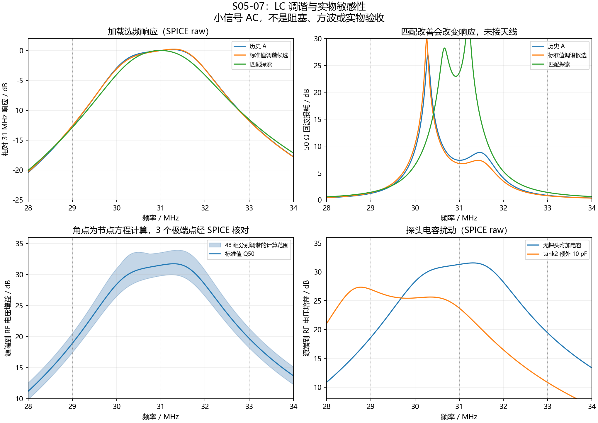

# S05-07：LC 实物化与调谐验证（首批，实物待验）

日期：2026-10-30。起点 Git `1bdd648431c799e707298164f0dc7d65cda6a2f2`；S05-06 已由用户本地归档，提交 `0345aa3`。本轮保留 **A + 原 Q1/Q2 + G22**，只新增独立 LC 夹具；原候选网表未改，未提交或推送 Git。

**结论：约 2 MHz 双调谐具有可调实现路径，可进入少量器件备样；尚不能称实际器件版接收机通过。** 两只独立微调电容能纠正所测电感偏差。Q、意外磁耦合和测量负载仍会改变增益与抑制；输入匹配改善也会改变带宽，不能独立追求最小反射。

用户确认：尚未采购，准备依据仿真清单购买；目前可用设备为示波器。因此交付 [样品清单与调试步骤](lc_realization_20261030/样品清单与示波器调谐步骤.md)，不要求先买 VNA，也不把未知样品写成已测合格件。

## 1. 历史证据与要求核对

- S05-06 全部结论按原条件保留。两个未完成用例 `F22_sq10_Ac20`、`F22_sq50_Q40` **未重跑**，没有新瞬态仿真。
- 发现归档 §7 和 `network_sensitivity.csv` 的线性 RF 增益误标为 dB，已另存 [勘误](S05_06_勘误_增益单位.md)：20.96→46.36 **V/V** 实为约 26.43→33.32 dB。原报告/CSV/脚本保持原字节，新增 [修正副本](lc_realization_20261030/s0506_network_units_corrected.csv)。阻塞比值、Vpp、带宽等不受影响。
- 重读评分原文，规定基带 1～4 Vpp、解调幅度、比例和 6 m 距离，**未发现明确规定接收端 20 mV RF 输入必测**。这不意味着可以忽略最终链路动态范围，只是不把该压力点提前升级成课程硬指标。[要求核对与原文摘录](lc_realization_20261030/requirements_review.json)。
- 正式整机还要求 10/30/50% 占空比；S05-06 的 10/50% 标称证据不等于全矩阵整机验收。

## 2. 方法与数据口径

**实际电路拓扑的小信号 AC**：9 V、27°C、源端 AC 1 V、50 Ω，Q1/Q2/射随器及模型逐字保持原值；RF 测点仍接历史的 2 kΩ∥10 pF 测试负载，并保留原 1 kΩ 回路。没有检波器大信号负载或 OPA197 瞬态，因此不能直接给出新器件版的 Vpp、方波保真度或 1 dB 阻塞边界。

定义：`G31=|Vrf/Vsrc_open|`，同时报告 V/V 和 `20log10(G31)`；相对响应 `D29=20log10(G29/G31)`，负值表示抑制。带宽为含全局最大值的连续 −3.0103 dB 区间，10 kHz 网格并插值。**本报告中心频率指两个 3 dB 边界的算术中点**，同时在 JSON 保留峰值频率。双调谐的幅频峰不一定位于中心；例如原 A 峰为 31.27 MHz，边界中心为 30.990 MHz。所有本轮曲线在该判据下无分离通带。

输入阻抗由 `Zin=Rs·Vin/(Vsrc−Vin)` 求出；50 Ω 回波损耗为 `−20log10(|(Zin−50)/(Zin+50)|)`。这不是天线匹配验收，源电压增益也不是 50 Ω 两端口 S21。

复用 S05-06 `C_Q50.raw` 提取真实 Q1 加载导纳及从 port 到 rf 的传递函数，解四节点复数方程作快速调谐搜索。对历史 raw 的最大复数相对误差 **7.53×10⁻¹³**，未重跑基线。[基线复用记录](lc_realization_20261030/baseline_reuse.json)。选中的解再用完整原 RF 有源级做 ngspice AC。

调谐目标预先固定为 29、30、30.5、30.8、31、31.2、31.5、32、33 MHz 相对响应接近历史 A；仅调整 CTUNE1/2。匹配探索另加复反射系数项，再逐步开放 CSEL、CK；没有以最终幅度最大为目标。这是工程比较方法，不是课程规定容差，也没有证明全局最优。

## 3. 从实际料号到模型

### 3.1 首选备样方向：Coilcraft 132-17L

[官方规格](https://www.coilcraft.com/en-us/products/rf/air-core-inductors/maxi-spring/132/132-17/)及[存档手册](lc_realization_20261030/sources/coilcraft_132.pdf)：**460 nH ±5%、Q≥66 @25 MHz、SRF≥340 MHz、DCR≤43.1 mΩ，直插**。旧仪表列的 475 nH 仅供历史对照，不能与当前 460 nH 混用；也不能误买 `132-17SM`。

这是贴近原 470 nH 的实际备样候选，2.1% 的名义差由调谐电容补偿。**未取得该型号 31 MHz 的厂家频变模型或实测曲线**，不把 Q66@25 MHz 写成 Q66@31 MHz。本轮按 Q31=40/50/65/80 做设计范围测试。由 SRF 下限折合 Cp≈0.476 pF 只是简单并联模型起点，不是厂家 Cp 保证；另加每腔 0.5～2 pF 布局电容作扰动。假设串联损耗 `Rs=2π·31MHz·L/Q31`，不得用 DCR 代替。

### 3.2 有厂家模型的反例：Coilcraft 1008CS-471

[产品规格](https://www.coilcraft.com/en-us/products/rf/ceramic-core-chip-inductors/1008-%282520%29/1008cs/1008cs-471/)为 470 nH、Q≥45@100 MHz、SRF≥450 MHz，**不能据此保证 31 MHz 高 Q**。已核对[厂家模型图和数据](lc_realization_20261030/sources/coilcraft_1008cs_model.pdf)，2026-04-30 版：

`Z = R2 + [(k√f + jωL) ∥ (R1 + 1/jωC)]`，R1=31 Ω，R2=1.2 Ω，L=465 nH，C=0.156 pF，k=4.27×10⁻⁴，f 单位 Hz。

端口计算 Q31≈**25.29**；这是去嵌入的典型模型结果，不是批次下限。CT 重调后 G31 只有 **26.442 V/V**，比历史 A 低约 **3.44 dB**；本轮不把它作为维持现有 G22 输出幅度的首选采购件。

频变方程用于解析搜索。整条 SPICE 扫频为 RVAR 固定在 31 MHz 的显式近似；另外在 29/31/33 MHz 各重新按对应 RVAR 做独立单点 AC，最大复数相对误差 **1.39×10⁻¹¹**。[精确频点核对](lc_realization_20261030/manufacturer_exact_check.json)、[端口阻抗](lc_realization_20261030/manufacturer_model_impedance.json)。不能把该近似网表用于任意频段瞬态并声称等同厂家宽带模型。

旧 Vishay IRF-24 0.47 µH 的 ±20%、Q≥40@25.2 MHz 继续作为历史参考，暂不作为此轮首选。只看“470 nH”或“SRF 足够高”不足以选料。

## 4. 调谐与标准值结果

下表均为完整 RF 有源级的新 AC 仿真或注明的历史 raw；1008CS 整扫近似见上节。完整数据见 [主对照表](lc_realization_20261030/comparison_table.md)、[23 组测试](lc_realization_20261030/sweep_results.json)。

| 条件 | G31 V/V（dB） | 边界中心/MHz | 带宽/MHz | 29/33 相对响应/dB |
|---|---:|---:|---:|---:|
| 原 A，历史 raw | 39.284（31.884） | 30.9900 | 1.9585 | −12.679 / −11.740 |
| 原 470 nH，L1−5%、L2+5%，不调 | 31.057（29.843） | 30.8796 | 2.2647 | −10.155 / −9.566 |
| 同上，只调两只 CT | 39.878（32.015） | 30.9674 | 1.9475 | −13.162 / −11.590 |
| 原 470 nH，L1+5%、L2−5%，不调 | 20.027（26.032） | 31.2443 | 2.7291 | −5.964 / −3.774 |
| 同上，只调两只 CT | 38.983（31.817） | 30.9938 | 1.9419 | −12.641 / −11.753 |
| 460 nH、假设 Q50，14.5/10.8/2.4 pF，调 CT | 36.707（31.295） | 30.9966 | 1.9342 | −12.671 / −11.878 |
| **460 nH、假设 Q50，15/11/2.4 pF，调 CT** | **37.615（31.507）** | **31.0000** | **1.9188** | **−12.589 / −11.802** |
| 1008CS 厂家模型，调 CT | 26.442（28.446） | 30.9992 | 1.9999 | −10.868 / −9.568 |

**样品搭建起点**：CSEL=15 pF、COUT=11 pF、CK=2.4 pF；CTUNE1/2 约 40.38/46.32 pF。这些 CT 是并联固定电容与微调电容的合计，**不含模型另列的线圈自电容和布局寄生**。用 30 pF+2～18 pF、39 pF+2～18 pF 两组，可覆盖本轮调谐范围。[标准值记录](lc_realization_20261030/standard_values.json)、[独立网表](lc_realization_20261030/netlists/P460_C15_C11_CT.cir)。微调起点约 10.38/7.32 pF，实际必须按加载响应调整。

新标准值 G31 比历史 A 低 0.377 dB，但**不据此推算或宣布最终输出≥4 Vpp**。二极管检波是非线性的，实际元件版需在新模型条件明确后验证幅度。

### 48 组分别调谐的设计角点

L1/L2 独立 ±5%、共同 Q31=40/50/80、每腔共同布局电容 0.5/2 pF、CK=2.3/2.5 pF，共 48 组；每组独立调两只 CT。是**节点方程计算**，不是 48 次 SPICE、不是统计良率、不是同一组固定 CT 的保证。未涵盖所有元件同时独立偏差、温漂或实际 PCB。

| 假设 Q31 | G31 范围/V/V | 带宽范围/MHz | 29 MHz 相对响应/dB | 33 MHz 相对响应/dB |
|---|---:|---:|---:|---:|
| 40 | 30.842～37.805 | 1.865～1.976 | −12.839～−12.028 | −11.603～−10.858 |
| 50 | 33.245～41.825 | 1.875～1.972 | −13.197～−12.509 | −11.989～−11.381 |
| 80 | 37.468～47.452 | 1.844～1.976 | −13.854～−12.927 | −12.661～−11.797 |

边界中心总范围 30.935～31.019 MHz，CT1 35.394～44.800 pF、CT2 42.577～50.195 pF。选出最低增益、最弱邻近抑制、最差回波损耗的三个角点，用完整 SPICE 核对（`corner_02/37/08`）；其余仍标为计算。[全部角点](lc_realization_20261030/corner_results.json)。

**解释：调谐能挽回频偏，但不能消除损耗引起的幅度差异。** 即使低 Q 条件的抑制仍约 11～12 dB，也不能据此承诺所有样品达到 G22 基带幅度门槛。

## 5. 输入匹配：存在改进路径，暂不定版

在 460 nH/Q50 模型，先保持 COUT=10.8 pF、CK=2.4 pF，仅开放 CSEL 和两只 CT。四舍五入取 CSEL=19.1 pF、CT1=35.3 pF、CT2=47.2 pF 时：G31=42.723 V/V、回波损耗 **23.61 dB**，相对响应 −12.869/−11.550 dB；但带宽缩为 **1.715 MHz**。再开放 CK，取得 1.807 MHz、回波损耗19.44 dB。方便拼值的 CSEL=20 pF、CK=2.7 pF 取得 1.885 MHz、18.64 dB，却把两侧响应放宽到 −11.642/−10.572 dB。

这些比较表明可通过同一拓扑改善 50 Ω 测试匹配，**但并非“匹配更好而其他指标自动不变”**。当前标准值起点的 Zin31=113.23+j44.98 Ω、回波损耗6.78 dB，仍未匹配。先保留上述对照，不把匹配版替换进已验证 A+G22 主网表；真实天线阻抗未知时不永久串装一个 50 Ω 电阻充当匹配。

源阻抗 200 Ω 对照是在未重新调谐的 14.5/10.8/2.4 pF 夹具上，G31降为20.196 V/V、33 MHz 抑制仅8.32 dB。回波损耗仍按50 Ω参考报告，不能把“源阻抗变了”和“参考阻抗变了”混为一谈。[匹配与寄生扩展](lc_realization_20261030/extension_results.json)。

## 6. 布局和示波器会改变电路

以下以 14.5/10.8/2.4 pF、460 nH/Q50 已调谐夹具为参照，单独改变一个条件；不是对用户探头参数或实际布局的测量。

- **tank2 附加10 pF**：G31 36.707→15.343 V/V，3 dB 边界中心30.997→29.588 MHz，29 MHz 响应反而比31 MHz高3.23 dB。不要把普通探头直接挂在谐振节点上追求“31 MHz 峰值”；优先从缓冲后 RF 点观察并记录探头等效负载。
- **电感间磁耦合**：假设 k=−0.03，不重调时带宽增至3.075 MHz，两侧抑制仅5.75/5.87 dB；k=+0.03 则带宽缩至1.117 MHz，G31降为16.936。符号对应线圈端子方向。这里的 k 是压力参数，**没有把它换算为保证间距**。实物两只线圈轴向错开、留间距，靠加载扫频确认；只补偿对地电容不代表消除了互感。
- **调谐电容损耗**：把整个 CT 等效 Q31 假设为500/200，G31分别35.470/33.699 V/V，较理想 CT 少0.30/0.74 dB。该测试不是具体微调型号的31 MHz保证；所选微调手册给出100 MHz损耗上限与自谐振资料，仍需实际布局复核。



## 7. 可复现性、失败与边界

新增 **38 份 AC 求解记录**（含3个厂家模型精确频点和3个角点复核）、48组独立调谐的节点计算，**0 次新瞬态**。38份结果的原始数组、网表、日志 SHA-256 均已核对；覆盖20～44 MHz/2401点或声明的单频点；原RF有源级和模型块一致。历史S05目录 **2014个文件哈希未变**。[审计](lc_realization_20261030/audit.json)、[起点快照](lc_realization_20261030/baseline_snapshot.json)。

额外将Python的外部进程启动接口改为遇调用即报错，再运行三份测试脚本，均完全复用既有结果并成功；**没有为可重复性检查重跑仿真**。见 [缓存复现记录](lc_realization_20261030/replay_without_simulator.json)。

本批没有失败或超时的 SPICE 用例。首次用 Python 下载厂家 PDF 返回 HTTP403，后用常规浏览器 User-Agent 成功，见 [下载记录](lc_realization_20261030/sources/retrieval_log.json)；没有将此当作模型问题。旧仿真失败全部保留。

原始文件目录 `D:/ms_xsp/s05_lc_20261030/`，不入 Git；每个结果 JSON 给出绝对 raw 路径及哈希。脚本从工程文件定位历史依赖，新结果只写本目录。再次运行将按哈希复用结果，不会重跑已成功用例；不同参数须用新名字。

```powershell
py -3.13 simulation/v4_hardware/stage5_receiver/lc_realization_20261030/run_lc.py
py -3.13 simulation/v4_hardware/stage5_receiver/lc_realization_20261030/check_extensions.py
py -3.13 simulation/v4_hardware/stage5_receiver/lc_realization_20261030/check_corners.py
py -3.13 simulation/v4_hardware/stage5_receiver/lc_realization_20261030/publish_evidence.py
```

## 8. 决策与下一步

1. 保持原 A+G22 为标称仿真基线；不回到 B、不加 AGC。S05-07 首批形成**直插 132-17L 少量备样 + 两只独立微调 + 15/11/2.4 pF 标准值夹具**，主网表暂不替换。
2. 可按附表准备独立前端样品；实物测试先固定50 Ω源条件，核查两侧响应、带宽和增益，不只观察中心峰。由于用户目前只有示波器，需先确认可借用29～33 MHz射频信号源；没有激励源时不能完成加载扫频。无需因此购买VNA。
3. 输入匹配与实际Q、寄生尚未闭合。确认器件和调谐状态后，才在该版本验证G22幅度、方波和邻近阻塞；**不能把旧40～60 mV正弦阻塞边界直接转移到新料号版**。本轮AC抑制也不是阻塞边界。
4. 20 mV动态范围继续登记，待实际链路输入范围或课程补充要求明确后处理。BAT85S仍为 `false`，冷启动、真实TX、天线与6 m无线验收均未关闭。

**阶段状态：仿真与采购前选型首批完成；实物实现、实际Q/SRF/匹配及新元件版整链验证待验。**
