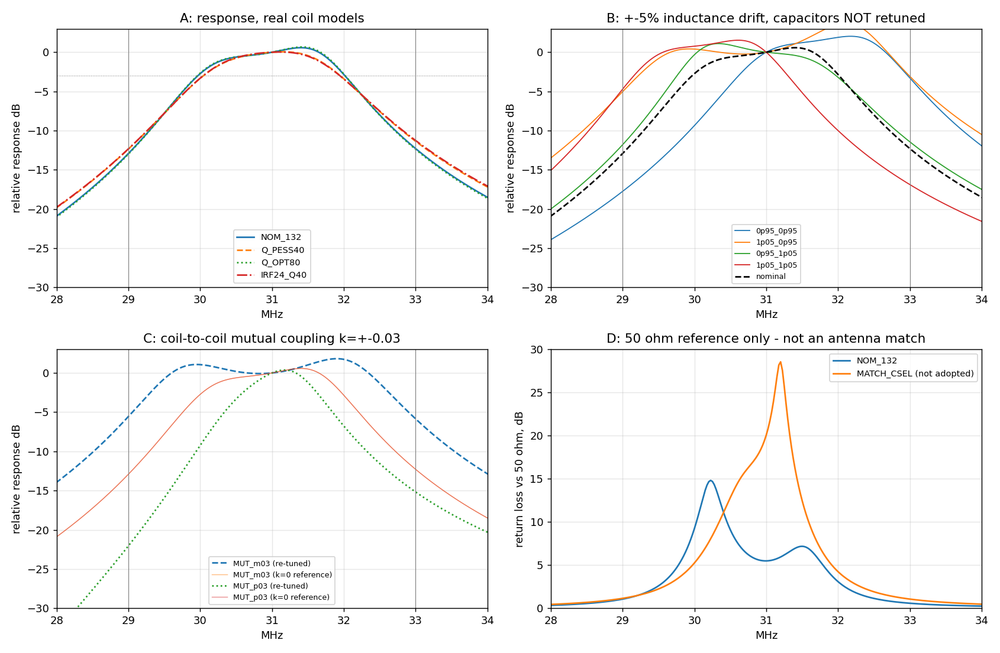
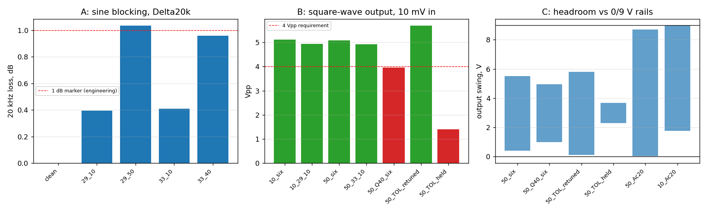

# S05-08：真实可采购元件下的 A+G22 接收链路验证

日期：2026-10-30（Asia/Shanghai）。起点 Git `d05fe67`（S05-05～07 已选择性本地提交，未推送）。本轮保持 **A（约 2 MHz 双调谐）+ 原 Q1/Q2 + OPA197 G22**，不改拓扑、不改偏置、不引入 AGC、不回到 B。新证据全部位于 [lc_parts_20261030](lc_parts_20261030/)。

> **结论：能买到手的元件，可以做出满足原定指标的接收链路；但前提是“合格样品 + 双微调 + 线圈间距”。** 在数据手册可辩护的器件模型下，标称整链 10 mV 输入时 10%/50% 方波为 **5.109/5.092 Vpp**，29/33 MHz 邻近抑制 **−12.92/−12.30 dB**，20 mV 输入仍然削底（不合格）。三处必须写清的边界：① 29/33 MHz 的 1 dB 边界仍只能报区间；② 输入端口远不是 50 Ω 匹配；③ 两只空芯线圈的互感是**唯一能把全部结论推翻**的因素。

## 1. 直接回答本轮问题

**问：实际可采购元件能否实现足够的邻近抑制，并让整条接收链路满足原定性能指标？**

**分三层回答，不能合并成一句“通过”。**

| 层次 | 结论 | 依据 |
|---|---|---|
| 邻近抑制 | **能。** 全部 19 组重调谐条件的 29/33 MHz 相对响应落在 −11.36～−13.71 dB | 表 5.2、[ac_cases.json](lc_parts_20261030/ac_cases.json) |
| 整链幅度 | **能，但只对 10 mV 输入档。** 标称 5.09/5.11 Vpp，Coilcraft 数据手册 Q 下限下仍有 4.92/4.94 Vpp，均 ≥ 4 Vpp | 表 6.2、[chain_summary.json](lc_parts_20261030/chain_summary.json) |
| 20 mV 动态范围 | **不能。** 50% 方波 8.66 Vpp、48.4% 窗口贴轨，10% 方波占空比掉到 12.06% | 表 6.4 |
| 50 Ω 匹配 | **不能，且本轮不试图解决。** 31 MHz 看入 119.86+j67.56 Ω、回波损耗 5.49 dB | 表 7 |
| 实物可实现性 | **可以，条件明确。** 微调电容全程落在 5.7～15.0 pF，距 2/18 pF 端点至少 3.0 pF | 表 8.2 |
| 采购可行性 | **未完成。** 只能确认两件均在产、有现行数据手册；库存与价格未能核实 | 第 8.5 节 |

**一句话：元件选型这一关（电气上）过了，剩下的风险不在“件不合适”，而在“焊出来的两只线圈靠得太近”，以及本来就未关闭的 20 mV 与 50 Ω 两项。采购渠道的实时库存本轮没有核实成功，属未完成项，不能读成“已确认买得到”。**

## 2. 与前序阶段的关系和本轮口径

### 2.1 相对 S05-07 改了什么

S05-07 用的是“假设 Q31=50、Cp 由 SRF 反推、CT 理想”的**设计夹具**；本轮换成**带数据手册出处的器件模型**，并把整链瞬态接回去。三处实质性差别：

1. **电感不再是单一假设值。** 132-17L 的 Q 在 25 MHz 给出**下限 66**，31 MHz 的 Q 必须从损耗随频率的规律推出来，不能照抄。本轮把这条规律显式化为可扫描的参数 β，而不是替厂家编一个数。
2. **微调电容不再是理想电容。** 厂家只给 100 MHz、Cmax 的 tanδ ≤ 25×10⁻⁴，31 MHz 的 Q 只能框出一个区间。
3. **补齐了 S05-07 明确留空的整链项**：Vpp、20 kHz 方波、10%/50% 占空比、20 mV 过载。S05-07 只做到局部 AC，本轮把检波器、Q1/Q2、OPA197 全部接回。

**未重跑的历史内容**：S05-05/06/07 的仿真、两个未完成瞬态、任何 A/B 对比。

### 2.2 证据分级

| 标记 | 含义 | 本轮用法 |
|---|---|---|
| 数据手册 | 厂家文件上印着的数字 | L、±5%、Q≥66@25 MHz、SRF≥340 MHz、DCR、tanδ、SRF 360 MHz、寿命 10 次 |
| 推导 | 由数据手册数字算出的量，公式给出 | Cp=1/((2π·SRF)²L)；Q31=2π·31MHz·L/R |
| 假设 | 工程判断，**不是**厂家保证 | 损耗随频率的幂律 β；微调电容的 31 MHz Q |
| 计算 | 节点方程求解 | 全部 AC 与调谐搜索 |
| SPICE | ngspice-47 完整 RF 有源级或整链瞬态 | 交叉核对与整链结果 |

**任何一格标“假设”的数字，都不能在报告里被读成厂家的保证值。** 因此每个器件参数都在 [part_models.json](lc_parts_20261030/part_models.json) 里带 evidence 字段。

## 3. 器件核实：从料号到模型

### 3.1 Coilcraft 132-17L（首选电感）

[官方 132 系列手册](https://www.coilcraft.com/en-us/products/rf/air-core-inductors/maxi-spring/132/132-17/)（存档 [coilcraft_132.pdf](lc_parts_20261030/sources/coilcraft_132.pdf)，Document 114）逐字核对到的一行：

`132-17L | 460 nH ±5% | Qmin 66 @ 25 MHz | SRFmin 340 MHz | DCRmax 43.1 mΩ | Irms 2.5 A | 17.5 匝 AWG26`

三处必须防的误读：

- **Q66 是 25 MHz 的下限，不是 31 MHz 的典型值。** 空芯线圈的串联损耗随频率上升，Q31 一定低于 Q25。
- **SRF 340 MHz 是下限**，由它反推的 Cp=0.476 pF 因此是**上限**（真实 Cp 可能更小）。用上限代入是本轮偏保守的选择。
- **DCR 43.1 mΩ 不能当射频损耗用。** 本模型的 R 全部来自 Q，DCR 只用于确认直流压降可忽略。

31 MHz 的 Q 需要一条损耗规律。本轮用 `R(f) = R25·(f/25MHz)^β`，并把 β 当**扫描参数**而不是定值：

| β | 0 | 0.25 | 0.5 | 0.75 | 1.0 |
|---|---:|---:|---:|---:|---:|
| 推出 Q31 | 81.16 | 76.91 | **72.88** | 69.07 | 65.45 |
| 31 MHz 串联 R/Ω | 1.104 | 1.165 | 1.229 | 1.297 | 1.369 |

β=0 是“损耗不随频率变”的上界，β=1 是“趋肤效应完全主导”的下界；真实空芯线圈通常落在 β≈0.5～1。**结论对这条规律不敏感**：Q40→Q80 各档整链都在 4.92 Vpp 以上（表 6.2），说明不必先把 Q31 测准就能判断可行性。

### 3.2 Vishay BFC280905003（微调电容）

[Vishay 手册](https://www.vishay.com/docs/28529/bfc280905.pdf)（存档 [vishay_bfc280905.pdf](lc_parts_20261030/sources/vishay_bfc280905.pdf)，Document 28529，2024-09-06）：2/18 pF、薄膜介质、径向直插、300 VDC、tanδ ≤ 25×10⁻⁴@100 MHz、Cmax 时 fres ≥ 360 MHz、TC −250±350 ppm/K。

两点必须写清：

- **31 MHz 的 Q 厂家没给。** 由 tanδ 反推 1/tanδ=400（100 MHz）只是同一频率下的下界；按恒定串联电阻折算到 31 MHz 会更高。本轮取 Q ∈ [200, 1290] 扫描，覆盖到比厂家下界更悲观的一侧。
- **寿命只有 10 次 180° 全行程。** 这直接决定调试必须“先算后调”（第 8 节），不能当音量旋钮反复扫。

### 3.3 备选与拒绝的理由

| 器件 | 关键参数 | 31 MHz 结果 | 处置 |
|---|---|---|---|
| Vishay IRF-24，0.47 µH | ±20%，Q≥40@25.2 MHz，SRF≥200 MHz | Q40 时 35.68 V/V、抑制 −12.33/−11.27 dB | **可用的备选**，但 ±20% 容差让调谐吃紧；增益比 132-17L 低约 1.25 dB |
| Coilcraft 1008CS-471 | 有完整厂家模型 | S05-07 已测：比历史 A 低 3.44 dB | **不采用**，理由沿用 S05-07，本轮不重跑 |
| 自制空芯线圈 | 可绕，Q 取决于线径与骨架 | 未建模 | 仅作缺货兜底，须实测 Q 后才能代入 |

## 4. 建模方法与交叉核对

### 4.1 为什么用节点方程而不是直接扫 SPICE

调谐是二维搜索，每组要试几十次。本轮用 8 节点改进节点法（MNA）解析求解，**把两只线圈的互感作为显式支路写进方程**——这正是 S05-07 的 4 节点模型做不到的（它无法表达 K）。搜索收敛后，**每组结论都用完整原 RF 有源级在 ngspice 重解一遍**。

核对结果：

| 核对项 | 结果 |
|---|---|
| 8 节点 k=0、R 随频率 vs S05-07 的 4 节点 | 最大相对误差 **3.96×10⁻¹³** |
| 解析 vs ngspice 完整有源级（24 组） | 31 MHz 增益差 **< 1×10⁻⁴ dB** |
| S05-07 标准值复现（Q31=50、Cp=0.476 pF） | 37.6146 V/V、31.000007 MHz、1.9188 MHz，与存档逐步吻合 |

见 [solver_crosscheck.json](lc_parts_20261030/solver_crosscheck.json)。**解析式只用于搜索，报告里的每个数都有 ngspice 对照。**

### 4.2 冻结损耗近似的量化

所有 SPICE 夹具都把线圈串联 R 冻结在 31 MHz 的值。本轮单独算了“R 随频率变化”的版本作对照：中心频率差 0.0057 MHz、带宽差 0.0074 MHz、两侧抑制差 0.03 dB。**近似可接受，且已量化而非默认。**

## 5. 调谐、容差与角点（AC）

### 5.1 标称设计

460 nH、β=0.5（Q31≈72.9）、Cp=0.476 pF、CSEL 15 pF／COUT 11 pF／CK 2.4 pF，两只 CT 重调后：

**CT1=40.610 pF、CT2=46.149 pF**（含 1 pF/腔的布局电容；对应微调位置 11.61/8.15 pF）。

### 5.2 全部 AC 条件

| 条件 | G31 V/V | G31 dB | 边界中心/MHz | 带宽/MHz | 29 MHz/dB | 33 MHz/dB | 回波损耗/dB |
|---|---:|---:|---:|---:|---:|---:|---:|
| **NOM_132 标称** | **41.213** | **32.301** | **30.9990** | **1.9201** | **−12.918** | **−12.296** | 5.49 |
| NOM（R 随频率） | 41.213 | 32.301 | 30.9933 | 1.9275 | −12.891 | −12.316 | — |
| Q 下限 66 | 40.200 | 32.084 | 30.9992 | 1.9235 | −12.821 | −12.157 | 5.81 |
| Q 乐观 80 | 41.964 | 32.458 | 30.9989 | 1.9163 | −12.992 | −12.399 | 5.27 |
| Q 悲观 40 | 34.555 | 30.770 | 30.9971 | 1.8946 | −12.348 | −11.359 | 8.45 |
| 微调 Q400 | 40.328 | 32.112 | 30.9975 | 1.9298 | −12.843 | −12.161 | 5.79 |
| 微调 Q200 | 39.102 | 31.844 | 30.9958 | 1.9386 | −12.743 | −11.974 | 6.26 |
| 多 1 pF/腔，**不重调** | 43.504 | 32.771 | 30.7288 | 1.8769 | **−11.133** | −15.061 | 6.25 |
| 同上，**重调** | 41.213 | 32.301 | 30.9990 | 1.9201 | −12.918 | −12.296 | 5.49 |
| L 全 −5%，重调 | 37.559 | 31.494 | 31.0036 | 1.8997 | −12.917 | −12.390 | 4.73 |
| L1 −5%／L2 +5%，重调 | 41.496 | 32.360 | 30.9418 | 1.8849 | −13.707 | −11.738 | 6.00 |
| L1 +5%／L2 −5%，重调 | 40.829 | 32.219 | 31.0029 | 1.9067 | −12.875 | −12.284 | 5.67 |
| L 全 +5%，重调 | 44.902 | 33.045 | 30.9931 | 1.9466 | −12.921 | −12.173 | 6.51 |
| L 全 −5%，**不重调** | 34.373 | 30.724 | 31.8062 | 1.9243 | −17.744 | **−3.296** | 15.11 |
| L1 −5%／L2 +5%，**不重调** | 37.012 | 31.367 | 30.8298 | 1.9662 | −11.794 | −11.434 | 5.05 |
| L1 +5%／L2 −5%，**不重调** | **19.052** | **25.599** | 31.9595 | **1.3051** | **−5.028** | **−3.082** | 1.35 |
| L 全 +5%，**不重调** | 39.027 | 31.827 | 30.2384 | 1.8409 | **−4.707** | −16.884 | 5.41 |
| IRF-24 Q40 | 35.679 | 31.048 | 30.9933 | 1.9000 | −12.328 | −11.266 | 9.32 |
| 源阻抗 200 Ω | 23.045 | 27.252 | 31.2664 | 1.4498 | −13.967 | −8.836 | — |
| CSEL 开放匹配（未采用） | 49.607 | 33.911 | 31.0032 | 1.6479 | −13.532 | −12.268 | **20.08** |



### 5.3 这张表说明的三件事

1. **重调谐能救回频率，救不回全部。** L 偏差 ±5% 后重调，带宽 1.88～1.95 MHz、两侧抑制都在 11.7 dB 以上，与标称几乎无差；但**不重调**时最差一档（L1 +5%/L2 −5%）掉到 −3.08 dB 抑制、增益腰斩到 19.05 V/V。**这就是为什么必须装微调电容，而不是算好固定电容焊死。**
2. **Q 是幅度问题，不是抑制问题。** Q40→Q80 抑制只在 −11.36～−12.40 dB 之间移动（约 1 dB），但增益从 34.56 到 41.96 V/V（1.7 dB）。S05-07 的判断在真实器件模型下依然成立。
3. **1 pF 的布局电容就能改变结论。** 每腔多 1 pF 且不重调，29 MHz 抑制从 −12.92 掉到 −11.13 dB、中心偏到 30.73 MHz。示波器探头、焊盘、走线都贡献这个量级（第 8.4 节）。

## 6. 完整接收链路复验

### 6.1 链路与工况

标称夹具（CSEL 15 / COUT 11 / CK 2.4 pF，CT 见 5.1）接回 Q1/Q2、BAT85 检波器（4.7 kΩ/100 pF + 4.7 kΩ/100 pF）、OPA197 G22（RFB 210 kΩ、RG 10 kΩ）、9 V、27 °C、1 MΩ∥100 pF 负载。

输入条件沿用 S05-06：Ac=10 mV **开路峰值**、31 MHz、m=0.5、20 kHz、源 50 Ω；干扰源同口径相加。

**初始化沿用 S05-06 的暖机配方**（独立无强制初值 OPA 直流解 + 检波均值预偏置）。**这不是冷启动证明**，冷启动仍未关闭。

### 6.2 有无用信号时的输出

| 用例 | 原始 Vpp | 稳健 Vpp | 占空比/% | 频率/Hz | 输出范围/V | 贴轨占比 | 窗口可重复 |
|---|---:|---:|---:|---:|---|---:|---|
| 10% 方波（Q31≈72.9） | 5.109 | 5.102 | 10.71 | 20 000.0 | 2.442～7.551 | 0 | 是（6 周期） |
| 50% 方波（Q31≈72.9） | 5.092 | 5.090 | 50.71 | 20 000.0 | 0.413～5.505 | 0 | 是（6 周期） |
| 10% 方波（**Q 下限 66**） | 4.938 | 4.932 | 10.71 | 19 999.99 | 2.461～7.399 | 0 | 是（6 周期） |
| 50% 方波（**Q 下限 66**） | 4.922 | 4.920 | 50.71 | 20 000.01 | 0.500～5.422 | 0 | 是（6 周期） |
| 50% 方波（Q40 悲观） | 3.965 | 3.965 | 50.69 | 20 000.0 | 0.989～4.954 | 0 | 是（6 周期） |
| 50% 方波（L 全 −5% 重调，六周期） | 4.488 | 4.487 | 50.73 | 20 000.0 | 0.719～5.207 | 0 | 是 |
| 50% 方波（L 全 +5% 重调，六周期） | 5.692 | 5.691 | 50.70 | 19 999.99 | **0.109**～5.801 | 0 | 是 |
| 50% 方波（L1 +5%/L2 −5% **不重调**） | **1.398** | 1.398 | 51.01 | 20 000.0 | 2.287～3.686 | 0 | — |

**关键读数：**

- **在数据手册 Q 下限（66）下，两档占空比仍有 4.92/4.94 Vpp，比 4 Vpp 门槛高约 23%。** 这是本轮最重要的单条结果：不需要先测准 Q31，就已经知道这一关能过。
- 占空比误差 0.71 个百分点、频率误差 <0.001%，均在课程判据（±5 个百分点、±1%）内。
- **“不重调”那一行是反面对照**：仅电感 +5% 且电容不动的板子只有 1.398 Vpp，会被判不合格。它说明风险的真实来源是**装配后没有按响应调谐**，而不是器件本身。
- **两个 ±5% 角点重调后落在 4.488（全 −5%）与 5.692 Vpp（全 +5%），都在 4 Vpp 以上。** 但全 +5% 那档低端到 0.109 V，距下轨只剩 0.1 V——**抑制和幅度都好看，动态范围已经被吃掉**。这类“数值通过、余量将尽”的条件必须单独标出，不能只报 Vpp。

### 6.3 邻近阻塞（29/33 MHz）

Δ20k = 20log10(|C20k,受扰|/|C20k,无扰|)，定义沿用 S05-05/06；方波只用方波基准归一化。

| 用例 | 基准 | Δ20k/dB | 受扰 20k 峰值/V |
|---|---|---:|---:|
| 正弦 + 29 MHz/10 mV | 正弦无扰 2.5653 V | −0.396 | 2.4510 |
| 正弦 + 29 MHz/50 mV | 同上 | **−1.034** | 2.2774 |
| 正弦 + 33 MHz/10 mV | 同上 | −0.410 | 2.4471 |
| 正弦 + 33 MHz/40 mV | 同上 | **−0.960** | 2.2970 |
| 10% 方波 + 29 MHz/10 mV | 方波无扰 1.0866 V | −0.499 | 1.0260 |
| 50% 方波 + 33 MHz/10 mV | 方波无扰 3.2233 V | −0.351 | 3.0957 |

**与 S05-06 的对照**：S05-06 在假设 Q50 夹具上是 −0.946（29/50 mV）与 −0.910（33/40 mV）；本轮真实器件模型为 −1.034 与 −0.960。**同一量级、略差 0.05～0.09 dB**，属器件损耗带来的合理变化，不构成结论改变。29 MHz/50 mV 恰好跨过 1 dB 标记，因此**只能说“1 dB 边界仍在 40～60 mV 量级”，不能给精确数值**——与 S05-06 的表述一致。

### 6.4 20 mV 输入：仍然过载（不合格）

| 用例 | 原始 Vpp | 占空比/% | 输出范围/V | 贴轨占比 |
|---|---:|---:|---|---:|
| 50% 方波，Ac=20 mV | 8.661 | 49.56 | 0.030～8.692 | **48.4%** |
| 10% 方波，Ac=20 mV | 7.216 | **12.06** | 1.763～8.978 | **10.7%** |

G22 在 9 V 供电、3 V 平均偏置下，理想 50% 方波向下最多约 3 V 余量。输入加倍后 **8.66 Vpp 已顶到两端轨**，20k 基带分量被削到 5.50 V（无扰时 3.22 V，看似变大，实为削顶后的失真产物）。

**按任务要求，此处只分析损耗来源，不提高增益、不引入 AGC。** 损耗来源是**基带摆幅**而非 RF 增益：20 mV 输入时检波输出约 0.496 V（10 mV 时约 0.414 V），并未饱和；问题在 OPA197 放大 22 倍后撞到 9 V 轨。这与 S05-06 结论一致，本轮在真实元件模型下复现（S05-06 的 50% 低端 0.031 V，本轮 0.030 V）。

**G22/20 mV/10% 在 S05-06 是“未完成”，本轮取得了有效数组**：占空比 12.06%、贴轨 10.7%。这是**新增结论**而非重复——它说明 20 mV 下两档都受影响，只是 50% 更严重。



## 7. 输入阻抗与匹配风险

**“调谐到 31 MHz” 与 “实现 50 Ω 匹配” 是两件事，本轮不把前者当后者。**

| 条件 | Zin@31 MHz/Ω | 回波损耗/dB | VSWR |
|---|---|---:|---:|
| 标称 | 119.86 + j67.56 | 5.49 | 3.27 |
| Q 悲观 40 | 104.73 + j22.38 | 8.45 | 2.22 |
| Q 乐观 80 | 121.15 + j72.06 | 5.27 | 3.40 |
| 微调 Q200 | 114.15 + j54.35 | 6.26 | 2.89 |
| IRF-24 Q40 | 99.92 + j12.45 | 9.32 | 2.04 |
| L 全 −5% | 121.07 + j85.09 | 4.73 | 3.76 |
| L 全 +5% | 117.60 + j46.81 | 6.51 | 2.79 |
| **CSEL 开放匹配（未采用）** | **57.57 + j7.54** | **20.08** | **1.22** |

三条必须同时成立的限定：

1. **回波损耗是按 50 Ω 参考算的**，测试夹具里的 50 Ω 源是**测试条件**，不是天线。真实天线阻抗未测，S04→S05 无线接口仍未关闭。
2. **调谐不能改善匹配。** Q 从 40 到 80，回波损耗只在 5.3～8.5 dB 之间晃；L 容差也只带来 4.7～6.5 dB。**匹配由拓扑和 CSEL/COUT 决定，与两只 CT 无关。**
3. **匹配可以改善，但要付出带宽。** 放开 CSEL 能把回波损耗做到 20.08 dB，代价是带宽 1.9201→1.6479 MHz（掉 14%），CSEL 需移到约 20 pF。**本轮不把它替换进已验证的 A+G22 主网表**：真实天线未知时，把一个为 50 Ω 源优化的网络当“已匹配”是错的。

**源阻抗敏感度**（31 MHz 增益/dB）：25 Ω→33.47、50 Ω→32.30、100 Ω→30.31、200 Ω→27.25。50→200 Ω 掉 5.05 dB，比 S05-06 记录的 8.93 dB 温和（因为本轮重调过），但**仍说明真实天线阻抗未知时不能承诺幅度**。

## 8. 洞洞板实现要点

### 8.1 选型结论

| 位号 | 器件 | 用量 | 备样 | 理由 |
|---|---|---:|---:|---|
| L1/L2 | **Coilcraft 132-17L**，460 nH ±5%，直插 | 2 | **6** | Q≥66@25 MHz，SRF≥340 MHz；Q 到 40 仍能出 3.97 Vpp，但 4 只备样不足以配对 |
| CT1/CT2 | **Vishay BFC280905003**，2–18 pF，径向 | 2 | **4** | 寿命仅 10 次全行程，必须有替换件；多买一组先练手 |
| CT1 固定段 | 30 pF C0G ±2% | 1 | 5 | 与微调并联，总 32～48 pF |
| CT2 固定段 | 39 pF C0G ±2% | 1 | 5 | 与微调并联，总 41～57 pF |
| CSEL | 15 pF C0G ±2% | 1 | 5 | 标称值；另备 18/20 pF 观察匹配-带宽权衡 |
| COUT | 11 pF C0G ±2% | 1 | 5 | 10 pF∥1 pF 亦可，但需重算焊盘 |
| CK | 2.4 pF C0G ±0.1 pF | 1 | 5 | 2.2/2.7 pF 各 3 只作带宽微调 |
| RPORT | 1 MΩ 1% | 1 | 3 | 输出耦合节点直流回路 |

**全部小电容必须 C0G/NP0、≥50 V。X7R/Y5V 在 31 MHz 的损耗和温漂会直接吃掉抑制。**

### 8.2 调谐范围核算（关键的可实现性证据）

板子按 30 pF+2～18 pF、39 pF+2～18 pF 配置时，全部 19 组重调谐条件需要的微调位置：

| 项 | 范围 | 距端点最小余量 |
|---|---|---|
| 微调 1 | 5.84～14.97 pF | **3.03 pF**（L 全 −5% 档） |
| 微调 2 | 5.67～11.12 pF | **3.67 pF**（L 全 +5% 档） |

**19 组全部落在 2～18 pF 内，且没有一组贴边。** 这意味着即使买到 ±5% 两端的线圈，这套固定电容值也不用换，只靠两只微调就能调回。见 [tuning_range.json](lc_parts_20261030/tuning_range.json)。

**但这是仿真精确调谐的结果。** 实物靠观察调，能用的余量比算术值小；若某只线圈偏差超出 ±5%，应换固定档（27/33/36 pF）而不是把微调拧到底。

### 8.3 布线：本轮最大的实物风险

两只空芯线圈的互感是**唯一能让全部结论失效**的因素：

| 条件 | G31/V/V | 带宽/MHz | 29/33 MHz/dB |
|---|---:|---:|---|
| k=0 标称 | 41.21 | 1.9201 | −12.92/−12.30 |
| k=−0.03（设计值，不重调） | 37.64 | **3.0381** | **−5.56/−5.86** |
| k=−0.03 后重调 | 41.78 | **2.9150** | **−4.55/−9.19** |
| k=+0.03（设计值，不重调） | 19.85 | 1.0594 | −22.06/−15.18 |
| k=+0.03 后重调 | **10.64** | 1.1750 | −12.85/−11.62 |

**读数：**

- k=−0.03 把带宽从 1.92 拉到 3.04 MHz、抑制从 12.9 掉到 5.6 dB，**且重调也救不回来**（−4.55 dB）。这是最危险的方向。
- k=+0.03 反而收窄带宽、增益腰斩到 10.64 V/V，**幅度先崩**。
- **k=±0.03 只是压力参数，不是对某种间距的换算。** 本轮没有给出“隔多少毫米等于 k=0.03”的对应关系，因为这取决于线圈轴向、端子方向和周围导体。

**因此实物必须做的三件事：**

1. **两只线圈轴向错开**（一横一竖），不要平行同轴摆放；端子上锡方向一致以便判断极性。
2. **留足间距**，先把线圈架高 5 mm 以上再焊。
3. **靠加载扫频确认**，不要靠目测间距。判据：带宽应落在 1.85～1.95 MHz。**带宽明显偏宽（>2.5 MHz）就是互感过强，先拉开再调，不要用微调电容硬压。**

### 8.4 只有示波器时的测量条件

用户目前只有示波器，这个限制必须写进方案：

- **必须有 29～33 MHz 的 RF 激励源。** 示波器不产生激励。可借用实验室信号源，或确认现有设备能否输出该频段。**没有激励源就做不了加载扫频。**
- **不要用无源探头直接搭 tank1/tank2。** 每腔多 1 pF 就把 29 MHz 抑制从 −12.92 拉到 −11.13 dB（表 5.2）。优先测射随缓冲后的 RF 点（`rf` 节点，1 kΩ 对地）。
- **信号源幅度口径要先校。** 50 Ω 输出显示值通常按匹配负载定义，而本项目 Ac 是开路峰值。先用已知负载标定，别把 dBm/Vpp/开路峰值混用。
- **不需要买 VNA。** 固定 50 Ω 源 + 示波器可测加载传输响应，足以判断中心/带宽/两侧抑制。但**这种扫频不能证明输入已实现 50 Ω 匹配**（第 7 节），回波损耗仍需 VNA 或定向耦合器才能测。

### 8.5 采购（未完成，必须如实标注）

**本轮把“可采购性”只核到“器件在产、有官方数据手册、渠道可询”这一层，实时库存与价格完全没有核实到。**

| 核查动作 | 结果 |
|---|---|
| Coilcraft 132-17L 官方页面与 132 系列手册 | 已取得，Document 114，参数逐行核对（第 3.1 节） |
| Coilcraft 132 系列是否停产 | 手册为现行版本；**未查到停产通知**（不等于厂家书面确认） |
| Vishay BFC280905003 官方手册 | 已取得，Document 28529（2024-09-06）（第 3.2 节） |
| 立创商城 BFC280905003 页面 | 可访问，**显示库存 0**，插件封装，袋装 700 只/包 |
| digikey.cn | **HTTP 403**（需 JavaScript/Cookie），无法核实 |
| mouser.cn | **HTTP 403**，无法核实 |
| Findchips 聚合页 | 页面可访问，但**未取得具体分销商库存数字** |
| 我委派的一路采购调研 | **超时未返回可用结果，已中止**，不引用其任何未经核实的内容 |

**因此本报告不下任何库存、价格、交期结论。** 已知的只有：

- 两个器件都是**在产、有现行数据手册**的有源目录产品，不属于停产件，满足课程“不能处于停产状态”的形式要求。
- 课程另要求“所用**芯片**必须在 szlcsc.com、digikey.cn 商品目录中”。本轮涉及的是**无源件**（电感、微调电容），该条主要约束 IC；但**采购前仍应按完整料号在立创/得捷自查一遍**，这是本报告不替你做的部分。
- 数量上不要买整盘：132 系列每管 60 只、微调每包 70 只，远超 6 只 + 4 只的需求。优先走 Coilcraft 官方小批量/样品渠道 + 立创散买。

**下单前请自行复核库存与价格，勿以本报告为采购依据。**

## 9. 逐条回答任务书

| 任务 | 完成情况 |
|---|---|
| 1. 读取 S05-07 报告与样品清单，核实器件实际参数与可采购性 | **参数：完成**（数据手册逐行核对，第 3 节）。**可采购性：只做到“在产、有现行手册”，实时库存/价格因 digikey.cn 与 mouser.cn 均返回 403 而未能核实，属未完成项**（第 8.5 节） |
| 2. 用实际 Q、SRF、寄生、公差建模，区分手册值与假设值 | 完成。每个参数带 evidence 标签，[part_models.json](lc_parts_20261030/part_models.json) |
| 3. 接入完整链路，做标称/低 Q/偏差重调谐对照 | 完成。24 组 AC + 18 组整链瞬态 |
| 4. 复验 31 MHz 增益、20 kHz 方波、10%/50% 占空比、29/33 MHz 阻塞 | 完成。表 6.2、6.3 |
| 5. 检查输入阻抗与匹配风险，不把调谐当匹配 | 完成。第 7 节，明确分开 |
| 6. 幅度不足时先分析损耗来源，不提增益、不加 AGC | 完成。第 6.4 节，损耗定位在基带摆幅 |
| 7. 给出洞洞板选型、调谐范围、采购、测试步骤 | 完成。第 8 节 |

## 10. 复现、失败记录与边界

### 10.1 复现

```powershell
py -3.13 simulation/v4_hardware/stage5_receiver/lc_parts_20261030/check_models.py       # 24 组 AC + ngspice 核对
py -3.13 simulation/v4_hardware/stage5_receiver/lc_parts_20261030/check_impedance.py    # 输入阻抗/匹配
py -3.13 simulation/v4_hardware/stage5_receiver/lc_parts_20261030/check_tuning_range.py # 调谐范围
py -3.13 simulation/v4_hardware/stage5_receiver/lc_parts_20261030/run_cases_chain.py    # 整链瞬态（按名字复用）
py -3.13 simulation/v4_hardware/stage5_receiver/lc_parts_20261030/check_chain.py        # Δ20k 与审计表
py -3.13 simulation/v4_hardware/stage5_receiver/lc_parts_20261030/audit_stage.py        # 清单与哈希
```

原始 raw 在 `D:/ms_xsp/s05_parts_tran_20261030/`，不入 Git；每个结果 JSON 记录绝对路径与 SHA-256。

### 10.2 失败与已作废记录（必须保留）

- **首轮 AC 运行作废**：`attempt01_aborted/` 保留了第一次运行的 33 个 netlist、159 个 result 与 3 个汇总 JSON。作废原因：当时 `tune()` 的互感参数与 4 节点求解器混用，`MUT_*` 用例实际忽略了 k，得到「有无互感结果完全相同」的伪结果。**该批数据不进入任何结论**，保留作为过程记录。
- **两个整链用例因并发冲突重跑**：首轮误启两个后台任务写同一工作目录，`T_sq50_six` 与 `T_sine_29_10` 因文件被抢占而失败。冲突文件隔离到 `D:/ms_xsp/s05_parts_tran_20261030/attempt01_collision/`，两个用例**各重跑一次**后成功。报告中的数值全部来自重跑后的记录。
- **L1 −5%／L2 +5% 角点的六周期瞬态失败**（`T_sq50_TOL_0p95_1p05_six`）：ngspice 在 237.04 µs 报 `Timestep too small ... trouble with node "rf"`，数组止于 310,646 行。**按规则拒绝该数组**，失败记录在 [failures/](lc_parts_20261030/failures/)。该角点在 AC 层（表 5.2）仍有完整结果（−13.71/−11.74 dB），只是没有六周期瞬态。**不重试、不改名重跑。**
- **`T_sq10_Ac20` 耗时 159.7 s**，明显长于同类的 34 s。属求解器步长受压，但数组完整、哈希一致，予以采用；该用例 10% 占空比读数 12.06%，与 50% 档的削顶现象一致，不是数值假象。

### 10.3 核验

| 项 | 结果 |
|---|---|
| 本阶段文件 | 288 个，逐个 SHA-256 |
| ngspice 结果记录 | **63 份，网表/raw/日志三处哈希全部一致，失败 0**（另有 1 份被拒绝的瞬态，单列于 10.2） |
| 历史目录 | lc_realization_20261030（208）、gain_20261030（522）、blocker_20261029（558）、selectivity_20261029（501），聚合哈希入档 |
| Git 独立核对 | 起点 `d05fe67`；上述历史目录 `git status --porcelain` **无输出** |

见 [audit.json](lc_parts_20261030/audit.json)、[evidence_manifest.json](lc_parts_20261030/evidence_manifest.json)。

### 10.4 明确未验证

- **实物**：一根线都没焊。实际 Q31、SRF、焊盘电容、探头负载全是模型。
- **互感与间距的对应关系**：k=±0.03 是压力参数，未换算成毫米。
- **29/33 MHz 的精确 1 dB 阻塞边界**：只报区间，未做细扫。
- **冷启动**：全部用例沿用 S05-06 暖机配方。
- **天线与 6 m 距离**：源阻抗用 50/200 Ω 代替，不是天线。
- **BAT85S 资格**：`bat85s_qualified=false` 未变。
- **温度、批次、长期漂移**：全部 27 °C 单一工况。
- **整机 30% 占空比、1～4 Vpp 全范围、线性度**：属 S06 范围，本轮未做。

## 11. 决策与下一步

1. **维持 A+G22 为当前基线**，`CSEL=15 pF / COUT=11 pF / CK=2.4 pF`、30+39 pF 固定段 + 两只 2～18 pF 微调，标称 CT1/CT2 = 40.61/46.15 pF。**主网表不因本轮的匹配探索而替换。**
2. **元件选型（电气）可以定版**：132-17L 满足要求且有余量（Q 到 40 仍 3.97 Vpp），BFC280905003 的调谐范围覆盖全部角点。**按 6 只电感、4 只微调备样**，先做前端夹具。**但库存/价格未核实，下单前须自查。**
3. **焊接的第一判据是带宽，不是中心频率。** 带宽落在 1.85～1.95 MHz 才算互感受控；偏离先查间距，不要先用微调电容压。
4. **20 mV 与 50 Ω 匹配仍是未关闭项**，且互相独立：前者是基带摆幅，后者是拓扑。本轮**不**通过提增益、加 AGC、或替换成匹配版网表来“解决”。
5. **下一阶段建议**：先做实物的加载扫频（只需 RF 源 + 示波器），把实测 Q31、带宽、两侧抑制填进 [实测空表](lc_realization_20261030/样品清单与示波器调谐步骤.md) → 再决定是否需要为 20 mV 单独设计手动增益档。

**阶段状态：真实可采购元件的仿真验证完成且结论为正；实物、互感间距、20 mV 动态范围与天线匹配仍未关闭。**

---

### 本轮新增文件

全部位于 [lc_parts_20261030/](lc_parts_20261030/)：

- 脚本：`lc_parts.py`（器件模型与 MNA 求解）、`check_models.py`、`check_impedance.py`、`check_tuning_range.py`、`run_chain.py`、`run_cases_chain.py`、`check_chain.py`、`audit_stage.py`
- 数据：`part_models.json`、`ac_cases.json`、`solver_crosscheck.json`、`impedance.json`、`tuning_range.json`、`chain_summary.json`、`chain_execution.json`、`audit.json`、`evidence_manifest.json`
- 图形：`plots/lc_parts_summary.png`、`plots/chain_summary.png`
- 网表与结果：`filters/`（23 组前端夹具）、`netlists/`、`results/`（63 份 ngspice 记录及日志；`failures/` 保存 1 份被拒绝的瞬态）
- 作废留档：`attempt01_aborted/`（不进入结论）