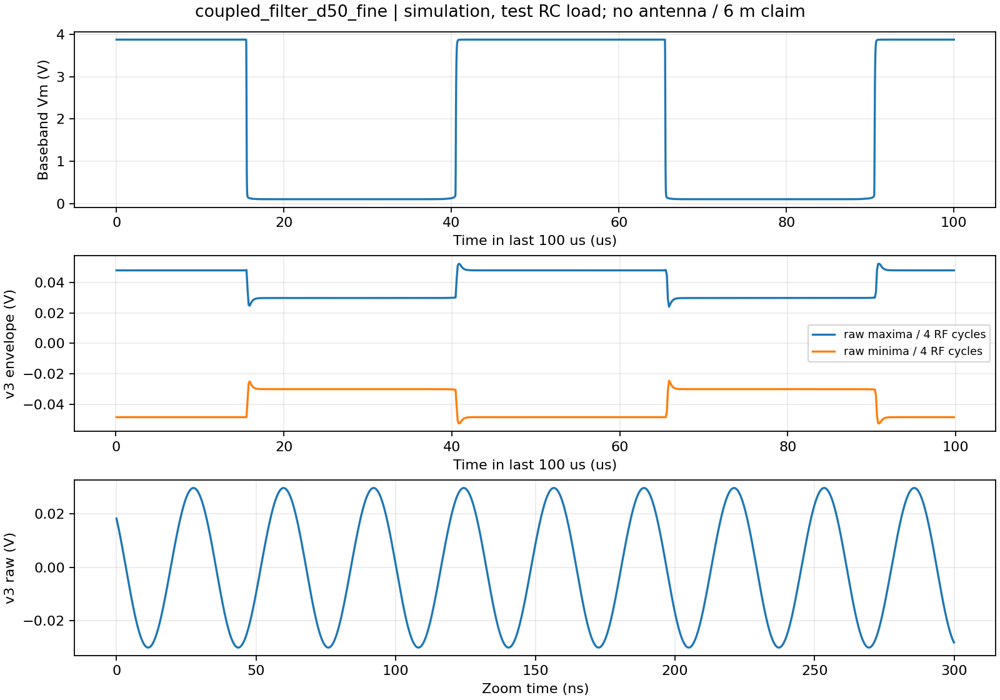

# AM-ALT.1 续阶段 基极调制与完整发射输出候选报告

日期：2026-11-15。目录：`simulation/v4_hardware/stage_am_alt1_base_20261115/`。

**阶段结论：完成设计依据更新、TP3到v3映射和基极调制首轮验证；已形成包含实际晶振、LM393、调制管、输出缓冲和选频网络的仿真候选。尚未完成天线、无线接收、6m与电池端实物验收，不能称课程验收通过，也不是可直接照焊的定版。**

## 1. 设计依据与历史结论的适用范围

按本次用户明确指令执行：不要求TX驱动50Ω，没有正式2.0/1.2Vpp包络门槛；对象是完整发射模块输出v3；需AM波形、载波稳定、电池供电、整机功耗<0.5W和6m无线通信，并保留原课程v1/v2性能要求。

详见[设计依据与节点映射](01_设计依据与TP3到v3节点映射.md)。AM-REQ.1报告作为历史审查原样保留；本次指令闭合本阶段设计口径，不虚构另一份教师确认文件。

AM-02.3原报告、网表和结果保持不变。其50Ω、2.0/1.2Vpp下未通过的判定现在标为**历史工程测试条件下的结果**，不能据此宣称课程指标失败；其中压缩、自激和带载变化仍需认真对待。旧AM-ALT.1的“TP3高阻就是最终验收”解释也不再采用。

## 2. TP3到v3的最终候选映射

```text
C4晶振/已有缓冲/载波增益级(out，功能对应TP2)
  → 2.2kΩ/10Ω射频衰减 → 100pF → QM基极mb
LM393的V1 → 47kΩ基带注入 ───────────┘
5V → 15kΩ/3.3kΩ直流偏置 ──────────┘

QM集电极mc → 100pF → tp3（1kΩ到地，内部调制器输出）
  → 100pF → QOB基极ob → 射随输出oe（330Ω到地）
  → 10nF → tx_drv（内部驱动接口）
  → 1kΩ隔离电阻 → v3（输出选频网络后的最终连接器）
                   ├─ 51pF到地
                   ├─ 470nH + 串联损耗电阻到地
                   └─ 测量夹具10kΩ∥5pF（不是天线）
```

QM为`QM mc mb me 2N3904`，射极470Ω到地并联1nF。QOB为`QOB vcc ob oe 2N3904`，基极由33kΩ/33kΩ偏置。两个晶体管均用既有educational 2N3904模型，不代表具体厂家/批次的保证性能。

输出电感先采用Q=40假设，按31MHz换算串联损耗约2.29Ω；输出总标称电容为51pF加夹具5pF。这个网络用于抑制低频穿越及RF谐波，**尚不是按实际天线阻抗设计的匹配网络**。后续若加入匹配级，正式v3必须移到匹配级之后的天线馈点。

冻结网表TP4是eEPA之后、理想信道之前的节点，功能上最接近完整发射输出边界；冻结TP3仅是调制器输出。不能因冻结eEPA输入不取电流，就省略实际后级与天线加载验证。

## 3. 基极调制和静态工作点的耦合如何处理

### 3.1 先纠正旧候选的接线问题

旧`stage_am_alt1/netlists/mod_B_base.cir`写的是`Q9M vcc m9col m9emit`。在C/B/E顺序下，m9col是基极，真正接载波和偏置的m9base却未接到三极管。因此它不能代表有效基极调制试验。本轮从正确端口重新建立，旧文件未改。

### 3.2 两个调节量不是天然完全独立

忽略基极电流时：

`Vb=(5/RMT+Vm/RMINJ)/(1/RMT+1/3300+1/RMINJ)`。

RMT控制偏置，RMINJ控制基带注入系数，但改变RMINJ也改变总电导，因此仍会改变静态点。本轮采用**先确定未调制低电平时的偏置，再按注入量补偿RMT**的方法，而非假称两个旋钮完全无耦合。

给定参考低平台基极电压Vb0和VmL，补偿式为：

`(5−Vb0)/RMT_new=(5−Vb0)/RMT_ref+(Vb0−VmL)×(1/RMINJ_new−1/RMINJ_ref)`。

参考RMT=15kΩ、RMINJ=100kΩ，Vb0≈0.86994V；使用同一套实际晶体管模型验证得到：

| RMINJ | 补偿RMT | 低平台Ic估计 | 调制度 | 高/低平台v3基波Vpp |
|---:|---:|---:|---:|---:|
| 47kΩ | 14.52694kΩ | 0.474956mA | 22.113% | 0.078305 / 0.049945 |
| 100kΩ | 15.00000kΩ | 0.474953mA | 13.014% | 0.064897 / 0.049951 |
| 220kΩ | 15.24006kΩ | 0.474955mA | 6.710% | 0.057140 / 0.049954 |

证据：`results/comp2_ri*.json`、对应网表和raw。这组三点使用理想载波/基带和未加LC的输出接口，专门隔离研究耦合；不能把表中绝对幅度当作完整发射候选结果。Ic由集电极1kΩ压降的平台平均值估计，单位mA。

**已验证的结论**：在这些模型和条件下，可保持低平台工作点基本不变，同时连续改变调制深度，且全窗VCE最低3.63V，VCB保持正向裕量，不需要以深饱和换调制度。**未验证的结论**：自动免调解耦、跨批次免校准、所有温度下调制度恒定。调制本来就改变高平台电流，周期平均电流也会随占空比变化；本报告没有声称平均工作电流完全不变。

补偿得到的精密阻值是验证用设定值，实物需选择固定电阻加微调并复测，不能直接当采购BOM。

## 4. 从机制试验到完整候选的修正

1. **载波注入源阻抗**：最初47kΩ/330Ω射频衰减使调制效果很小，部分工作点还出现反向变化。改用2.2kΩ/10Ω降低注入阻抗后，得到明显可调AM。该结论来自对照，不能把31MHz增益简单等同于低频gm×RC。
2. **窄脉冲建立时间**：载波耦合电容1nF与偏置网络构成低频瞬态，10%占空比高平台来不及建立。改为100pF后，理想源1–4V、10/30/50%共12点的同幅度平台基本不依赖占空比。4V时三个占空比m均约24.1%，这里仅为测得结果，不是强制调制度。
3. **低频边沿穿越**：单靠耦合电容，v3仍有明显尖峰和基线偏移。把调制器输出改为100pF+1kΩ高通能减轻问题，但原始时域波形仍不够好。因此增加有限Q输出选频网络，不能只截取平台后宣布波形合格。
4. **测量窗口错误已修正**：早期统计把记录窗口边界当作完整平台边界，影响低平台平均值。现只采用实际基带交越之间的完整平台；修正前JSON保留在`results/analysis_v1/`，raw未删除。最新报告只使用修正后统计。

理想源矩阵显示非线性仍存在：以4V输入包络阶跃为参考，1V点相对线性误差约12%，2V约8%，3V约4%。因此不能宣称全幅度理想线性已经解决；最终仍需检查真实接收v2的比例。

## 5. 实际载波与基带接入结果

载波使用冻结C4副本的完整晶振、缓冲及增益级。仅在新副本中撤下原2kΩ∥10pF测试夹具，改接本候选，并保留1MΩ直流回路。基带接入现有LM393器件级模型。不是以理想正弦和理想方波冒充实际源。

完整候选从0运行到2ms，保留最后150µs，`uic`加原C4电源爬升，无手工指定电容预充电。只证明这一次模型启动及末窗表现，不证明器件离散性下可靠起振。

标称测量夹具为10kΩ∥5pF。0.5ns最大步长的初步结果：

| 工况 | v3高/低平台基波Vpp | 调制度 | 平台H2–H5 THD最大 | 最低VCE | 5V射频链电流 | LM393电流 |
|---|---:|---:|---:|---:|---:|---:|
| 4V设定、10% | 0.096416 / 0.060088 | 23.212% | 0.862% | 3.700V | 13.531mA | 4.216mA |
| 4V设定、50% | 0.096423 / 0.060010 | 23.277% | 0.862% | 3.700V | 13.679mA | 3.473mA |
| 2V设定、50% | 0.078833 / 0.060065 | 13.512% | 见自动汇总 | 见自动汇总 | 见自动汇总 | 见自动汇总 |

证据：`coupled_filter_d10_r2`、`coupled_filter_d50_r2`、`coupled_filter_a2`。前两次无r2后缀的运行被会话中断，没有完整raw/结果；只保留其日志，不算失败工况，也不计入成功数据。

加入选频前，同条件平台THD约11%；加入后约0.86%，原始输出波形由明显基带尖峰变为近似对称的AM包络。**边沿仍有过冲/欠冲，不能把平台THD代替整个调制波形失真指标。** 波形图采用原始每4个载波周期的最大/最小值，没有把包络尖峰裁掉。

4V→2V设置时，RF包络阶跃从约0.036412Vpp降至0.018768Vpp，按设置值减半计算偏差约+3.09%。这只是TX包络阶跃，不是RX的v2验收结果；真实Vm并非正好4/2V，分析须同时保留实际输入值。

### 5.1 实际基带加载的缺口

实际4V档高/低电平约3.876/0.12V，实得约3.75–3.76Vpp；2V档约1.926/0.121V，实得约1.805Vpp。RMINJ对LM393造成了加载，不能继续把档位标签当实测幅度。正式v1的1–4V覆盖和对应比例仍需校准/接口优化。本轮没有通过降低课程v1要求来掩盖这个缺口。

### 5.2 频率与步长

旧高通候选0.5ns→0.25ns时，包络幅度变化约0.02%以内，但载波频率由约30.9792MHz变到30.9928MHz。该变化首先是**数值步长影响**，不能冒充真实电路频率牵引。最终选频候选另做0.125ns对照，详见后附自动核验。

平台1µs中的载波过零频率及高低差只能作为短窗口数值记录，不能给出温漂、长期稳定性或硬件测量结论。课程频率判据在实际整机与天线负载下仍要复测。

## 6. 负载、模型与功耗边界

### 6.1 负载敏感性不是课程新增门槛

理想源隔离试验、同一调制器设置下：

| 假设 | 高/低平台v3基波Vpp | 调制度 | 含义 |
|---|---:|---:|---|
| 10kΩ∥5pF、Q40 | 0.0542 / 0.0331 | 24.21% | 标称夹具 |
| 2kΩ∥10pF | 0.0366 / 0.0224 | 24.20% | 加载使幅度明显下降，必须纳入实际天线/探头 |
| 1MΩ∥2pF | 0.0529 / 0.0323 | 24.24% | 不能仅按电阻越高幅度越大推断，电容也改变选频 |
| Q20 | 0.0452 / 0.0275 | 24.22% | 电感损耗影响绝对幅度 |
| Q80 | 0.0603 / 0.0368 | 24.21% | 同上 |

0℃/50℃时m约28.86%/21.18%，说明偏置补偿不等于自动温度补偿。把模型Bf由416.4改为100时m约24.34%，也只是一种模型参数扰动，不是厂家最坏角保证。证据：`sens_*.json`。

没有新设50Ω必测或必达条件，也没有从10kΩ夹具反推实际天线就是高阻。输出只有几十mV量级不能自行判不合格，但也绝不能据此宣称能传6m。

### 6.2 电池端预算

本轮分别记录实际C4+调制+缓冲链的5V供电电流和LM393的5V电流。若后续仍采用9V电池及线性5V稳压器，则：

`Pbat≈9V×(I_RF_chain+I_LM393+I_reg_ground)`。

以**稳压器地电流8mA的预算假设**估算，10%工况约231.7mW、50%约226.4mW。已包含线性稳压压差对应的电池端功耗，不能用5V×负载电流冒充9V电池输入。8mA不是本轮实测；供电源仍为理想5V，没有模拟真实电池、稳压器压降、纹波或热效应。

结论只能是“在现有级数及该稳压假设下有低于500mW的预算余量”。实际天线、匹配、可能新增的输出级和真实稳压器都未闭合，**不能写整机0.5W验收通过**。接收机供电不计入TX电池功耗；本轮也没有把接收机移入TX预算。

## 7. 已完成与下一步

| 项目 | 状态 |
|---|---|
| 按用户明确约束恢复工作 | 已完成 |
| 历史50Ω/2.0/1.2Vpp改归工程测试条件 | 已完成，原历史文件保留 |
| TP3、实际缓冲、选频后v3映射 | 已完成 |
| 基极注入与偏置可补偿关系 | 已在隔离模型中验证 |
| 实际C4、LM393、调制、缓冲、选频联接 | 已有独立仿真候选 |
| 调制全波形质量、温度、源加载全面闭合 | 未完成；有边沿瞬态及v1幅度加载缺口 |
| 实际天线阻抗与匹配 | 未完成 |
| 无线接收、v2指标和6m | 未完成，不能用理想信道替代 |
| 电池端<0.5W | 仅预算，实测未完成 |
| 采购、焊接、完整BOM、实物定版 | 未开展 |

下一步顺序：先解决实际LM393接入后的幅度校准并复核完整包络边沿；随后按实际天线与接收机确定输出接口/匹配和所需驱动能力；再做电池端整机功耗、无线v2和6m实测。输出幅度应由这些接口与通信结果决定，不恢复已经撤销的50Ω/2.0/1.2Vpp强制门槛。

## 8. 文件与复核方法

- `scripts/study.py`：生成独立网表、运行ngspice、解析二进制raw、记录平台与功耗。运行名称重复时拒绝覆盖。
- `scripts/summarize.py`：汇总既有结果并画原始波形，不运行仿真。
- `netlists/*.cir`：每次测试的精确网表；历史阶段网表未改。
- `results/*.raw`、`*_trace.npz`、`*.json`、`*.log`：本轮原始数据、紧凑波形、测量和日志。
- `results/summary.csv`、`summary.json`：汇总；通过“settings”和网表核查负载及模型条件。
- `sources/historical_files_sha256.json`：859个历史电路/报告/脚本/JSON的完整性记录。

复核时优先使用保存的精确网表在另建的输出目录运行同一ngspice-47，再按当前测量方法分析；不要把最新脚本默认参数当作所有早期试验的参数。报告中所有绝对输出幅度均说明了测试接口与负载。全过程未修改历史冻结电路、未删除历史证据、未采购焊接、未Git提交。

更细步长、直接v3频率及最终哈希校验见下方自动核验附录。

## 9. 自动核验附录

使用保存的原始数据重新提取v3过零频率，不增加电路仿真。提取前的JSON保留在`results/analysis_before_v3_frequency/`；可用`scripts/verify_final.py`复核。记录见`results/final_verification.json`。

| 最终候选工况 | 最大步长 | v3直接测频范围/MHz | 高/低基波Vpp | 调制度 | 平台THD最大 |
|---|---:|---:|---:|---:|---:|
| 4V档、10% | 0.5ns | 30.979833–30.979872 | 0.096416 / 0.060088 | 23.212% | 0.862% |
| 4V档、50% | 0.5ns | 30.979851–30.979879 | 0.096423 / 0.060010 | 23.277% | 0.862% |
| 2V档、50% | 0.5ns | 30.979766–30.979839 | 0.078833 / 0.060065 | 13.512% | 0.831% |
| 4V档、50%细步长 | 0.125ns | 30.997345–30.997402 | 0.096406 / 0.060001 | 23.276% | 0.872% |

细步长相对0.5ns：高/低平台幅度分别变化−0.01734%/−0.01645%；调制度相对变化−0.00181%；v3频率范围中点移动约+17.508kHz。**幅度结果在本次步长对照中一致，但频率仍明显依赖数值步长；不据此宣称频率数值已收敛。** 细步长值约30.99737MHz，也不是实物绝对频率或长期稳定性证明。表中范围仅覆盖保留末窗的完整平台，不能当温度/电池/天线变化下的稳定度。

四组最终raw均通过数值有限、时间严格递增检查，网表SHA-256与结果中的记录一致。历史清单包含859项；其中两个中文文件名在最初清单中发生编码乱码，原清单保留，以同目录唯一匹配原SHA-256的真实文件解析并另行记录。完整性判断以最终核验JSON中的`changed_or_missing`为空为准，不把路径乱码冒充历史文件被修改。

细步长工况按9V电池、线性稳压、额外8mA稳压静态电流假设，预算约226.37mW；这是前述假设下的计算结果，尚不包含未定天线驱动/匹配变更，不能代替电池供电实物整机<0.5W验收。



图中包络为原始极值，边沿过冲/欠冲仍可见。下一阶段须继续处理实际v1幅度加载与包络边沿，再依据真实天线和接收效果闭合输出接口；本阶段结果不授权省略无线接收、6m和电池端功耗验证。
