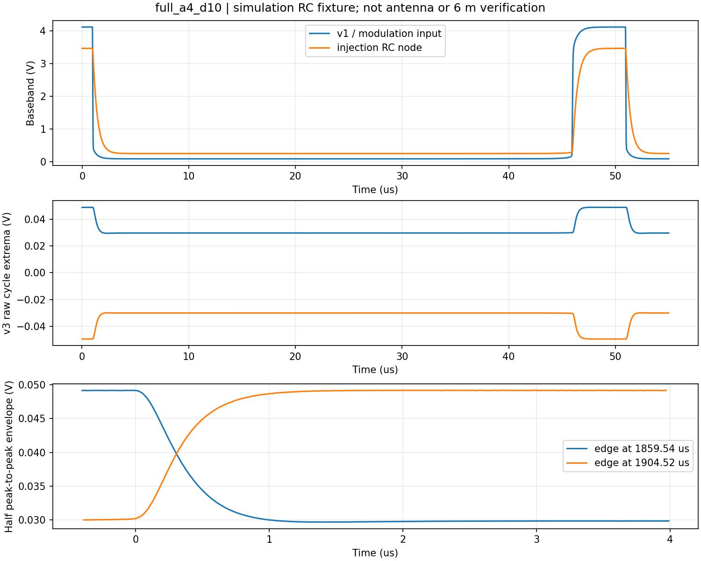

# AM-ALT.2 基带加载、v1校准与包络边沿报告

日期：2026-11-15。工作目录：`stage_am_alt2_20261115`。

状态：**本阶段仿真任务已完成（2026-11-15 20:45）**，12组组合、入选候选细步长/上限核验、边沿与工作点核验、频率步长核验和功耗预算均已闭合，结论见第8节。本阶段全部是模型和独立网表工作，不是实物验收；AM-ALT.3的天线匹配、AM-ALT.4的接收/v2/6m/电池端功耗仍未开始。

## 1. 设计目标与来源

按用户采用的AM-ALT.2～5计划，本阶段只解决实际基带加载、v1校准、偏置关系与完整包络边沿，承接AM-ALT.1基极调制路线。课程最终对象为完整发射端v3、实际接收v2、6m无线通信和TX电池端整机<0.5W；不设50Ω/2.0Vpp/1.2Vpp发射输出门槛。

来源：用户已明确的约束；[阶段任务书](00_AM-ALT.2至AM-ALT.5阶段计划与任务书.md)；[AM-ALT.1候选报告](../stage_am_alt1_base_20261115/02_基极调制与完整发射输出候选报告.md)。原课程评分及AM-REQ.1原始证据不改写。

## 2. 加载原因：幅度电位器被基极注入网络加载

既有LM393的PWM端用2.2kΩ上拉，再经20kΩ幅度电位器输出v1。原4V档上段1847.93Ω、下段18152.07Ω。接入47kΩ基极注入电阻后，它不再是原来的1MΩ∥15pF测量负载。

在50%占空比、既有电位器位置、低频器件级夹具中：

| 接法 | 高平台/V | 低平台/V | 实际Vpp | 基带5V电流/mA |
|---|---:|---:|---:|---:|
| 原独立输出，取消调制器加载 | 4.074818 | 0.090258 | 3.984560 | 3.4485 |
| 直接接47kΩ注入网络 | 3.876293 | 0.116593 | 3.759700 | 3.4730 |
| OPA197电压跟随缓冲后的输出 | 4.074836 | 0.091121 | 3.983715 | 4.4814 |

证据：`bb_unloaded`、`bb_original`、`bb_opa2022`的网表/raw/JSON。缓冲一行统计输出vm，前两行vm与v1仅隔0.001Ω测流连接；各节点均保留，未用缓冲前读数代替缓冲后输出。

直接加载时，高平台基极约1.04789V，注入电流约(3.87629−1.04789)/47k=60.2µA；低平台基极约0.84985V，电流约−15.6µA，流回电位器。结果是高电平下降约198.5mV，低电平上移约26.3mV，Vpp合计减少约224.9mV。不能只看上拉电阻，或把偏置网络当成接地电阻。

独立原输出在本轮平台定义下也不是精确4.000Vpp。因此修复需在接入调制器后测量并校准，不能按旧档位标签判定。

## 3. 候选比较与采用方法

| 方法 | 本轮证据 | 选择 |
|---|---|---|
| 保留2.2kΩ上拉和20kΩ电位器，带载校准 | 低频夹具四档均可回调；4V档基带电流约3.4764mA | 作为本阶段主候选，后续加入实际RF复核 |
| 1.5kΩ上拉＋10kΩ电位器，重新校准 | 4V档可回调，电流约4.0988mA，顶部余量变小 | 未显示必须替换原网络的收益，保留对照 |
| 注入电阻改100kΩ并补偿偏置 | 原刻度实际3.8721Vpp，加载减轻，但仍未达到4V且注入量改变 | 不能把增大电阻当成校准或调制度验证的替代 |
| 增加OPA197跟随器 | 输出3.9837Vpp，接近独立源；相对原加载接法多约1.01mA基带电流 | 隔离有效，保留候选；本轮不因固定负载可校准问题额外加入有源级 |

采用的是**固定实际接入负载下的可调范围恢复和校准**，没有宣称原电位器源阻抗已消失。后续若改变注入阻抗、缓冲结构或负载，必须重新校准。

器件资料：TI将[LM393](https://www.ti.com/product/LM393)列为开集电极比较器；[OPA197](https://www.ti.com/product/OPA197)支持4.5V起的总供电、轨到轨输入输出，典型静态电流1mA。这里的仿真分别使用项目已有TI LM393宏模型及2022版OPAx197模型，数据手册能力不能代替本电路实测。

早期2016版OPA模型直接导入失败；启用PSpice兼容后又在启动出现奇异矩阵/步长过小。`bb_opa.log`、`bb_opa_ps.log`保留，属于工具/模型失败，不能据此否定OPA197硬件。随后使用既有2022模型、PSpice兼容及低频gear夹具完成对照；RF主候选不包含该运放，使用trap。

## 4. v1带载校准与测量点

v1继续定义在幅度电位器滑端，预留测试点。主候选的`RBBPORT V1 vm 0.001`只用于连接，vm与v1几乎相同。新增RC节点mod_env位于无线发射模块内部，不改名冒充课程v1。

初始校准在实际LM393＋调制管DC负载模型上进行，随后用完整RF链复核。电位器总值仍为20kΩ：

| 目标档/Vpp | 上段RVAT/Ω | 下段RVAB/Ω | DC负载夹具实测Vpp |
|---:|---:|---:|---:|
| 1 | 15101.790 | 4898.210 | 1.000088 |
| 2 | 9897.568 | 10102.432 | 1.999990 |
| 3 | 5049.093 | 14950.907 | 2.999955 |
| 4 | 931.278 | 19068.722 | 4.000055 |

这些小数是可复现模型位置，不是采购精密阻值要求。实物须按接入后的v1幅度回调，切换占空比时再核对幅度、频率和占空比。完整C4＋LM393的12组实际读数见[组合测量表](results/matrix_table.md)，不得用本表覆盖后者。

20kΩ电位器在低频负载夹具、10%占空比时，上段接近零可达到约4.2488Vpp，上段接近20kΩ时约0.00022Vpp，显示有覆盖1～4V的调节余量。完整RF链上限另做`full_span_high_d10`与`full_span_max_d10`验证：接入调制器后满刻度仍达4.248603Vpp，与DC夹具的4.248821Vpp只差0.219mV，详见8.4节。

## 5. 包络边沿：在注入网络内部加入RC

主候选只将原来的47kΩ改成：

```text
LM393幅度电位器滑端 v1 ≈ vm
       │
     10kΩ（RPRE）
       │
   mod_env ── 47pF（CENV）── 地
       │
     37kΩ（RMINJ）
       │
   调制管基极 mb（原15kΩ/3.3kΩ偏置保留）
```

37kΩ可由36kΩ＋1kΩ串联实现；当前网表用37kΩ等效值，尚未做实物寄生验证。直流总注入电阻仍为47kΩ，电容在直流开路，保持原偏置与注入量的设计关系。电容放在串联电阻中点，避免直接把RF基极旁路到地。

机制对照使用相同LM393、校准位置、理想31MHz/1.83Vpk载波及10kΩ∥5pF输出夹具。它只用于控制变量，完整C4另行验证：

| CENV | 最大包络过冲/阶跃 | 10%高平台表现 |
|---|---:|---|
| 不加RC，原47kΩ直连 | 34.26% | 边沿明显过冲/欠冲 |
| 22pF | 14.80% | 改善不足 |
| 47pF | 1.32% | 约1.1µs内进入阶跃2%诊断带，保留高平台 |
| 100pF | 未测得正向过冲 | 高平台幅度已下降，v1约3.982Vpp |
| 220pF | 未测得正向过冲 | 窄脉冲明显削弱，v1约3.893Vpp，不采用 |

过冲统一按高低包络阶跃幅度归一化；下降沿的欠冲按负向阶跃同样计为过冲。“2%诊断带”仅用于比较建立时间，并非课程容差。没有以消除过冲为由忽略慢边沿带来的平台损失。

47pF试验中10–90%包络过渡约0.55～0.59µs，5µs高脉冲仍有平台。最终需同时检查12组v1与v3、完整周期及边沿，不仅统计末段平台THD。

## 6. 实际发射链路映射与验证范围

```text
C4晶振/已有缓冲及增益级 out（TP2功能）
  → RF注入 → QM基极mb ← 新10kΩ/47pF/37kΩ基带注入网络
QM集电极mc → CMOUT 100pF → tp3（内部点，1kΩ到地）
  → CBUF 100pF → QOB射随 → oe
  → COV3 10nF → tx_drv → ROISO 1kΩ → v3
v3：51pF、470nH串联损耗约2.29Ω、测试夹具10kΩ∥5pF
```

输出选频仍沿用AM-ALT.1的Q40假设，尚未按天线匹配。AM-ALT.3若加入匹配网络，必须重新登记完整发射输出接口与v3测点；不能把内部tp3高阻仿真当作最终课程条件。

完整C4候选从0运行至2ms，保留最后150µs，沿用C4电源爬升和uic；LM393供电为理想5V。此处只验证模型在这些条件下的启动和末窗波形，没有验证实物或所有电池电压/元件偏差。

功耗预算汇总使用`9V × (射频链电流＋基带电流＋8mA)`，其中9V电池、线性稳压、8mA稳压静态电流都是预算假设。它不能代替电池端实测，也不包含未来未确定的额外天线驱动级。

## 7. 测量与复现方法

- `scripts/alt2.py`：生成独立网表，运行ngspice-47，校准及提取v1与RF平台；已有名称拒绝覆盖，检查瞬态终止时间。
- `scripts/core.py`：从AM-ALT.1脚本复制的解析与测量工具；其ROOT指向本阶段。历史脚本未编辑。
- `scripts/edges.py`：用原始每个载波周期最大/最小值构成半峰峰值包络与中心线，无平滑滤波；检查上升、下降完整边沿、平台倾斜与建立时间。
- `scripts/full_matrix.py`、`post_checks.py`、`span_check.py`：完整源12组组合、选定候选细步长/上限验证，以及RF加载链的v1上限验证。
- `scripts/summarize_alt2.py`：汇总既有raw/JSON，不运行新仿真。
- `scripts/verify_stage.py`：重算前置清单哈希、逐工况核对网表/raw/JSON/边沿/图与记录内网表SHA-256，写出`results/stage_verification.json`；不运行电路仿真。
- `sources/ALT1_baseline_exact.cir`：前阶段精确网表副本；`sources/predecessor_sha256.json`记录前阶段及冻结网表，结束时复核。

原始raw、精确网表、模型来源、日志和测量JSON保存在本阶段。没有删除导入失败记录，也没有修改冻结电路、AM-ALT.1、AM-02.3或执行Git提交。

## 8. 最终核验

### 8.1 采用的主候选

本阶段最终采用的调制与前级结构是：**保留LM393原有的2.2kΩ上拉和20kΩ幅度电位器，在接入调制器的实际负载下按v1实测回调，基带注入改为10kΩ（RPRE）＋47pF（CENV）＋37kΩ（RMINJ）**。直流总注入电阻仍为47kΩ，CENV在直流开路，因此原偏置与注入量的设计关系不变。

不采用OPA197跟随器作为主案：它确实能把加载后的3.9837Vpp恢复到接近独立源，但要在固定负载下多耗约1.01mA基带电流，而带载校准已能让原网络覆盖1～4V。它是保留候选，不是被否定。

完整链路的输出侧仍是AM-ALT.1的有限Q选频网络，**电感Q=40是假设值，输出网络也未按天线设计**。因此本阶段交付的是"可以进入AM-ALT.3做天线与接口设计的仿真候选"，不是可以直接焊接的定版。

### 8.2 实际C4＋LM393的12组组合结果

全部为仿真，输出夹具10kΩ∥5pF，完整C4从0运行到2ms并保留最后150µs。设定值来自第4节的带载校准位置，实测值是本次仿真读数；校准误差指实测v1 Vpp减设定值。

| 设定Vpp | 占空比设定% | 实测v1 Vpp | 校准误差mV | 实测频率Hz | 实测占空比% | v3高平台Vpp | v3低平台Vpp | 调制度% | 平台THD% | 包络过冲/阶跃% | 反向欠冲% | 平台倾斜% | 10–90%过渡ns | 2%建立µs |
|---:|---:|---:|---:|---:|---:|---:|---:|---:|---:|---:|---:|---:|---:|---:|
| 1 | 10 | 0.998536 | −1.46 | 20006.52 | 10.0133 | 0.070365 | 0.059650 | 8.241 | 0.816 | 0.645 | 0.114 | 0.404 | 720.1 | 1.356 |
| 1 | 30 | 0.999559 | −0.44 | 20001.59 | 30.0125 | 0.070372 | 0.059643 | 8.252 | 0.817 | 0.536 | 0.106 | 0.314 | 724.3 | 1.361 |
| 1 | 50 | 1.000355 | +0.35 | 19998.08 | 50.0121 | 0.070373 | 0.059634 | 8.260 | 0.816 | 0.443 | 0.109 | 0.237 | 725.1 | 1.367 |
| 2 | 10 | 1.996823 | −3.18 | 20006.53 | 10.0111 | 0.080760 | 0.060116 | 14.654 | 0.834 | 0.488 | 0.098 | 0.400 | 822.8 | 1.614 |
| 2 | 30 | 1.999120 | −0.88 | 20001.61 | 30.0085 | 0.080770 | 0.060100 | 14.673 | 0.834 | 0.383 | 0.104 | 0.302 | 827.0 | 1.634 |
| 2 | 50 | 2.000694 | +0.69 | 19998.08 | 50.0075 | 0.080767 | 0.060084 | 14.684 | 0.834 | 0.329 | 0.090 | 0.231 | 831.1 | 1.631 |
| 3 | 10 | 2.994998 | −5.00 | 20006.52 | 9.9994 | 0.090020 | 0.060172 | 19.873 | 0.851 | 0.475 | 0.100 | 0.426 | 742.5 | 1.462 |
| 3 | 30 | 2.998343 | −1.66 | 20001.60 | 29.9978 | 0.090028 | 0.060146 | 19.898 | 0.851 | 0.409 | 0.099 | 0.329 | 744.8 | 1.473 |
| 3 | 50 | 3.000776 | +0.78 | 19998.08 | 49.9972 | 0.090030 | 0.060123 | 19.918 | 0.851 | 0.292 | 0.069 | 0.255 | 747.8 | 1.473 |
| 4 | 10 | 3.992633 | −7.37 | 20006.52 | 10.0007 | 0.098325 | 0.059931 | 24.261 | 0.866 | 1.347 | 0.082 | 0.483 | 588.0 | 1.082 |
| 4 | 30 | 3.996825 | −3.17 | 20001.59 | 30.0015 | 0.098332 | 0.059893 | 24.294 | 0.865 | 1.227 | 0.104 | 0.382 | 586.8 | 1.082 |
| 4 | 50 | 4.000275 | +0.28 | 19998.08 | 50.0024 | 0.098335 | 0.059860 | 24.322 | 0.865 | 1.123 | 0.051 | 0.290 | 587.1 | 1.080 |

汇总与判读：

| 指标 | 12组范围 | 说明 |
|---|---|---|
| v1校准误差 | −7.37～+0.78mV | 最大偏差出现在4V/10%工况；校准位置按50%占空比求出，改变占空比会引起小幅偏移 |
| v1频率 | 19998.08～20006.53Hz | 随占空比变化约8.45Hz（0.042%），同一档位跨幅度基本不变 |
| v1占空比 | 9.9994～50.0121% | 设定10/30/50%的实测偏差最大为0.0133个百分点 |
| v3包络占空比 | 比v1高0.025～0.059个百分点 | 由边沿过渡与包络对称性造成，属诊断量，非课程容差 |
| 低平台v3基波 | 0.059634～0.060172Vpp | 全12组极差0.538mV；偏置补偿在完整链路上仍然成立 |
| 调制度 | 8.241～24.322% | 由基带注入量决定；同幅度跨占空比极差≤0.060个百分点 |
| 平台THD（H2–H5） | 0.816～0.866% | 仅统计完整平台，不能代表整个调制波形 |
| 包络过冲/阶跃 | 0.292～1.347% | 最差为4V/10%；1～3V档≤0.645% |
| 反向欠冲 | 0.051～0.114% | 下降沿负向偏移 |
| 平台倾斜 | 0.231～0.483% | 相对包络阶跃归一化 |
| 10–90%包络过渡 | 586.8～831.1ns | 4V档最快，2V档最慢 |
| 2%诊断带建立 | 1.080～1.634µs | 全部4个边沿均可建立，无"未建立"记录 |
| 最低全窗VCE | 3.686～4.163V | 未进入饱和，无需以压缩换调制度 |

调制度与静态点的耦合结论：在同一幅度下改变占空比，低平台集电极电流估计稳定在0.4343～0.4391mA，而调制度仅变化0.019～0.060个百分点。这说明"先定低平台工作点、再用注入量定调制度"的分工在完整链路上仍成立。高平台电流随幅度从0.5342mA升到0.8451mA，所以周期平均电流会随v1幅度和占空比变化——这一点没有被"低平台不变"掩盖。



图为4V/10%工况：上格为v1与注入RC节点，中格为v3原始每载波周期极值，下格为半峰峰值包络。包络为原始极值，未做平滑，下降沿与上升沿分别按阶跃归一化。

### 8.3 包络阶跃的比例关系

以实测v1而不是档位标签为基准，各幅度相对4V档的包络阶跃比例：

| 档位 | 实测v1比值（相对4V档） | 包络阶跃比值 | 比例偏差 |
|---|---:|---:|---:|
| 1V | 0.2501 | 0.2791 | +11.6% |
| 2V | 0.5001 | 0.5377 | +7.5% |
| 3V | 0.7501 | 0.7774 | +3.6% |

三个占空比下的结论一致（各档偏差的离散度≤0.03个百分点）。**这仍是不可忽略的非线性**：低幅度档的包络阶跃相对偏大，不能宣称全幅度线性已经解决。它是否影响课程判据，取决于接收端v2的实际比例要求，属于AM-ALT.4的验证内容；本阶段只登记这一偏差，不额外自创容差。

若改用高平台绝对值对实测v1做弦线拟合（以1V与4V两点定线），2V和3V点只比弦线高1.01～1.07mV（+1.14%～+1.35%）。也就是说，非线性主要来自低平台随幅度的微小抬升，而不是高平台增益本身在大范围上弯折；这也解释了为什么边沿差异在有RC滤波后仍然存在但幅度有限。

### 8.4 入选候选的细步长与上限核验

| 工况 | 实测v1 Vpp | 调制度% | 包络过冲/阶跃% | 2%建立µs | 9V电池预算mW |
|---|---:|---:|---:|---:|---:|
| 4V/50%、0.25ns | 4.000273 | 24.320 | 1.083 | 1.061 | 226.511 |
| 4V/50%、0.125ns | 4.000274 | 24.319 | 1.090 | 1.066 | 226.514 |
| 4V/10%、0.125ns | 3.992629 | 24.263 | 1.301 | 1.077 | 231.757 |
| 上限核验（v1高位、10%） | 4.109582 | 24.734 | 1.699 | 1.036 | 231.768 |
| 满刻度上限（电位器上段≈0Ω、10%） | 4.248603 | 25.283 | 2.210 | 1.451 | 231.779 |

**v1调节范围**：在真实RF加载链上，电位器上段拉到接近0时v1可达4.248603Vpp，比4.000Vpp设定点高248.6mV（6.2%）。所以20kΩ电位器在接入调制器后仍有余量覆盖1～4Vpp，不需要更换电位器或增加缓冲。

第4节的4.248821Vpp（`range_high_d10`）是DC负载夹具读数，本节4.248603Vpp（`full_span_max_d10`）是完整RF链读数。两者只差0.219mV，说明满刻度上限本身几乎不随RF级接入而变——加载的代价体现在中低段刻度位置（见第4节校准表），而不是绝对上限。两组数据来自不同夹具，引用时须注明来源。

**步长收敛**：0.5ns→0.25ns→0.125ns时，高/低平台基波变化分别为−0.0206%/−0.0152%（0.5ns对0.125ns），调制度变化−0.003个百分点。幅度已收敛，边沿指标在细步长下同样稳定（过冲1.083%→1.090%）。

**上限工况的边沿变差**：满刻度时过冲升到2.210%、建立时间1.451µs。它超出1～4Vpp的课程输入范围，登记为调节范围边缘的行为，不参与主候选判定。

### 8.5 载波频率与数值步长

| 工况 | 最大步长 | v3实测频率范围MHz | 高/低平台Vpp | 调制度% |
|---|---:|---:|---:|---:|
| 4V/10% | 0.5ns | 30.979841–30.979878 | 0.098325 / 0.059931 | 24.261 |
| 4V/10% | 0.125ns | 30.997336–30.997392 | 0.098315 / 0.059921 | 24.263 |
| 4V/50% | 0.5ns | 30.979833–30.979863 | 0.098335 / 0.059860 | 24.322 |
| 4V/50% | 0.25ns | 30.992797–30.992835 | 0.098316 / 0.059850 | 24.320 |
| 4V/50% | 0.125ns | 30.997345–30.997383 | 0.098315 / 0.059851 | 24.319 |

步长减半，频率中点依次为30.979848、30.992816、30.997364MHz；相邻差12.968kHz、4.548kHz，比值2.85——介于严格一阶（2:1）与二阶（4:1）之间，说明频率收敛比理论二阶慢。按二阶Richardson外推，0.5/0.25ns对给出30.997138MHz、0.25/0.125ns对给出30.998880MHz，两者仍差1.74kHz。因为实际收敛阶不足二阶，这个外推只能当作量级估计：**频率在本步长范围内尚未收敛，千赫兹量级就是当前数值不确定度，不能当作电路的真实频率。**

作为旁证，按时间加权有效步长`h_eff`对线性振子做的相位误差诊断给出30.998890/30.998893/30.998895MHz三个值，随步长变化的趋势已基本消失。但这只是线性化模型的校正估计，不能替代真实收敛判据，也不改变"未收敛"的结论——它只说明剩下的偏差符合步长相位误差的特征，而不是电路行为。

这一点与晶体参数不矛盾：按`sources/C4_original.cir`的LM=2.637082nH、CM=10fF、CX0=3pF、CSTRAY=1pF、C1=C2=33pF，串联谐振约30.992622MHz，加载20.5pF后约31.000180MHz。仿真读数落在这两个值之间并随步长趋近后者，说明剩余偏差主要来自数值方法而不是元件取值错误。**真实频率、温度漂移和长期稳定性必须实测，不能引用本表。**

### 8.6 功耗预算

按`9V × (I_RF链 + I_LM393 + 8mA稳压地电流)`的预算式，12组组合落在224.881～231.757mW，全阶段最高为满刻度工况231.779mW，约为500mW上限的46%。射频链电流13.501～13.690mA，LM393电流3.447～4.220mA（随占空比变化，因为高平台注入电流不同）。

这仍然是**预算**：9V电池、线性稳压和8mA静态电流都是假设，供电源在仿真中是理想5V，没有电池内阻、压差、纹波和热效应。接收机不计入TX电池功耗，新增天线驱动级也未计入。**不能据此写整机<0.5W验收通过。**

### 8.7 阶段结论与未闭合项

| 项目 | 状态 |
|---|---|
| 加载根因定位与量化 | 已完成：高平台−198.5mV、低平台+26.3mV、Vpp合计−224.9mV |
| 带载v1校准1～4Vpp | 已完成：12组最大偏差7.37mV；RF链上限4.248603Vpp，比4V设定点高248.6mV |
| 包络边沿改善 | 已完成：过冲34.26%→1.12～1.35%（4V档），1～3V档≤0.645% |
| 偏置与调制度分工 | 已在完整链路复核：低平台极差0.538mV，同幅度跨占空比调制度极差≤0.060pp |
| 步长与幅度收敛 | 已完成：幅度变化<0.021%，边沿稳定 |
| 载波频率数值收敛 | **未完成**：外推仍有约1.74kHz不确定度 |
| 包络阶跃线性 | **仍有偏差**：1V档相对4V档偏大11.6%，需由接收端v2判读 |
| 天线阻抗与输出匹配 | 未开始，属AM-ALT.3 |
| 无线接收、v2、6m | 未开始，属AM-ALT.4，必须实测 |
| 电池端整机功耗 | 仅预算231.8mW，属AM-ALT.4实测项 |
| 采购、焊接、BOM定版 | 未开展，属AM-ALT.5 |

**AM-ALT.2的仿真任务到此闭合**：加载、校准、边沿三项目标均有可复现证据，主候选已定，接口说明见8.8。未闭合的频率数值收敛和线性偏差如实保留，不写成已解决。

### 8.8 交给AM-ALT.3的接口说明

```text
基带源：LM393（2.2kΩ上拉）→ 20kΩ幅度电位器滑端 = v1（预留测试点）
        RVAT/RVAB 按实际负载校准，4Vpp档约931.278/19068.722Ω
注入网络：v1 → RPRE 10kΩ → mod_env（CENV 47pF到地）→ RMINJ 37kΩ → 调制管基极mb
偏置：5V → RMT 15kΩ → mb，mb → RMB 3.3kΩ → 地（与AM-ALT.1相同）
调制器：QM集电极mc → CMOUT 100pF → tp3（1kΩ到地，内部观察点，不是验收点）
缓冲：tp3 → CBUF 100pF → QOB射随 → oe（330Ω到地）
输出：oe → COV3 10nF → tx_drv → ROISO 1kΩ → v3
v3现有负载：51pF到地 ∥ (470nH + 2.2887Ω) 到地，Q=40假设，夹具10kΩ∥5pF
```

AM-ALT.3需要决定的事项：

1. 天线形式、尺寸、安装位置，以及它的阻抗来源（实测或可引用的模型），不能用现在的10kΩ∥5pF夹具代替。
2. 匹配网络加在`tx_drv`与天线之间时，**v3测点必须重定义为匹配后的天线馈电点**，并重新登记；不能继续把内部tp3或匹配前节点当课程输出。
3. 加入匹配后要复测：v3幅度与波形、载波频率牵引、以及TX电流变化是否仍在0.5W预算内。
4. 电感Q=40、51pF和470nH都是当前假设；选定天线后应重新核算，并核对探头/夹具电容对v3读数的加载影响。

本阶段没有修改冻结电路、AM-ALT.1或AM-02.3的历史文件。`results/stage_verification.json`记录：前置清单190项哈希全部一致，17个核验工况（12组组合＋5个专项）的网表/raw/JSON/边沿/图齐全，网表记录SHA-256与磁盘一致，瞬态均运行到设定终止时间。全过程未采购、未焊接、未执行Git提交。

## 9. 最终组合与数值核验、阶段完成判断

状态：**AM-ALT.2 主体完成（2026-11-15 20:53）**。第8节已给出主候选、12组组合、细步长与上限、频率步长和功耗预算的结论；本节按任务书第4节第7项的验收口径，补上12组完整链组合的独立数值核验表、容差核验、候选选择与阶段完成判断。载波频率数值收敛与包络阶跃线性偏差两项未闭合项如实保留，不写成已解决。

### 9.1 12组完整链组合数值核验表

数据来源：`results/full_matrix_index.json`所列12个`full_a*_d*`组合（完整C4＋LM393、输出夹具10kΩ∥5pF、从0运行至2ms保留最后150µs、trap求解器、LM393理想5V供电，边界见第6节）；边沿指标取自对应`full_*_edges.json`，字段名按JSON原文保留。vm与v1仅隔0.001Ω测流连接，12组实测Vpp差≤8.1×10⁻⁸V，表内以vm实测为代表。i_bb_ma与`rf.lm393_supply_ma`一致，i_rf_ma与`rf.rf_chain_supply_ma`一致。数值按JSON原值四舍五入；校准误差＝实测vm Vpp−设定Vpp，个别±0.01mV的显示差异仅为舍入口径，精确值以各JSON为准。

| 设定Vpp | 占空比设定% | 实测vm Vpp | 校准误差mV | vm频率Hz | vm占空比% | i_bb_mA | i_rf_mA | v3高平台Vpp | v3低平台Vpp | 调制度% | 平台THD% | 最大过冲% | 反向% | 倾斜% | 10–90%过渡（降/升）ns | 2%建立µs |
|---:|---:|---:|---:|---:|---:|---:|---:|---:|---:|---:|---:|---:|---:|---:|---:|---:|
| 1 | 10 | 0.998536 | −1.46 | 20006.52 | 10.0133 | 4.2109 | 13.501 | 0.070365 | 0.059650 | 8.241 | 0.816 | 0.645 | 0.114 | 0.404 | 720.1/706.0 | 1.356 |
| 1 | 30 | 0.999559 | −0.44 | 20001.59 | 30.0125 | 3.8287 | 13.520 | 0.070372 | 0.059643 | 8.252 | 0.817 | 0.536 | 0.106 | 0.314 | 724.3/702.7 | 1.361 |
| 1 | 50 | 1.000355 | +0.35 | 19998.08 | 50.0121 | 3.4470 | 13.540 | 0.070373 | 0.059634 | 8.260 | 0.816 | 0.443 | 0.109 | 0.237 | 725.1/702.6 | 1.367 |
| 2 | 10 | 1.996823 | −3.18 | 20006.53 | 10.0111 | 4.2125 | 13.515 | 0.080760 | 0.060116 | 14.654 | 0.834 | 0.488 | 0.098 | 0.400 | 822.8/805.8 | 1.614 |
| 2 | 30 | 1.999120 | −0.88 | 20001.61 | 30.0085 | 3.8326 | 13.554 | 0.080770 | 0.060100 | 14.673 | 0.834 | 0.383 | 0.104 | 0.302 | 827.0/802.3 | 1.634 |
| 2 | 50 | 2.000694 | +0.69 | 19998.08 | 50.0075 | 3.4531 | 13.593 | 0.080767 | 0.060084 | 14.684 | 0.834 | 0.329 | 0.090 | 0.231 | 831.1/801.7 | 1.631 |
| 3 | 10 | 2.994998 | −5.00 | 20006.52 | 9.9994 | 4.2154 | 13.525 | 0.090020 | 0.060172 | 19.873 | 0.851 | 0.475 | 0.100 | 0.426 | 742.5/741.2 | 1.462 |
| 3 | 30 | 2.998343 | −1.66 | 20001.60 | 29.9978 | 3.8395 | 13.583 | 0.090028 | 0.060146 | 19.898 | 0.851 | 0.409 | 0.099 | 0.329 | 744.8/740.4 | 1.473 |
| 3 | 50 | 3.000776 | +0.78 | 19998.08 | 49.9972 | 3.4640 | 13.642 | 0.090030 | 0.060123 | 19.918 | 0.851 | 0.292 | 0.069 | 0.255 | 747.8/740.2 | 1.473 |
| 4 | 10 | 3.992632 | −7.37 | 20006.52 | 10.0007 | 4.2190 | 13.532 | 0.098325 | 0.059931 | 24.261 | 0.866 | 1.347 | 0.082 | 0.483 | 555.4/588.0 | 1.082 |
| 4 | 30 | 3.996825 | −3.18 | 20001.59 | 30.0015 | 3.8484 | 13.611 | 0.098332 | 0.059893 | 24.294 | 0.865 | 1.227 | 0.104 | 0.382 | 557.1/586.8 | 1.082 |
| 4 | 50 | 4.000275 | +0.28 | 19998.08 | 50.0024 | 3.4783 | 13.690 | 0.098335 | 0.059860 | 24.322 | 0.865 | 1.123 | 0.051 | 0.290 | 558.6/587.1 | 1.080 |

口径说明：过冲/反向/倾斜按包络阶跃归一化，取edges JSON文件级最大值（`max_overshoot_step_pct`／`max_reverse_step_pct`／`max_abs_tilt_step_pct`）；10–90%过渡列为该工况下降沿/上升沿的最大`transition_10_90_ns`；2%建立列为4条边沿的最大`settle_2pct_step_us`，2%是诊断口径不是课程容差；平台THD为平台窗口H2–H5最大值。每工况4条完整边沿（2升2降），12组共48条边沿全部有建立值，无"未建立"记录；10%窄脉冲的5µs高平台在所有幅度下保留，无平台损失记录。

### 9.2 核验结论

对照第4节带载校准表（DC负载夹具实测1.000088/1.999990/2.999955/4.000055Vpp），12组完整链组合：

- **v1幅度**：实测vm Vpp落在0.998536～4.000275Vpp，与设定档的偏差−7.37mV（4V/10%）～+0.78mV（3V/50%），最大相对偏差0.18%（4V/10%）。12组中11组偏差绝对值≤5.0mV，唯一超过的是4V/10%的−7.37mV；4V档在50%占空比（校准所用占空比）下偏差仅+0.28mV。完整链读数与DC负载夹具读数同档相差最多约7.4mV（4V/10%），一致在个位数mV量级，第4节校准表在接入完整RF链后仍成立，档位标签没有失准。
- **基带频率**：vm频率19998.08～20006.53Hz，相对20.000kHz标称误差−1.92～+6.53Hz（≤0.033%），远小于频率误差≤1%的课程容差。同幅度跨占空比变化约8.45Hz（0.042%）；同占空比跨幅度差异≤0.019Hz。
- **占空比**：实测9.9994～50.0121%，与设定的偏差−0.003～+0.013个百分点，远小于占空比误差≤5个百分点的课程容差。
- **v3载波频率**：12组平台读数30.979729～30.979878MHz，相对31.000000MHz偏移约−20.1～−20.3kHz，落在±1%（±310kHz）的课程容差带内；但按第8.5节的步长核验，该偏移本身混有约千赫兹量级的数值不确定度，因此本阶段只记录"读数在容差带内"，真实频率必须实测，不写为已按容差验收。
- **偏置与调制度**：低平台v3基波0.059634～0.060172Vpp，全矩阵极差0.538mV；同幅度跨占空比调制度极差≤0.060个百分点；全窗最低VCE 3.686～4.163V，未进入饱和，没有以压缩换调制度。
- **边沿**：最大归一化过冲0.292～1.347%，其中4V档1.123～1.347%、其余三档≤0.645%；10–90%过渡586.8～831.1ns；2%诊断带建立1.080～1.634µs，48条边沿全部建立。相对无RC直连的34.26%（第5节），过冲已降到百分之一量级。
- **功耗口径**：9V预算224.881～231.757mW，约为500mW上限的45～46%；这只是预算，口径见第8.6节。

逐条列出的异常档位与残留：

1. **4V/10%是12组中最差工况**：校准误差−7.37mV、过冲1.347%、平台倾斜0.483%均为全矩阵最大。与第8.4节上限核验一致——越接近满刻度边沿越差，属调节范围边缘行为，但各项仍在容差内、边沿全部建立。
2. **2V档过渡最慢**：10–90%过渡801.7～831.1ns、2%建立1.614～1.634µs为全矩阵最慢。这是边沿速率差异，不是不合格项；10%占空比时5µs高脉冲仍有平台。
3. **窄脉冲削弱只出现在被弃用的对照中**：第5节220pF对照在10%窄脉冲下v1降至约3.893Vpp、高平台受损，故不采用；采用的47pF主候选在10%工况下平台保留、无未建立边沿，本轮12组没有窄脉冲削弱。
4. **过冲残留**：4V档1.12～1.35%是相对无RC时34.26%的残余，未完全消除；属"改善后残留"，与第8.4节满刻度2.210%的边缘行为同源，不构成平台损失。
5. **载波频率的系统性偏移**：12组读数全部低于31.000000MHz约20kHz，且与第8.5节的步长不确定度叠加，不能把12组读数当作真实频率引用。

### 9.3 候选选择结论与进入AM-ALT.3的接口

**候选选择（对应任务书第4节第7项）：主候选通过本阶段目标。**主候选为保留2.2kΩ上拉＋20kΩ幅度电位器、在实际调制负载下按v1实测回调，注入网络10kΩ（RPRE）＋47pF（CENV）＋37kΩ（RMINJ），直流总注入电阻仍为47kΩ。通过依据：12组幅度/频率/占空比/偏置/边沿核验见9.1、9.2；调制度8.241～24.322%连续可调；RF加载链上限4.248603Vpp保留6.2%调节余量（第8.4节）；无平台损失、无未建立边沿。OPA197跟随器只保留为对照候选，不作为主案。AM-ALT.1仍保留为首轮仿真候选，其未闭合项随本任务书承接，不能记为课程验收完成。

未闭合项清单（如实保留，不写已解决）：

1. 载波频率数值收敛：外推对仍有约1.74kHz差异，千赫兹量级是当前数值不确定度（第8.5节）。
2. 包络阶跃线性：1V档相对4V档偏大11.6%，是否影响课程判据取决于接收端v2，属AM-ALT.4（第8.3节）。
3. 温度、元件偏差、电池电压范围未验证；LM393为理想5V供电（第6节）。
4. 天线匹配、无线接收、6m、电池端实测未开始，分别属AM-ALT.3/4。

进入AM-ALT.3的接口说明（节点映射以第6节为准，与第8.8节一致）：

```text
基带源：LM393（2.2kΩ上拉）→ 20kΩ幅度电位器滑端 = v1（预留测试点）
        RVAT/RVAB 按实际负载校准，4Vpp档约931.278/19068.722Ω
注入网络：v1 → RPRE 10kΩ → mod_env（CENV 47pF到地）→ RMINJ 37kΩ → 调制管基极mb
偏置：5V → RMT 15kΩ → mb，mb → RMB 3.3kΩ → 地（与AM-ALT.1相同）
输出：QM集电极mc → CMOUT 100pF → tp3（内部观察点，不是验收点）
      → CBUF 100pF → QOB射随 → oe（330Ω到地）→ COV3 10nF → tx_drv → ROISO 1kΩ → v3
v3现有负载：51pF到地 ∥ (470nH + 2.2887Ω) 到地，Q=40假设
当前夹具10kΩ∥5pF只是仿真夹具，不是天线阻抗，不能沿用为AM-ALT.3的天线设计依据
```

测量窗口：完整C4从0运行至2ms、保留最后150µs、沿用C4电源爬升与uic；平台窗口与边沿按各自JSON内plateaus的time_s区间取（约1.859～1.959ms）。AM-ALT.3改动网表后必须重新登记窗口与v3测点，不能沿用旧时间戳。

AM-ALT.3需要决定的事项：1) 天线形式、尺寸、安装位置及阻抗来源（实测或可引用模型），不能用10kΩ∥5pF夹具代替；2) 匹配网络加在`tx_drv`与天线之间时，v3测点必须重定义为匹配后的天线馈电点并重新登记，不能继续把内部tp3当课程输出；3) 加入匹配后复测v3幅度与波形、载波频率牵引、TX电流变化是否仍在0.5W预算内；4) 电感Q=40、51pF、470nH都是当前假设，选定天线后应重新核算，并核对探头/夹具电容对v3读数的加载影响。

### 9.4 遗留与边界、阶段完成判断

本阶段不判定的项：天线匹配与天线阻抗、6m无线通信、接收端v2、电池端实测功耗均未开始，分别属AM-ALT.3/4；6m与电池端整机<0.5W必须实测，9V预算口径224.881～231.757mW不能写成验收（第8.6节）。

仿真边界（以第6节为准）：LM393为理想5V供电；输出选频沿用AM-ALT.1的Q40假设；完整C4从0运行至2ms、只保留最后150µs；trap求解器；12组组合用0.5ns步长，载波频率读数因此带千赫兹量级不确定度（第8.5节）；37kΩ由36kΩ＋1kΩ串联实现，尚未做实物寄生验证；10kΩ∥5pF为仿真夹具而非天线阻抗。

**阶段完成判断：AM-ALT.2主体完成。**任务书第4节7项全部完成（前6项执行记录见任务书，第7项候选选择见9.3），本节的12组核验对前6项做了独立数值复核：带载校准在完整链下保持（最大−7.37mV）、频率与占空比远在课程容差内、边沿过冲从34.26%降到1.35%以下且窄脉冲平台保留、偏置与调制度分工成立。未闭合的两项（载波频率数值收敛约1.74kHz、包络阶跃线性偏差11.6%）如实保留。因此写"主体完成"，不写"全部闭合"，也不写课程验收通过。
