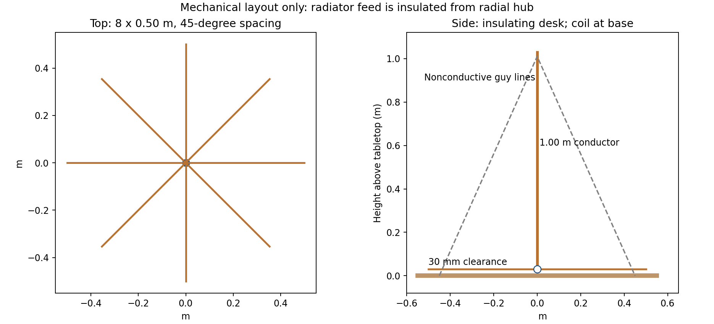
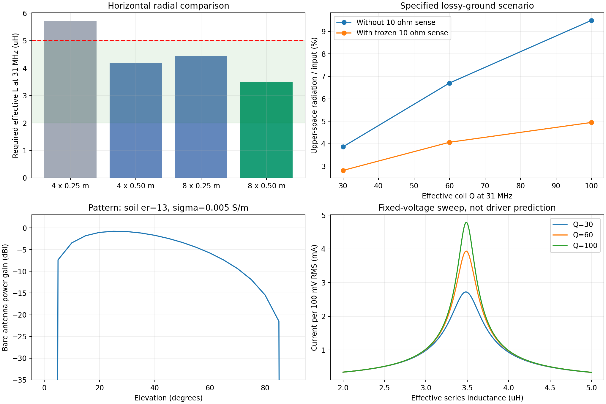

# AM-ALT.3.1｜31 MHz 桌面天线结构与匹配网络

日期：2026-11-16。全部文件在本阶段独立目录内。没有采购、焊接或修改冻结电路。

## 1. 本轮决定与完成边界

用户已明确：**木质或塑料桌面，可留约 1 m × 1 m**。据此选择：

| 项目 | 本轮结构规格 |
|---|---|
| 辐射体 | 1.000 m 垂直单极子；铜导体直径 1.0 mm，模型半径 0.5 mm；底部馈电 |
| 地网 | **8 根水平径向铜线，每根从公共中心到末端 0.500 m**，方位间隔 45°；直径 1.0 mm |
| 安装 | 地线平面距绝缘桌面约 30 mm；非金属底座，尼龙拉线扶正辐射体；占地最大跨度 1.00 m |
| 调谐 | 串联空心可调线圈；31 MHz **有效串联电感初调 3.49 µH**；扫描范围 2.0～5.0 µH |
| 线圈机械初值 | 导线中心直径 25 mm，1 mm 漆包铜线；16 匝、绕组轴向长约 35 mm 起调；备 18 匝及 12/14/16 匝临时抽头的调整能力 |
| Q | 31 MHz 端口有效 Q≥60 为验收目标，100 为争取目标；**未实测，不能标作已达到** |
| 接口 | 冻结射随输出 → 原 10 Ω 取样 → 调谐线圈 → 辐射体；8 根地线汇接发射机 RF 公共地 |

**材料与结构方案已形成，可据附表一次性备料；实物 RF 性能尚未验收。** 本轮没有证明 6 m 通信、接收端 v2 达标或真实线圈 Q。最终使用抽头和拉伸长度必须由安装状态下调峰决定；材料采购规格不依赖把某一个匝数误当成精密电感。

本报告代替旧主报告的理想地面天线估算作为本结构的设计依据，不覆盖、重写历史文件。2.957 µH 不再是本结构名义值；也没有选购 27 MHz、433 MHz 等成品天线。



## 2. 求解器与基准验证

使用 **nec2c 1.3.1**，即公开 NEC-2 的 C 移植版，原包来自[作者发布目录](https://www.qsl.net/5b4az/pkg/nec2/nec2c/)。没有重写电磁矩量法。Windows 编译只替换信号注册和计时接口、版本字符串；电磁计算源文件未改。原包、原源码、Windows 副本、差异补丁及 exe 均保留于 `tools/`。

编译：在 `tools/nec2c-win/` 执行 `gcc -O2 -o ../nec2c.exe *.c -lm`。文件名使用 ASCII 相对路径运行，避开求解器 81 字符文件名缓冲区与中文路径兼容问题。

| 核验 | 结果 / 判据 |
|---|---|
| [NEC 官方例 1](https://www.nec2.org/part_3/examples/ex1.html) | 输出 82.698+j46.306 Ω；[官方参考](https://www.nec2.org/part_3/examples/ex1.out)为 82.6979+j46.3060 Ω；误差 <0.02 Ω |
| 半波偶极子与 PEC 地面四分之一波单极子的镜像关系 | 21/41/81 段对照，检查 Zdipole≈2Zmonopole；详见 `benchmarks.json` |
| 最终模型网格细化 | 辐射体 40/80/120 段，径向线分别 20/40/60 段；80→120 段 R 变化约 0.51%，X 变化约 0.009% |
| 自由空间功率闭合 | 选定结构 120 段模型：方向图积分功率 + 铜损耗 = 输入功率的约 96.07%；残差约 3.93%，低于本轮 5% 筛查上限 |
| 端口串联加载交叉验证 | Q30/60/100 均用 NEC LD 卡实际加载，再与 Zant+Rcoil+10+jωL 对照，R 误差 <0.01 Ω，残余 X <0.02 Ω |

上述 5% 是项目数值筛查门槛，不是厂家精度保证或课程评分条款。阻抗收敛不能消除模型形状、地板、桌板和线圈寄生误差。**效率只报工程精度，不应把小数位当成实物准确度。** 首轮部分 45° 下倾模型功率残差超过 5%，不用于最终定型。

## 3. 模型、材料和环境定义

- `GW` 显式画出 1 m 辐射体与每根径向线。电压源位于辐射体底段，电压幅值为 1 V 峰值。该测试源不是发射机供电。
- 铜电导率取 5.8×10⁷ S/m；所有导线半径 0.5 mm。自由空间对照不是无限 PEC 地面。
- 桌面最终基准的地线高度取离地 0.83 m，即示例桌高 0.80 m + 30 mm 垫高。实际桌高未知，扫 0.68/0.83/1.03 m。
- 有损地面用 NEC Sommerfeld/Norton：三组 **假设场景** (εr,σ)=(5,0.001)、(13,0.005)、(20,0.03 S/m)。不是实测教室地板，也不表示木桌的介电常数。遵守 [NEC 结构建模规则](https://www.nec2.org/part_3/secii.html) 与 [GN 卡定义](https://www.nec2.org/part_3/cards/gn.html)，地线全部在地面上方。
- NEC-2 不直接模拟该木板/塑料板的体介电结构，也未模拟完整人体、墙体、钢筋和电池外壳。因此另扫安装并联电容 0～2 pF、线圈自容 0～2 pF，明确是集中参数敏感性，不是这些物体的全波解。
- 方向图按 5°×5°采样；自由空间积分整球，有损地面积分上半球。效率指进入上半空间的远区空间波功率/端口输入功率；缺失部分包括地面相关耗散及未计入的地面传播通道。**不能直接把 NEC 默认输出的“100%－导体损耗”当作含土壤的辐射效率。** 参见 [RP 卡定义](https://www.nec2.org/part_3/cards/rp.html)。

## 4. 地网比较与选型

下表使用 31 MHz、有损地面中间场景、0.83 m 高度、120 段辐射体；不含线圈和 10 Ω。

| 地网 | 最大跨度 | Zant / Ω | 需抵消容抗的有效 L / µH | 决策 |
|---|---:|---:|---:|---|
| 4×0.25 m 水平线 | 0.50 m | 3.903−j1115.4 | 5.726 | 超过 2～5 µH 扫描范围，不选 |
| 4×0.50 m 水平线 | 1.00 m | 4.137−j818.62 | 4.203 | 可制作，但线圈损耗更高、向上调节余量较小 |
| 8×0.25 m 水平线 | 0.50 m | 3.890−j866.56 | 4.449 | 紧凑备选，现有空间不需要付出该代价 |
| **8×0.50 m 水平线** | **1.00 m** | **4.088−j679.77** | **3.490** | **选定**；相同空间下减小线圈电抗和损耗 |

主扫描还覆盖 4/8 根、0.25/0.50/0.75/1.00 m、下倾 0/30/45°，数据在 `geometry.json`。下倾方案因用户明确桌面安装而不进入 BOM。地线长 0.75/1.0 m 的水平方案也超出当前桌面空间。

小型金属面用 0.20/0.30/0.50 m 边长方形**细线网格代理**比较；交点均为电连接端点，做 4/6/8/12 网格细化。该代理的等效导体面积随网格改变，不能冒充连续铜板：例如 0.30 m 网格所需 L 随 4→12 格由 4.66 降至 4.14 µH，未达到足以采购实体铜板的稳定性。故本轮不选金属板，不据此给实体铜板下精确效率结论。完整连续金属面若成为必要候选，应另用合适表面网格/求解器验证。

选定模型的 40/80/120 段数据分别为 4.191−j684.65、4.109−j679.83、4.088−j679.77 Ω。增加地线数的收益来自全波阻抗变化，不是预先指定“8 根一定最好”。

## 5. 调谐、Q、损耗与方向图

选定有损地面场景下：天线端口等效串联 C≈7.553 pF；L_eff=3.490 µH；铜损耗等效约 0.158 Ω；上半空间辐射等效约 1.033 Ω。其余约 2.896 Ω 为本场景剩余地面相关通道等效量，并非实物测得的接地电阻。

| Q@31MHz | 线圈等效串联损耗 / Ω | 调谐后总 R（不含/含 10Ω） / Ω | 空间波效率（不含/含 10Ω） |
|---:|---:|---:|---:|
| 30 | 22.659 | 26.747 / 36.747 | 3.86% / 2.81% |
| **60** | **11.330** | **15.417 / 25.417** | **6.70% / 4.07%** |
| 100 | 6.798 | 10.885 / 20.885 | 9.49% / 4.95% |

自由空间同结构效率会更高；这里刻意保留地面场景与取样电阻的影响，**不沿用旧理想单极子的 28.5%**。这几项是不同边界的结果，不能混成一个保证值。

2.0～5.0 µH 每 0.01 µH 扫描，Q=30/60/100；24 个桌面细化工况共 21,672 个集中参数组合，见 `tuning_scan.csv`，并由三组实际 NEC LD 加载验证连接正确。电流峰值在有限 Q 下与 X=0 可有轻微偏差，因为 Rcoil随L变化；本报告的名义调谐值按 X=0 定义。

裸天线本场景最大空间波增益约 −0.78 dBi，主瓣仰角约 25°；加入线圈与取样电阻后增益进一步降低。该方向图不是 6 m 同桌链路的测量，不可用最大增益冒充水平方向接收增益。



## 6. 线圈制作规格及测量闭环

选择空心单层线圈：在没有指定磁芯材料的 31 MHz 复磁导率、损耗曲线和实测 Q 前，磁芯方案不能给出可核验优势。没有把任意磁芯编号写进 BOM。

低频机械初算采用 Wheeler 单层线圈公式，r、l 用英寸：L[µH]=r²N²/(9r+10l)。来源：[Wheeler 1928 原论文所在期刊](https://www.worldradiohistory.com/Archive-IRE/20s/IRE-1928-10.pdf)。它只确定绕制起点，不替代 31 MHz 的自谐振、Q 和安装测量。

| 导线中心直径 | 匝数 | 绕组轴向长 | 低频几何电感估算 |
|---:|---:|---:|---:|
| 25 mm | 16 | 30 / 35 / 40 / 60 mm | 3.818 / 3.405 / 3.073 / 2.210 µH |
| 25 mm | 18 | 30 / 35 / 40 / 60 mm | 4.832 / 4.309 / 3.889 / 2.797 µH |
| 25 mm | 14 | 30 / 50 mm | 2.923 / 1.969 µH |
| 25 mm | 12 | 25 / 30 mm | 2.444 / 2.147 µH |

- 采用外径 24 mm 可移除绕线芯棒，1 mm 导线形成约 25 mm 中心直径；线圈成形后移除芯棒，端部 PTFE 夹片支撑。轴向拉伸可调，不能使用金属穿心螺栓。
- **初调用 16 匝、约 35 mm；采购材料允许重绕为 18 匝并试 12/14/16 匝抽头。** 抽头只是调试选择，剩余开路匝仍有耦合和寄生；确定后去掉不用的尾段，再复测。不能把带开路尾段的抽头值直接等同于独立 N 匝表格。
- 粗调选匝，细调轴向间距。整个调整集覆盖低频约 1.97～4.83 µH，另可把 18 匝压至 25 mm 得约 5.50 µH；在 31 MHz 的有效范围须测，不能承诺每一种安装下都自动覆盖 2～5 µH。
- 自容使 L_eff 不等于几何 L。以需要 L_eff=3.49 µH 为例，Cp=0/0.5/1/2 pF 时，所需低频 L0 可按 L0=L_eff/(1+ω²L_effCp) 估算。完整安装电容×自容表见 `parasitic_sensitivity.json`。
- Q 使用 **Im(Zcoil)/Re(Zcoil)** 的端口有效值。串联模型验收：31 MHz 为感性、可调到目标电抗、Q≥60；争取 Q≈100。建议自谐振频率不低于 62 MHz（本轮工程裕量目标），不达标则减少自容/改绕组后重测，而非拿低频电感表读数直接验收。

100 pF、220 pF 电容**仅用于拆下线圈后的独立谐振测量**。低频 L 约 2～5 µH 时，100 pF 的谐振频率约 7.12～11.25 MHz，220 pF 约 4.80～7.59 MHz，均不是 31 MHz Q 测量。两点 f1/f2 可拟合 L0 与总寄生 C：L0=(1/ω2²−1/ω1²)/(C2−C1)，Cp=1/(ω1²L0)−C1；需要扣除夹具寄生并计入电容公差，差分结果可能放大误差。**不得把这两个电容永久并到天线上。** 高频 Q/自谐振仍需单独测量，参见 [Coilcraft 应用频率测试说明](https://www.coilcraft.com/en-us/resources/application-notes/testing-inductors-at-application-frequencies/) 和[夹具补偿说明](https://www.coilcraft.com/en-us/resources/application-notes/calibration%2C-compensation%2C-and-correlation/)。

## 7. 桌面、馈线和机械接口

冻结电路接线使用物理节点名，避免旧文档 v3 的前后混称：

```text
QEF 发射极 ef_e ── 原 RSENSE 10Ω ── sense_out ── 可调空心线圈 ── ANT_FEED
                                                                    │
                                                              1.000 m 辐射体
RF 公共地 ── 短而宽的连接 ── 8 根 0.500 m 水平径向线的公共汇接点
```

ANT_FEED 是线圈后天线端口；ef_e 是线圈前驱动输出。二者电压不可互换。辐射体与地线汇接点必须绝缘；示意图中的中心是空间投影，不是把两个节点短接。线圈、取样和冻结驱动板紧邻底座，RF 连接目标总长≤20 mm，避免额外长馈线。

本结构不需要为“看起来标准”额外采购 50 Ω 同轴、SMA 或 50 Ω 匹配网络；冻结输出不是已验证的 50 Ω 源。若实物必须使用同轴，其差模传输线和外导体共模应另行加入模型，不能把屏蔽层当理想地。

已对公共地新增 0.10/0.30/0.50 m 垂直导体作共模压力测试，选定结构的所需 L 由约 3.490 降至 3.463/3.432/3.391 µH。它是“额外接地导体参与辐射”的显式 NEC 模型，不是完整同轴内外导体仿真。调试时长示波器地线、电池引线位置都应固定；接仪器后要复核峰值位置。

9 组高度与地面场景的名义 L 约 3.483～3.496 µH，但效率随环境明显变化；该小电感区间**不包含真实桌板介电加载**。保留至少 30 mm 离桌垫高；端子、胶、支撑件尽量远离高电压端。0～2 pF 安装电容是压力范围，不是实测上界。图中的 1 m 导体用三条细尼龙拉线扶正，避免采购粗金属支柱改变天线。

底座 60×60×10 mm PTFE、200×200×18 mm 木托板、30 mm 尼龙垫高件均为机械装配尺寸，不是声称通过电磁优化的唯一尺寸。加工端子实际尺寸尚未全波纳入，靠寄生敏感性和装后调峰覆盖，若调不入范围则回填模型。

## 8. 冻结驱动的独立负载回填

源文件为上一阶段 `round2_20261116/netlists/d05.cir`；哈希保存于 `frozen_driver_sha256.json`。仅在新目录副本中替换天线 L/R/C 等效负载及输出文件名、积分步长；晶体管、偏置电阻、供电、10 Ω取样均未改。

NEC 31 MHz 负载回填为 C=7.5526 pF、L=3.48996 µH，R=Rant+ωL/Q；Rant 已含铜损和地面通道，**没有再叠加旧 1 Ω 地损**。这是单频局部等效，不是宽频天线宏模型；30.69～31.31 MHz 的 NEC 阻抗点另存 `selected_environment.json` 供检查。

电流与步长对照详见同目录 `驱动回填结果.md` 和 `driver_tabletop_summary.json`。只可报告冻结驱动在该假设负载下的载波/总 RMS；不得把恒压扫描电流或 1 V 峰值 NEC 测试源电流当成真实发射机输出。该负载的空间波辐射量、方向性及接收有效高度都已改变，**不能机械复用旧 3.75～5.30 mA 需求阈值来宣布距离通过**。

## 9. 可执行交付及剩余验收

材料规格和数量见 `采购BOM_单套发射天线.md`。没有检索价格、卖家或加入购物车。采购一套发射端制作材料即可；本轮没有授权更换冻结接收端天线，因此不擅自把数量乘二。

后续实物闭环：测线圈 L0/自容 → 测 31 MHz 端口 Q 与自谐振 → 在固定桌面结构上调电流峰 → 回填实测阻抗/损耗 → 检查完整 AM 波形与接收端 v2 → 实测通信距离。**这些未完成的实测项限制的是性能验收，不应再转而采购不明频段的成品天线。**

复现顺序：`run_nec.py`（首轮与细化）、`final_cases.py`（下倾历史对照）、`tabletop.py`（用户明确桌面后的比较）、`selected_analysis.py`（最终结构、加载验证与扫描）、`driver_check.py`（冻结驱动独立回填）、`make_outputs.py`（图表）。原始 `.nec/.out` 全部保存；证据哈希见 `evidence_sha256.json`。
