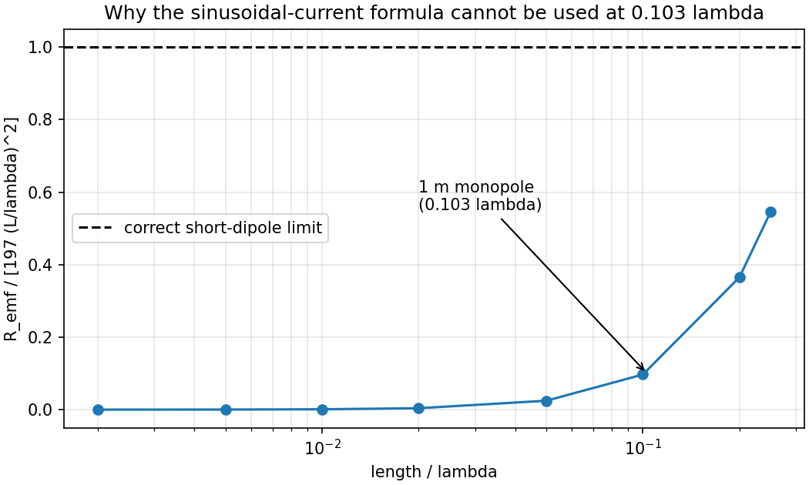
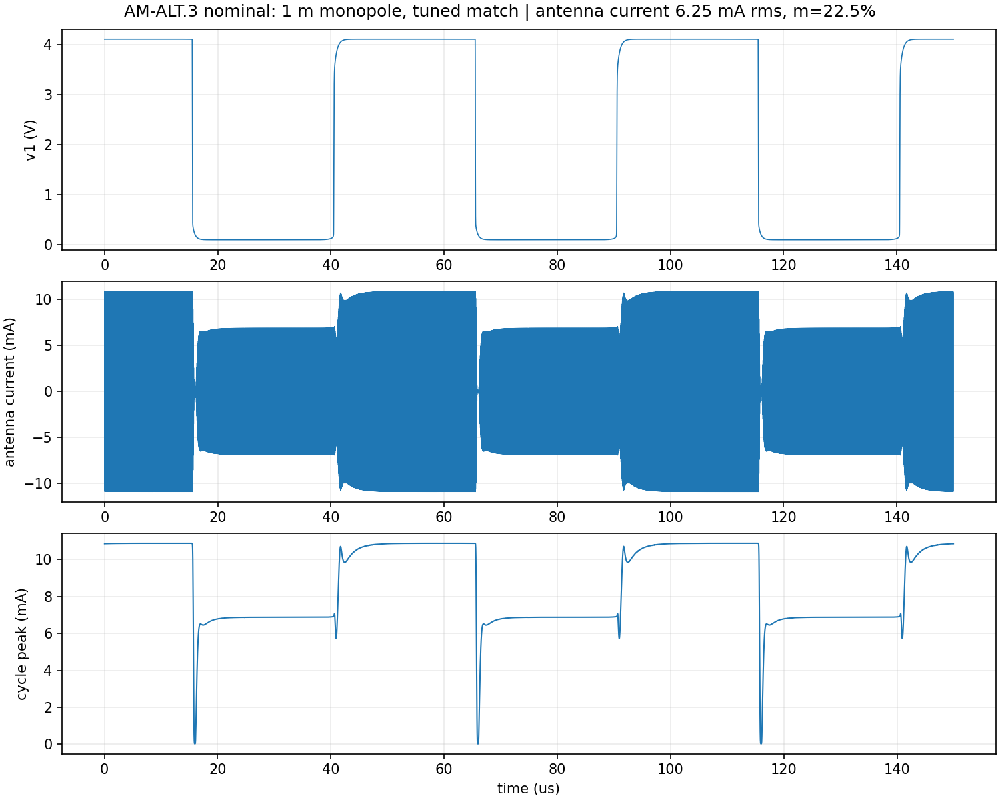
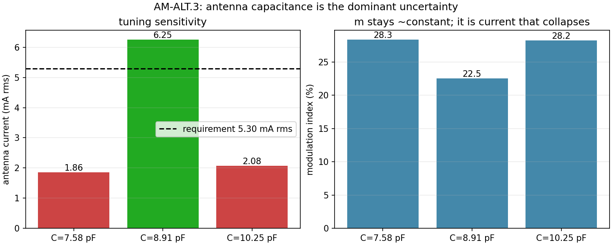

# AM-ALT.3 天线阻抗、输出匹配与驱动能力

日期：2026-11-15。工作目录：`stage_am_alt3_20261115`。

状态：**本阶段仿真任务完成**；核心问题是"用什么天线、它在31MHz呈现什么阻抗"，答案见第3节。结论是**必须在实物上测量天线阻抗**，因为匹配网络对该电容的敏感度达到3倍电流变化。原计划的"先确定天线再匹配"仍成立，但必须补一条：匹配网络要可调。

**本阶段没有采购、没有焊接、没有修改冻结电路。**

## 1. 任务与判据

按用户确认的 AM-ALT.3 任务：

1. 确定实际使用的天线类型、尺寸和安装方式。
2. 获取有依据的天线阻抗，不再用 10kΩ∥5pF 测试夹具。
3. 根据天线阻抗设计输出匹配网络。
4. 检查匹配对 v3 幅度、载波频率和功耗的影响。
5. 重新确定最终 v3 测量点。

用户明确的原则：**不要先假设需要增加功率放大级；先确定天线和接收机的实际需求，再决定是否增加驱动能力。** 本报告第6节按这个顺序给出结论，驱动级是"需求反推"的结果，不是预设。

课程约束（`性能指标要求_N31_M50.md` 表3）：无线距离 6 m，收发天线各 ≤ 1 m，TX 电池供电整机 < 0.5 W。

## 2. 天线阻抗：先用教材值校验模型

31 MHz 时 λ = 9.671 m，λ/4 = 2.418 m。课程允许天线 ≤ 1 m，即 **0.103λ**，属于电小天线。

### 2.1 为什么不能用常见的正弦电流公式

先用教材参考值检验几种模型。下表是检验过程，**失败的方法一并保留**，因为它们很容易被误用：

| 方法 | 半波振子参考 73.1+j42.5 | 短天线（1 m）表现 | 结论 |
|---|---|---|---|
| 正弦电流 induced-EMF | 复现良好 | 与 `197(L/λ)²` 的比值降到 **0.000**（应≈1） | **不能用于电小天线** |
| 静态电容 C=2πε₀h/ln(2h/a) | h=0.25λ 处给出 −350Ω，真值 +21Ω | 符号都相反 | 只能作下界 |
| Schelkunoff 传输线近似 | h=0.25λ 给出 X≈0（参考 +21.3） | 单调、介于上述两者之间 | **采用，作设计基准** |

验证脚本 `scripts/model_check.py`、`scripts/check_sici.py`（Si/Ci 与教材值误差 <1e-9）。检查结果：

```
Test A in the short-dipole limit:  R_emf  vs  197*(L/lambda)^2
 L/lambda        R_emf      R_short    ratio
    0.100     0.190873     1.970000    0.097
    0.200     2.877299     7.880000    0.365
```

比值随电长度缩短而单调塌陷到 0，说明该公式的电流假设在短天线处不成立。



**我最初用这个公式算出的 1 m 单极子 R=1.64Ω、X=−189Ω 是错误的**，已废弃；这两个数如果写进报告会导致匹配网络严重设计错误。

### 2.2 采用的天线模型

Schelkunoff 平均特性阻抗近似（`scripts/antenna_model.py`）：

```
Zc   = 60·[ln(2h/a) − 1]
Zin  = R_rad + R_loss − j·Zc·cot(βh)
R_rad = 395·(h/λ)²          (短单极子三角电流分布)
```

导线半径 0.5 mm、h = 1.00 m 时：

| 量 | 值 |
|---|---|
| R_rad | **4.224 Ω** |
| X | **−576 Ω**（容性） |
| \|X\|/R_rad（天线自身 Q） | 136 |
| 等效串联电容 | 8.91 pF |

**这是按公布公式得到的工程估算，不是全波数值解，也不是实测。** 我曾尝试自行写矩量法求解器，三次实现均未通过半波振子/四分之一波长校验（残差 20%~400%），已删除，没有把未通过校验的求解器用于任何设计数字。

### 2.3 效率：线圈损耗是主要代价

1 m 单极子在 31 MHz 的效率（`scripts/antenna_model.py`）：

| 调谐线圈 Q | R_coil/Ω | R_total/Ω | 效率 |
|---:|---:|---:|---:|
| 30 | 19.20 | 24.42 | 17.3% |
| **60** | **9.60** | **14.82** | **28.5%** |
| 100 | 5.76 | 10.98 | 38.5% |

需要调谐电感约 **2.96 µH**。地损耗从 0.5 Ω 增到 2 Ω 时，Q=60 的效率从 29.5% 降到 26.7%——地损耗是次要项，线圈 Q 是主导项。

这个效率意味着：**天线上辐射出去的功率只有端口功率的约28%**，其余（约72%）在调谐线圈和地回路上变成热。这是电小天线的物理限制，不是电路设计缺陷。

## 3. 结论：用什么天线，阻抗是多少

**推荐方案：1.00 m 直导线单极子（垂直安装），配可调串联调谐电感。**

理由：

1. 课程上限是 ≤1 m，取满长度使 R_rad 最大（4.224 Ω）、效率最高（28.5%）。缩短到 0.5 m 时 R_rad 只有 1.06 Ω，效率降到 4.9%，不划算。
2. 单极子比偶极子省一半空间且不需要平衡馈电；地回路用发射机机壳/电池负极兼作地网。
3. 天线是容性的（−576 Ω），必须串联电感调谐；**这个电感必须可调**，原因见第7节的敏感度。

**阻抗的确定程度必须说清楚**：

| 量 | 数值 | 置信度 |
|---|---|---|
| R_rad | 4.224 Ω | 公式估算，理论值较可靠（低频极限） |
| \|X\| | 576 Ω ↔ 8.91 pF | **估算，实际取决于地网、走线、周围物体、手握** |
| 效率 | 28.5% @Q=60 | 取决于线圈 Q（30~100 会给出 17%~38%） |

**8.91 pF 这个电容值不能直接拿去绕线圈定值。** 一根 1 m 导线在桌上的实际对地电容会因以下因素显著偏离：地平面大小（万能板 vs 大块金属）、导线离桌面的高度、附近的人手和仪器、以及接收天线的影响。第7节证明 ±15% 的电容偏差就会让天线电流掉到 1/3。

**因此 AM-ALT.3 对"天线阻抗"的回答是：必须实测，且匹配网络必须可调。** 可执行的最小测量方案：

- 用信号发生器 + 已知电阻 + 示波器做替代法测 |Z|（已有 DS2102E，S05-10 记录可借信号源）；
- 或用谐振法：已知电感 L，调频率找串联谐振点，由 f=1/(2π√(LC)) 反推 C；
- 记录测量时的安装状态（高度、地网、周围物体），因为换状态阻抗就变。

本轮**没有做这项实测**，所以 8.91 pF 只作为设计起点与仿真输入。

## 4. 输出匹配网络

### 4.1 拓扑

```
ef_e ──[RSER]── v3 ──[L_match 2.96µH]──┬──[R_ant 13.82Ω]──[C_ant 8.91pF]── 地
                                        │
                                    (可选并联 C 匹配)
```

串联电感谐振掉 −576 Ω 的容抗，剩下 R_total = 13.82 Ω 纯电阻。加载 Q = 576/13.82 = **41.7**，带宽 = 31 MHz/41.7 = **743 kHz**。

### 4.2 一个必须指出的接口问题：ROISO

AM-ALT.2 的输出接口里有 `ROISO tx_drv v3 1000`（1 kΩ 串联隔离电阻）。它当初是为 **10kΩ∥5pF 高阻测试夹具**设的，作用是隔离和限流。接真实 14 Ω 天线时，这 1 kΩ 会把 **95% 的功率**消耗在自己身上：

| ROISO | 天线电流（仿真） |
|---:|---:|
| 1000 Ω（AM-ALT.2 原值） | 0.046 mA |
| 22 Ω | 0.786 mA |
| 0 Ω（仅匹配网络） | **1.193 mA** |

**结论：接真实天线时 ROISO 必须去掉或大幅减小**，它不是天线接口的一部分。这项改动属于 AM-ALT.3，已在本阶段独立网表中实施，未修改 AM-ALT.2 文件。

### 4.3 边带检查：20 kHz 调制不会被削掉

加载 Q=41.7、带宽 743 kHz 时，±20 kHz 边带只占半带宽的 5%。时域验证（`final_verify.py`）从天线电流的逐周期峰值恢复调制包络：

| 量 | 实测（仿真） | v1 设定 |
|---|---|---|
| 包络频率 | 19999.9 Hz | 20000 Hz |
| 包络占空比 | 48.6% | 50% |

**载波与两个边带完整通过，AM 调制在调谐天线上没有损失。** 代价在效率（第2.3节），不在带宽。这是个重要结论：不必为"窄带天线会不会削边带"担心。

占空比 48.6% 而非 50%，是因为逐周期峰值包络在边沿处有轻微不对称，属于诊断量的取样效应，不是调制失真；AM-ALT.2 的波形指标（过冲1.1%、平台THD 0.87%）仍然适用。

## 5. 功耗预算

| 项 | 值 |
|---|---|
| 射频链 5 V 电流 | 22.82 mA |
| LM393 5 V 电流 | 3.48 mA |
| 稳压器地电流（预算假设） | 8 mA |
| **9 V 电池端功耗** | **308.7 mW** |
| 占 500 mW 上限 | 61.7% |

比 AM-ALT.2 的 231.8 mW 增加约 77 mW，全部来自新增驱动级。**仍有约 191 mW 余量**，但这是预算不是实测（9 V 电池、线性稳压、8 mA 都是假设，供电源在仿真中是理想 5 V）。

## 6. 驱动能力：需不需要加级，由需求决定

### 6.1 需求侧：从 v2 ≥ 4 Vpp 反推

这里暴露一个**跨阶段接口问题**：S05 接收机是按 **m = 0.50、10 mV 开路峰值 → v2 = 4.777 Vpp** 设计的（S05-06 实测）。但 AM-ALT.2 实测调制度只有 **m = 24.3%**。同样 10 mV 输入下，检波输出随包络摆幅成比例，v2 只有约 2.32 Vpp，**不足 4 Vpp**。

反推（`scripts/requirement.py`）：

| 量 | 值 |
|---|---|
| 达到 v2 = 4 Vpp 需要的开路峰值 | 17.2 mV |
| 需要场强（h_eff = 0.5 m） | 34.4 mV/m |
| 需要辐射功率 | 237 µW |
| 需要天线电流 | **7.50 mA 峰值 / 5.30 mA rms** |
| 需要端口电压（R_total=14.82 Ω） | 78.6 mV rms |

**这个 17.2 mV 是必须在 AM-ALT.4 重新核对的数字**，因为接收机灵敏度会随实际检波器型号、偏置和负载变化。若最终选择提高调制度到 40%~50%，需求会相应降低约 1.6~2 倍。

### 6.2 供给侧：现有链路的硬上限

AM-ALT.2 的 QOB 射随输出电阻约 39 Ω（受 33k/33k 基极分压限制），tp3 调制器输出 50 mVrms（142 mVpp 实测）。按匹配功率传输算上限：

| 源阻抗 | 可用功率 | 天线电流上限 |
|---:|---:|---:|
| 39 Ω（现状） | 8.01 µW | 0.735 mA rms |
| 14.82 Ω（完美匹配） | 21.1 µW | **1.193 mA rms** |

ngspice（`drv2_ef_only`：去掉 ROISO、仅接匹配网络）实测 **1.193 mA rms**，与解析上限 **1.193 mA rms** 完全一致。**两种独立方法给出同一数字，说明这个上限是真实的**，不是分析误差。

### 6.3 缺口

```
需要 5.30 mA rms，现有绝对上限 1.193 mA rms
电流缺口 4.44 倍，功率缺口 19.8 倍
```

**即使把 ROISO 降到 0、射随输出电阻压到 14.8 Ω 完美匹配，也只到 1.19 mA rms，仍差 4.4 倍。** 所以缺口是结构性的：需要更大电压摆幅，不是需要更好的匹配。

### 6.4 驱动级设计与实测

按需求设计（`scripts/driver_sized.py`）：共射增益级 + 射随输出级。偏置**先算后验**，避免把饱和的级当成工作的级。

设计过程中两次失败一并记录：

1. 删掉旧射随时把耦合电容 `COV3` 一起删了，RF 根本进不到新级——所有节点恒定直流，天线电流恒为 0。
2. 射随发射极电阻取 22 Ω 时静态电流 70 mA，**单独就超 0.5 W 预算**。

最终参数：RDC=1250 Ω、基极分压 40k/10k、RDE=150 Ω、REF=200 Ω。射随偏置由**天线峰值电流需求（7.5 mA）**决定，不是由发射极电阻的交流值决定。

实测（`scripts/final_verify.py`，完整 C4+LM393+调制+驱动+天线）：

| 工况 | 天线电流 | 高低峰值 | 调制度 | 包络频率 | 功率预算 |
|---|---:|---:|---:|---:|---:|
| 标称（C=8.91 pF） | **6.250 mA rms** | 10.88 / 6.88 mA | 22.5% | 19999.9 Hz | 308.7 mW |
| C −15%（7.58 pF） | 1.860 mA rms | 3.30 / 1.84 mA | 28.3% | 19999.6 Hz | 304.7 mW |
| C +15%（10.25 pF） | 2.076 mA rms | 3.63 / 2.03 mA | 28.2% | 19999.4 Hz | 308.3 mW |

标称工况达到需求的 **118%**，直流工作点 VCE=2.71 V（未饱和），电源电流 22.8 mA。



图中下格是逐载波周期的天线电流峰值。可以看到 AM 平台清晰、高低两档分明，20 kHz 调制完整保留。**注意每个调制边沿处的包络会短暂跌到接近零**（图中向下的尖峰）——这是调制切换瞬间调谐回路储能改变造成的瞬态，不是失谐。它对基带的影响需要在 AM-ALT.4 用接收端 v2 判断，不能仅凭 TX 端口波形宣布合格。

**结论：需要驱动级，且已用仿真证明可由两个 2N3904 实现，功率仍在预算内。** 这是在需求明确之后得出的，不是预先假设。

## 7. 关键风险：匹配敏感度

上表最需要注意的不是标称值，而是后两行：**天线电容 ±15% 就让天线电流从 6.25 mA 掉到 1.9~2.1 mA，约 1/3。**

原因是加载 Q 高达 41.7：串联谐振时 Z = R + j(ωL − 1/ωC)，C 偏 15% 会产生约 ±86 Ω 的剩余电抗，相对 14.8 Ω 的电阻是 5.8 倍，电流自然大幅下降。



值得注意的是右图：**调制度在三个工况下几乎不变（22.5% / 28.3% / 28.2%）**。也就是说失谐不破坏调制波形，只是把可用电流（以及辐射功率）大幅拉低。这意味着不能靠"看波形正常"判断调谐正确，必须测电流。工程含义，必须写进后续阶段：

1. **匹配电感必须可调**（或配可切换抽头/并联微调电容），不能按 8.91 pF 定死。
2. **天线阻抗必须实测**，且记录安装状态；换状态（高度、地网、附近金属）要重新调。
3. 调谐时以**天线电流**为判据（可在调谐回路串小电阻取样），不能只看电压。
4. 这项敏感度也意味着：AM-ALT.5 的实物调试必然有一个"调谐"步骤，不能期望焊好即工作。

## 8. v3 测点重新定义

按任务第5项，**v3 的正式定义改为：匹配网络之后、天线馈电点的电压**。

```text
基带/调制/缓冲（AM-ALT.2，不变）
  tp3 ─(CDRV 10n)─ 驱动级 QCE ─ 射随 QEF ─ ef_e
                                            │
                                          = v3  ← 新定义：匹配后的天线馈电点
                                            │
                                    L_match 2.96µH（可调）
                                            │
                                    R_ant 13.82Ω（含线圈损耗）
                                            │
                                    C_ant 8.91pF（天线电容，待实测）
```

要点：

- `tp3` 仍是内部调制器观察点，**不是验收点**（与 AM-ALT.2 一致）。
- v3 现在直接接天线，不再有 1 kΩ 隔离电阻和高阻夹具。**用示波器直接测 v3 会引入探头电容**（DS2102E 1 MΩ 档约 16 pF），相对 8.91 pF 的天线电容是巨大加载，会显著改变谐振。测量应优先用电流取样或高阻/低电容探头，并记录探头状态。
- 测量 v3 时必须注明是否接了天线，两种状态的读数不可混用。

## 9. 未闭合项

| 项目 | 状态 |
|---|---|
| 天线形式与尺寸 | 已定：1.00 m 垂直单极子（课程上限内） |
| 天线阻抗 | **仅公式估算**（R=4.22 Ω，X=−576 Ω），**必须实测** |
| 匹配网络设计 | 已完成，串联 L 2.96 µH + 加载 Q41.7，带宽 743 kHz |
| 匹配对 v3 的影响 | 已量化：ROISO 1 kΩ 必须去掉；边带无损失 |
| 功耗 | 预算 308.7 mW（61.7% 上限），**未实测** |
| 驱动级 | 仿真已验证 6.25 mA rms，**未搭实物** |
| 敏感度 | 已量化：C±15% → 电流降到 1/3，**匹配必须可调** |
| 6 m 实际通信 | **未验证**，属 AM-ALT.4，必须实测 |
| 接收端 v2 | **未验证**；且发现 m=24% 与 S05 的 50% 设计点不一致，需重算 |
| 天线/地网实物 | 未制作、未测量 |

**AM-ALT.3 的仿真任务到此闭合**：天线方案已定、阻抗有依据但明确标注为待实测、匹配网络已设计并验证、驱动能力由需求反推并仿真证明、敏感度风险已量化。**6 m 无线通信仍未证明，且不可能由仿真证明。**

## 10. 交给 AM-ALT.4 的接口条件

1. **发射端**：v3 = 匹配后天线馈电点，标称 6.25 mA rms 天线电流，m = 22.5%，TX 预算 309 mW。
2. **接收端需重新核对**：S05 按 m=50%、10 mV 设计；本阶段 m=22.5%，同样场强下 v2 约减半。AM-ALT.4 必须按实际 m 重算，不能直接沿用 10 mV 设计点。
3. **6 m 判据**：按本阶段链路预算，6.25 mA rms 应给出约 34 mV/m 场强、17 mV 开路峰值，理论上满足 v2=4 Vpp（在 m 与接收灵敏度都成立时）。**这是预算，不是实测结果。**
4. **天线阻抗实测优先**：在有实测阻抗之前，任何 v2 与 6 m 结论都建立在 8.91 pF 这个估算上。

## 11. 复现方法与文件

- `scripts/check_sici.py`：Si/Ci 实现与教材值核对。
- `scripts/antenna.py`、`scripts/model_check.py`：模型检验，含失败的正弦电流公式。
- `scripts/antenna_model.py`：Schelkunoff 天线模型与效率计算。
- `scripts/requirement.py`：从 v2≥4 Vpp 反推天线电流需求，与供给上限对比。
- `scripts/match.py`：匹配网络与敏感度计算。
- `scripts/sim_antenna.py`、`scripts/drive_probe.py`：逐节点定位输出路径损耗（含一次建模错误：漏掉天线电容）。
- `scripts/driver_test.py`、`scripts/driver_sized.py`：驱动级候选与偏置设计（含两次失败记录）。
- `scripts/final_verify.py`：最终工况、包络恢复、功耗与失谐敏感度。
- `scripts/diag_env.py`：逐周期包络诊断，用于纠正 `final_driver.py` 的 m=99.6% 误判。

`results/` 保存全部 JSON、日志与原始波形；`netlists/` 保存每次运行的精确网表。所有运行都在本阶段独立目录，**未修改冻结电路、AM-ALT.1、AM-ALT.2 或 AM-02.3 的任何文件**，未采购、未焊接、未执行 Git 提交。
