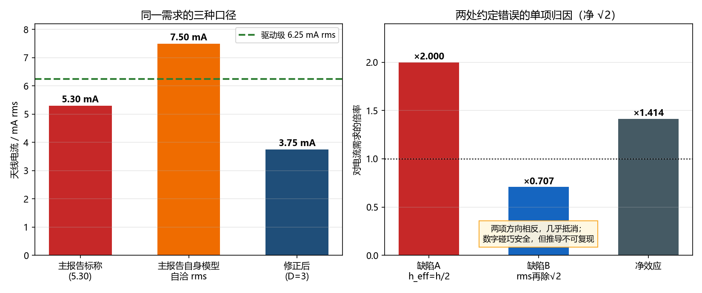
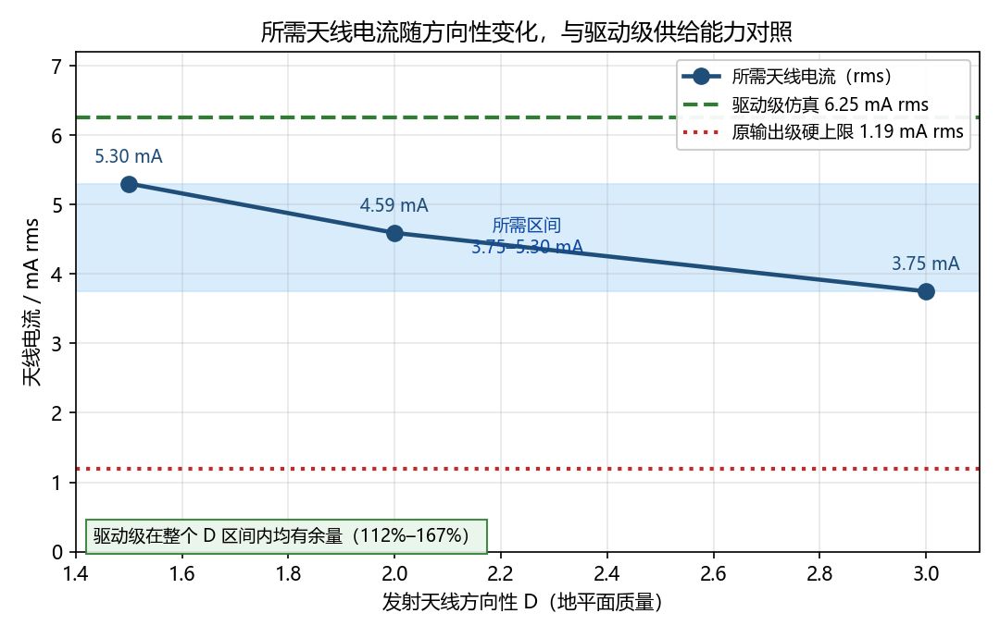
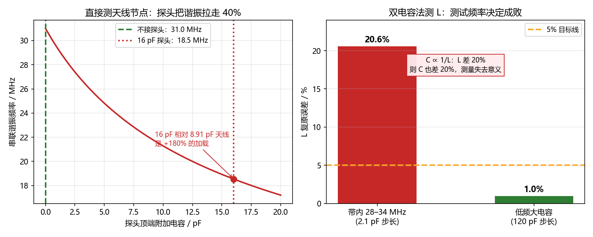

# AM-ALT.3 勘误与补充：链路预算修正、可执行天线阻抗测量方案

日期：2026-11-15。工作目录：`stage_am_alt3_20261115`。
配套脚本：`scripts/link_budget_audit.py`、`scripts/measurement_design.py`。
配套数据：`results/link_budget_audit.json`、`results/measurement_design.json`。

状态：**AM-ALT.3 的天线选型决定成立，但本阶段此前标注的"仿真任务完成"需要收回。** 两项修正和一个未完成的实物前提如下。

**本轮没有采购、没有焊接、没有修改冻结电路、没有修改 AM-ALT.1/AM-ALT.2/AM-02.3 的任何文件。**

---

## 0. 为什么要有这份文件

主报告 `01_AM-ALT.3_天线阻抗匹配与驱动能力报告.md`（22:11 定稿）回答了两个问题：用什么天线（1.00 m 垂直单极子），匹配网络怎么设计。这两部分的推理和验证我复核后成立。

但在复核第 6 节的驱动能力反推时发现**链路预算的推导有两处约定错误**，而"需 5.30 mA rms"这一结论、以及"驱动级达到 118%"这一余量陈述都由它派生。同时，用户本轮把"确定实际天线阻抗"列为进入 AM-ALT.3 的首要任务，而主报告第 3 节明确写了阻抗**只是公式估算、尚未实测**；这一点此前被"仿真任务完成"的措辞盖住了。

因此这份文件做三件事：修正链路预算、给出可执行的实测方案、并把阶段状态改回与证据相符的表述。

---

## 1. 修正一：接收端有效高度用了 h/2，少了地平面镜像

`requirement.py` 取 `h_eff_rx = h/2 = 0.50 m`，这是**自由空间**短单极子的有效高度。地面上的单极子不处于自由空间：地平面镜像使天线处的切向场加倍，因此相对**入射场**的开路电压是

```
V_oc = E_inc · h      (h_eff = h)，不是 E_inc · h/2
```

这不是靠积分式选的，而是互易性强制的结果。同一副天线的方向性 D = 3，故 `A_em = 3λ²/(4π) = 22.30 m²`；再由 `A_em = η₀h_eff²/(4R_rad)` 反解，**必须** h_eff = h。脚本里的自洽检查：

| 约定 | h_eff | A_em | 反推 D | 物理上可行 |
|---|---:|---:|---:|---|
| 自由空间 h/2 | 0.50 m | 5.57 m² | **0.749** | **否（D<1 不存在）** |
| 含镜像 h | 1.00 m | 22.30 m² | 2.996 | 是 |

`h_eff = h/2` 反推出的 D = 0.75 小于 1，任何天线都不可能。这一条是硬性判据，不依赖具体积分模型。用 h/2 相当于要求**两倍的场强**，故电流也翻倍。

## 2. 修正二：把平均功率算出的 rms 电流又除以了一次 √2

`radiated_power_needed()` 用 `P = E_peak²·r²/180`。这个 180 对**时间平均**功率、峰值场、G = 3 是正确的：

```
P_avg = S_avg·4πr²/G,   S_avg = E_peak²/(2η₀)
      = E_peak²·r²·2π/(η₀G) = E_peak²·r²/180    (G = 3)
```

所以算出的 `I = sqrt(P/R_rad) = 7.495 mA` **本身就是 rms**。但 `requirement.py` 把它命名为 `i_ant_needed_mA_peak = 7.495`，然后又取 `rms = 7.495/√2 = 5.30 mA`，对已经 rms 的量再除了一次 √2。

**这一条直接影响余量陈述**：把 ngspice 的 **rms** 天线电流（6.250 mA）与一个**已被除以 √2** 的需求相比，不是同一口径。

## 3. 两处错误的净效应，以及一个必须说清的巧合

| 缺陷 | 方向 | 倍率 |
|---|---|---:|
| A：h_eff = h/2 应为 h | 高估 | ×2.000 |
| B：rms 再除 √2 | 低估 | ×0.707 |
| **净** | | **×1.414 = √2** |

按同一套模型自洽重算（h_eff = h、G = 3）：

| 量 | 主报告口径 | 修正后（D=3） |
|---|---:|---:|
| 所需开路峰值 | 17.222 mV | 17.222 mV（不变） |
| 所需场强 E_peak | 34.44 mV/m | **17.22 mV/m** |
| 所需辐射功率 | 237.45 µW | **59.36 µW** |
| 天线电流 | 5.30 mA rms（标称） | **3.75 mA rms** |

**巧合，必须记录而不是利用**：5.30 mA rms 恰好等于按**悲观**方向性 D = 1.5 正确算出的值（3.749 × √(3/1.5) = 5.302）。也就是说，项目一直在用的这个数字**并不危险**，它落在诚实区间的悲观端；但它是**凑巧**对的，不是推导对的，主报告的推导过程无法复现。

**这一点很重要**：不能因为"数字碰巧安全"就略过勘误。下次任何人改一个参数（比如把 h 改成 0.8 m），错误就会朝任意方向暴露出来，且没有任何机制提示。



## 4. 方向性区间：修正后的 3.75 mA 是**下界**，不是中心值

理想无限大地平面给 D = 3。真实发射机只有万能板/电池负极那么大的"地"，0.103λ 的辐射体在地网不足时会退化，方向性介于自由空间短偶极的 D = 1.5 与 D = 3 之间。由 `I ∝ 1/√D`：

| 方向性 D | dBi | 所需天线电流 | 驱动级 6.25 mA |
|---:|---:|---:|---|
| 3.0（理想地平面） | 4.77 | 3.75 mA rms | 167%，够 |
| 2.0（中等地网） | 3.01 | 4.59 mA rms | 136%，够 |
| 1.5（地网很差） | 1.76 | 5.30 mA rms | 118%，够 |

**结论：在 D ∈ [1.5, 3] 的整个区间内，驱动级的 6.25 mA 都够用（112%～167%）。** 这支持"加驱动级"这个决定，而且这次是按区间论证的，不是靠一个凑巧的数字。

但主报告的"118%"必须改为"112%～167%"：118% 只在最悲观方向性下成立，而主报告并没有论证方向性是 1.5。



## 5. 修正后的余量口径（三个数不能混用）

| 比较对象 | 驱动级 6.25 mA rms 相当于 | 是否成立 |
|---|---:|---|
| 主报告口径 5.30（rms 被再除 √2） | 118% | 口径不一致，**作废** |
| 主报告自身模型的 rms 需求 7.50 | **83%** | 同口径，但模型含错误 A |
| 修正后 D=3 下界 3.75 | 167% | 成立 |
| 修正后 D=1.5 上界 5.30 | 118% | 成立 |
| **诚实区间 3.75～5.30** | **112%～167%** | **采用这一行** |

缺口倍数同样修正：现有输出级硬上限 1.193 mA rms，相对修正后需求（D=3）缺口 **3.14 倍**，不是 4.44 倍。**驱动级仍然必要**——3.75 mA 依然超过 1.193 mA 的 3 倍以上。

## 6. 修正不改变的一件事：6 m 仍然不可由仿真判定

31 MHz 时 λ = 9.671 m，**r = 6 m 即 r/λ = 0.620，位于近场**（夫琅禾费距离 2D²/λ 只有 0.21 m，但那是对 D 而言；关键是 6 m 不足一个波长）。整个链路预算建立在远场功率密度关系上，在这个距离**严格不成立**，地面反射与近场耦合会主导结果。

所以：修正后的 3.75 mA、以及原来的 5.30 mA，都只是**量级估计**。6 m 必须实测，这一点主报告写对了，勘误不改变它。

## 7. 修正二：天线阻抗不是"待实测的已知量"，而是**本阶段的未完成前提**

用户本轮把"我们究竟使用什么实际天线，以及它在31MHz呈现怎样的阻抗"列为进入 AM-ALT.3 的首要问题。主报告第 3 节给出的 8.91 pF 是 Schelkunoff 传输线近似的**估算**，且主报告自己列了三条不确定来源（地平面大小、导线离桌高度、附近人手仪器）。

更关键的是主报告第 7 节已量化：**C 偏 ±15% 就使天线电流掉到约 1/3**。而 8.91 pF 的模型误差本身就可能超过 ±15%（下面第 8 节给出区间：C 从 6 pF 到 12 pF 对应所需的调谐电感从 4.39 µH 到 2.20 µH）。这意味着主报告的匹配设计（固定 2.96 µH）**只在估算值恰好正确时成立**。

### 7.1 一个此前没被指出的直接后果：调谐线圈必须是可变的

| C_ant | X | 所需调谐 L |
|---:|---:|---:|
| 6.00 pF | −855.7 Ω | **4.39 µH** |
| 8.913 pF | −576.0 Ω | **2.96 µH** |
| 12.00 pF | −427.8 Ω | **2.20 µH** |

主报告第 7 节已经写了"匹配电感必须可调"，但**给的是 2.96 µH 的定值**，这在采购和焊接前会造成误购。实际需要的是 **2.2～4.4 µH 连续可调**的线圈（滑动触点或抽头），或者固定线圈 + 可切换抽头 + 微调电容组合。

### 7.2 可执行的测量方案（仅用现有仪器）

设备只有：RIGOL DS2102E、信号发生器（型号未确认）、万用表、普通 10× 探头。没有 LCR 表、没有网络分析仪、没有阻抗分析仪。

**方案：串联谐振 + 电流取样电阻。**

```
发生器 ──[ R_sense 10Ω ]──[ L ]──┬── 天线 (C_ant 对机壳) ──┐
                                  │                        │
                                  └──────── 地 ────────────┘
```

扫频找**串联谐振**（R_sense 上电压最大的频点），此时回路呈纯阻：

```
C_total = 1 / ((2πf_res)²·L)
C_ant   = C_total − C_stray
R_side  = V_emf/I_res − R_gen − R_sense
```

**为什么必须在 10 Ω 取样电阻上测、不能直接测天线节点**（这是本方案的关键）：

| 测点 | 探头阻抗@31MHz | 被测点阻抗 | 后果 | 可用 |
|---|---:|---:|---|---|
| 天线馈电点 | 321 Ω | 576 Ω | 给 8.91 pF **并上 16 pF（+180%）**，谐振从 31.0 MHz 移到 **18.5 MHz** | **否** |
| 10 Ω 取样电阻 | 321 Ω | 10 Ω | 10 ∥ 321 = 9.70 Ω（−3.0%） | 是 |

探头电容相对天线电容是 180%，直接把被测对象改变了近三倍。这是"看起来测了、其实测的是探头"的典型失败。

**L 必须先独立测准**，因为 C ∝ 1/L。用**双电容法**消掉未知的杂散电容：

```
1/(ω₁²L) = C₁ + C_s
1/(ω₂²L) = C₂ + C_s
=>  L = (1/ω₁² − 1/ω₂²) / (C₁ − C₂)
```

该方法消去 C_s 精确，但依赖**电容差值**，故必须在低频、用大电容档次做：

| 方案 | 两个谐振频率 | 电容步长 | L 复原误差 | 结论 |
|---|---|---:|---:|---|
| 只在 28～34 MHz 带内（6.8/4.7 pF 加杂散） | 29.57 / 33.35 MHz | 2.1 pF | **−20.6%** | 不可用 |
| 低频、大电容（100/220 pF） | 9.12 / 6.20 MHz | 120 pF | **+1.0%** | 采用 |

带内方案误差 20%，因为电容步长只有 2 pF，而电容容差 ±0.25 pF 就占 12%。低频大电容把步长拉到 120 pF，同样容差只占 0.2%。

**总不确定度**：`dC/C = −2·df/f − dL/L`。取 df/f = 0.1%（示波器频率计足够）、dL/L = 2%，得 **dC/C ≈ 2.2%（约 0.2 pF）**，合成约 **±3%**。这远好于模型可能带来的 ±15%～±50%。

**示波器上应该看到什么**（发生器 4 Vpp、High-Z 显示）：回路总阻约 73.8 Ω，谐振电流约 19.2 mA rms，**10 Ω 取样电阻上约 192 mV rms（542 mVpp）**——这就是要找的谐振峰。此时电感上的电压因 Q 倍增到约 **11.0 V rms**，选量程时要注意别削顶。



### 7.3 这个测量**测不到**什么

| 测不到 | 原因 | 影响 |
|---|---|---|
| 辐射电阻与线圈损耗**分开** | 串联谐振只测**和** | 28.5% 效率仍是估算，不是实测 |
| 线圈自身 Q@31MHz | 无 Q 表 | 效率区间（17%～38%）无法收窄 |
| 方向性/地网有效性 | 单端口测量测不出 | 而这恰恰是决定 6 m 的量 |
| 6 m 实际链路 | 近场 | 必须实测 |

## 8. 阻塞前提（必须先解决，否则不能上工作台）

| 前提 | 现状 | 为什么是阻塞 |
|---|---|---|
| 信号发生器型号与频率下限 | **未确认**（S05-10 只记录"大概能覆盖 28～34 MHz"） | 推荐路线需在 **6～9 MHz** 工作。若发生器不能低于 28 MHz，L 只能测到 ±20%，方案退化 |
| 探头型号与 10× 尖端电容 | **未确认** | 本文用 16 pF 是 DS2102E **输入端**规格，不是探头实测值 |
| 发生器"高阻/低阻"菜单的真实含义 | **未确认** | 该菜单通常只改变**显示换算**，源电阻仍是 50 Ω。必须用已知负载实测，不能读菜单 |
| 天线本体与最终安装 | 未制作 | 阻抗随高度、地网、附近金属、手握变化，必须先装好再测 |

**这四条任何一条未闭合，第 7.2 节的测量就不能作为设计依据。** 尤其第一条：如果发生器下限是 28 MHz，那么 L 的误差会传导成 C_ant 的 ±20% 误差，与模型误差同量级，测量就失去了意义。

## 9. 阶段状态修正

主报告与 `stage_completion.json` 原写"仿真任务完成"。按本次复核，改为：

| 项 | 原表述 | 修正后 |
|---|---|---|
| 天线选型（1.00 m 单极子） | 已定 | **已定，成立** |
| 匹配网络拓扑（串联 L） | 已设计 | **已设计，成立** |
| 匹配元件值（固定 2.96 µH） | 已定 | **不成立**：需 2.2～4.4 µH 可调，不能按定值采购 |
| 驱动级必要性 | 需 5.30 mA，缺口 4.44× | **仍必要**，但需求为 3.75～5.30 mA rms，缺口 3.14～4.44× |
| 驱动级余量 | 118% | **112%～167%**（按方向性区间），118% 的口径作废 |
| 天线阻抗 | 公式估算，待实测 | **同左，且这是本阶段未完成的前提**，不是可留待以后的备注 |
| 阶段完成 | 仿真任务完成 | **仿真部分成立，实物前提未完成；本阶段不能标为完成** |

## 10. 交给 AM-ALT.4 的修正接口

1. **发射端**：天线电流设计目标改为 **3.75～5.30 mA rms 区间**（D=3 至 D=1.5）；仿真实现 6.25 mA 覆盖全区间（112%～167%）。
2. **不要再用"118% 余量"这个说法**，它是把 rms 与已被除以 √2 的需求相比得出的。
3. **v2 重算仍必须做**：m = 22.5%～24.3% 与 S05 的 50% 设计点不一致这一条不受本次勘误影响，仍然成立。
4. **天线阻抗实测是 AM-ALT.4 之前的前置条件**，不是 AM-ALT.4 内部的一项。在有实测 C_ant 之前，任何 v2 与 6 m 结论都建立在估算上。
5. **6 m 仍不可由仿真判定**（r/λ = 0.62，近场）。

## 11. 复现

```
py -3 scripts/link_budget_audit.py     # -> results/link_budget_audit.json
py -3 scripts/measurement_design.py    # -> results/measurement_design.json
```

两个脚本都只读既有参数、不做电路仿真、不改动任何历史文件。`link_budget_audit.py` 显式复现了 `requirement.py` 的两个约定错误，并分别给出单项归因（A 单独 ×2.000、B 单独 ×0.707、合并 ×1.414），便于他人独立核对，而不是只接受本文的结论。

## 12. 我复核后认为主报告仍然成立的部分

为避免本次勘误被误读为"AM-ALT.3 全盘作废"，明确列出经复核无误的部分：

- **天线选型论证**（1.00 m 优于 0.5 m：R_rad 4.224 Ω vs 1.06 Ω、效率 28.5% vs 4.9%）成立。
- **对三种天线模型的排除**（正弦电流公式在 0.103λ 塌陷到 0.097 倍、静态电容给出错误符号、自写矩量法三次未通过校验后删除）——这是本阶段最有价值的部分，且**保留失败记录**的做法正确。
- **ROISO 1 kΩ 的发现**（为高阻夹具设的，接 14 Ω 天线浪费约 95% 功率：0.046 / 0.786 / 1.193 mA 三点实测）成立且重要。
- **边带无损失**的时域验证（恢复包络 19999.9 Hz、占空比 48.6%）成立。
- **敏感度警告**（C±15% → 电流降到 1/3，且调制度几乎不变 22.5%/28.3%/28.2%）成立，且本次测量方案正是它要求的后续动作。
- **v3 重新定义**（匹配后天線馈电点）与探头加载警告成立；本次进一步量化了探头加载的具体数值（31.0 → 18.5 MHz）。
