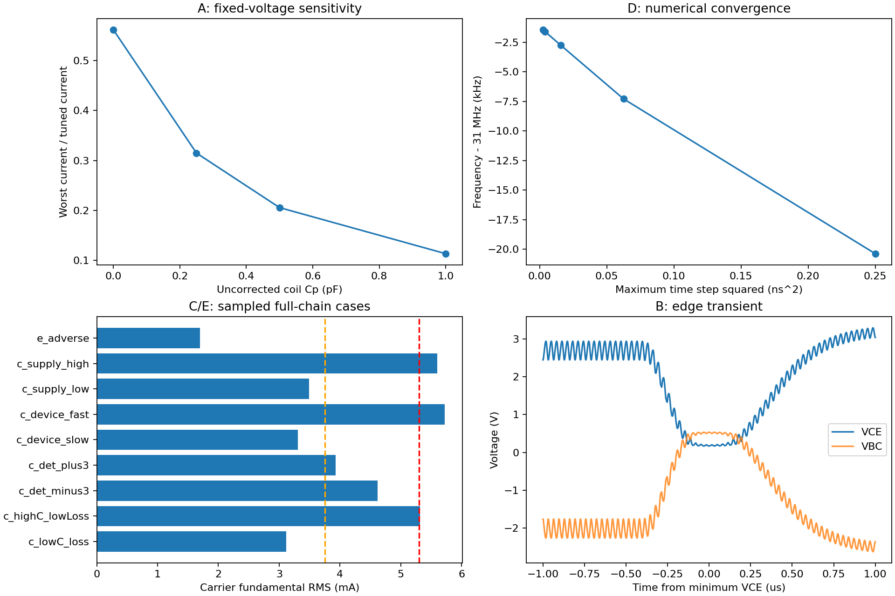

# AM-ALT.3 冻结驱动后的 A～E 仿真复核

2026-11-16。阶段状态：**已执行、勘误完成、待技术闭合**。

本轮完成2700点解析扩展和12组完整链路瞬态工况。现有两只2N3904驱动拓扑、RDC=1250 Ω、RDB1/RDB2=40k/10k Ω、RDE=150 Ω、REF=200 Ω及10 Ω取样保持不变。扫描只改独立仿真夹具中的负载、驱动器件模型参数或供电；没有改硬件设计，没有增加晶体管，没有采购、焊接。用户已确认天线与匹配未测，扫描结果不替代实测。

## A. 扩展天线/匹配敏感性

原九组谐振解析结果直接引用 `results/closure_review.json`，不重新作为新证据计数。新增C=6～12 pF共25点，Q=30/60/100，C误差−3/0/+3%，L误差−1/0/+1%，线圈并联寄生Cp=0/0.25/0.5/1 pF，共2700点。

这是**不重新调峰时、恒定驱动电压**的相对敏感性，不是驱动电流预测。寄生模型为串联R+L被Cp并联；天线及地损耗5.224 Ω，再串10 Ω。加寄生后应重新拟合并调谐，表中恶化不能解释成可调网络也必然无法工作。

| 未校正Cp / pF | 网格最小相对电流 | 5.30 mA所需端口电压最大值 / mV RMS |
|---|---:|---:|
| 0.00 | 0.5618 | 297.00 |
| 0.25 | 0.3148 | 451.05 |
| 0.50 | 0.2055 | 652.30 |
| 1.00 | 0.1131 | 1142.94 |

75个无误差、无寄生的谐振点均恢复相对电流1，解析自检通过。该结果支持保留连续可调方案；±3%测量目标不能替代安装状态调峰。

## B. 低VCE是否意味着实际压缩

名义细步长运行：QCE最低VCE=0.167061 V，发生在距最近调制边沿0.391 µs处。VBC最大0.5339 V；VBE与VBC同时为正的时间占比约0.860%，最长连续区间约408.2 ns。这里是瞬态结正向偏置证据，不只依据0.2 V阈值猜测。该时刻TP3=0.03246 V、共射集电极=0.41037 V、射随输出=0.00346 V，QEF集电极电流仅0.1040 µA。共射级集电极被拉低时，后级射随几乎截止，提供了边沿传输塌陷的直接节点/电流证据。

剔除边沿前后4 µs后分别分析连续平台，以下为各状态第一个完整片段；完整片段数据见JSON：

| 平台 | QCE最低VCE / V | 最大VBC / V | 共射基波增益 | 集电极THD(2～5次) | 天线电流THD(2～5次) |
|---|---:|---:|---:|---:|---:|
| high | 2.3229 | -1.6385 | 14.5142 | 9.349% | 0.281% |
| low | 2.5755 | -1.8953 | 14.6134 | 8.216% | 0.246% |

高/低平台共射基波增益之比为-0.0611 dB。稳定平台内VBC为负、基波增益变化很小，未见持续平台饱和；下降沿处则确实出现瞬态结正向偏置及包络凹陷。结论应分开记录，不能将最低VCE直接等同于整个平台严重压缩。两平台对照不是标准P1dB输入功率扫描；不能把差值直接称为P1dB。需同时看平台结偏置、增益及失真，区分边沿饱和与持续RF压缩。

边沿后的完整载波周期峰值（已剔除明显异常周期长度）：

| 边沿 | 最小周期峰值 / mA | 最大周期峰值 / mA | 最后超出目标平台±2%的时间 / µs |
|---|---:|---:|---:|
| fall | 0.0176 | 8.5184 | 3.287 |
| rise | 4.3368 | 8.4902 | 2.125 |
| fall | 0.0176 | 8.5178 | 3.285 |

观察窗为边沿后8 µs，±2%仅是恢复诊断带，非课程验收条款。表中电流幅值暂降或恢复过渡属于实际模型结果，不能用“平台增益变化小”将其删去。未做关闭饱和机制的反事实模型，因此不将全部包络过渡损失唯一归因于饱和。

## C. 负载、器件与供电扫描

完整工况定义在 `round2_20261116/cases.json`。负载两端为C=6 pF/Q30及C=12 pF/Q100，并各自调谐到31 MHz；另有固定L、C±3%。驱动器件模型仅QCE/QEF变化：BF=100、Tf×1.3、Cjc/Cje×1.2，或BF=600、Tf×0.8、Cjc/Cje×0.8；其余级的晶体管模型不变。供电扫描4.75/5.25 V同时施加于RF和基带电源。

**这些是独立参数扰动和联合压力工况，不是厂家统计分布或保证角点。** 模型BF不等于工作点实测hFE。器件手册的VCE(sat)有指定Ic/Ib测试条件，不能用来对本RF波形作单阈值判决：[onsemi 2N3904资料](https://www.onsemi.com/pub/Collateral/2N3903-D.PDF)。

表中 d125/d0625/d05 三行是同一名义负载在不同最大步长下的数值基线，供第 D 节收敛判断；其余各行为参数扫描。`c_det_minus3`/`c_det_plus3` 为固定 L、天线电容 ±3%；`c_lowC_loss`/`c_highC_lowLoss` 为负载两端并各自重新调谐到 31 MHz。

| 工况 | 载波RMS / mA | 总RMS / mA | QCE最低VCE / V | 电池预算 / mW |
|---|---:|---:|---:|---:|
| d125 | 4.6404 | 4.8305 | 0.1673 | 303.76 |
| d0625 | 4.6404 | 4.8305 | 0.1671 | 303.76 |
| c_lowC_loss | 3.1181 | 3.2526 | 0.1656 | 303.77 |
| c_highC_lowLoss | 5.3179 | 5.5220 | 0.1679 | 303.78 |
| c_det_minus3 | 4.6164 | 4.8061 | 0.1667 | 303.78 |
| c_det_plus3 | 3.9311 | 4.0994 | 0.1663 | 303.75 |
| c_device_slow | 3.3085 | 3.4351 | 0.9229 | 312.82 |
| c_device_fast | 5.7266 | 5.9153 | 0.1550 | 302.72 |
| c_supply_low | 3.4917 | 3.6685 | 0.2158 | 293.05 |
| c_supply_high | 5.6006 | 5.7724 | 0.1527 | 314.09 |
| e_adverse | 1.6965 | 1.7779 | 1.1410 | 300.02 |
| d05 | 4.6407 | 4.8306 | 0.1671 | 303.76 |

载波电流在联合压力工况约1.696 mA，器件慢模型约3.308 mA，低供电工况约3.492 mA，均低于3.75 mA预算下端；固定L且C+3%约3.931 mA，低损耗端约5.318 mA。因而**未证明现驱动在所扫范围内可靠覆盖需求**；功耗均低于500 mW不能替代电流/波形验收。该表界定的是**已采样仿真工况**。未覆盖全部参数组合、器件相关性、安装寄生、温度及冷启动，不能据此认证连续的可靠工作范围。对3.75/5.30 mA的比较仍是当前预算口径，实际调制度及接收链条件须统一后才能做最终判断。任何单点达到5.30 mA都不等于全范围通过。

## D. 31 MHz频率数值收敛

保留之前0.5/0.25 ns证据，新增0.125/0.0625 ns，并因末两点仍差1.147 kHz补做0.05 ns，不改晶体/电路参数。0.125 ns与0.0625 ns单帧运行分别约311 s与532 s，0.05 ns约629 s，raw约156/311/389 MB；这是本机该网表的实际成本，不是误差判据的一部分。各运行同为trap二阶、reltol=1e-5、同样2 ms终点及相同整数调制周期提取方法。细步长增加保存节点不改变电气网表。

| 最大步长 / ns | 提取载波频率 / Hz |
|---|---:|
| 0.5 | 30979629.752 |
| 0.25 | 30992712.296 |
| 0.125 | 30997259.191 |
| 0.0625 | 30998406.327 |
| 0.05 | 30998545.119 |

最后相邻差138.791 Hz，0.25/0.125/0.0625 ns三点实测收敛阶约1.987，零步长外推30998793.391 Hz，最细步长估计残差248.272 Hz。0.05 ns独立对照与前三点外推预测相差0.177 Hz。本轮工程数值判据（相邻差<1 kHz、估计残差<1 kHz、阶数接近2，并补查预测差<100 Hz）结果：**通过**。这是步长收敛证据，不是实物频率校准，也不是严格误差上界；实际晶体容差、温漂和模型误差未纳入。

采用自适应积分的原始时间戳进行时间加权，载波用时间加权基波拟合。数值方法参考：[ngspice官方文档入口](https://ngspice.sourceforge.io/docs.html)。频率即使数值收敛，也不可将其改写为精确31 MHz。

## E. 完整发射链路受限仿真基线

名义基线采用 `round2_20261116/netlists/d05.cir` 与对应raw/log/指标；包括原振荡器、基带LM393、调制器、冻结驱动及含10 Ω的名义天线负载。联合压力工况 `e_adverse` 合并6 pF/Q30、低供电和慢/低BF驱动模型。基线含完整发射链路，不含无线传播与接收机，因此不能代替6 m及v2验收。

名义载波RMS=4.6407 mA，总RMS=4.8306 mA，电池预算=303.76 mW。电池预算继续采用9 V、线性稳压、8 mA额外静态电流假设，非实测。全链路稳态窗口证据不能替代冷启动/长期漂移测试。

本轮得出的是可复现、带限制的仿真基线。**拓扑与电阻继续冻结；等待天线L/C、31 MHz安装调峰及损耗实测，再回填基线决定是否调整驱动。** 三个实物闭合任务尚未完成，阶段状态不升级。

## 复现与完整性

运行：`py -3 scripts/round2_runs.py`（独立文件、最多三个ngspice进程，已完成工况不会重复运行）；解析扩展：`py -3 scripts/round2_analyse.py`；汇总：`py -3 scripts/round2_finish.py`。

每个工况检查日志完成、raw尺寸/变量数/时间单调性；非均匀采样基波及10%已知THD自检通过。冻结前驱文件哈希见 `round2_20261116/frozen_sha256.json`，本轮证据清单见 `round2_20261116/results/evidence_sha256.json`。既有九组解析和两次步长结果保留原文件。
