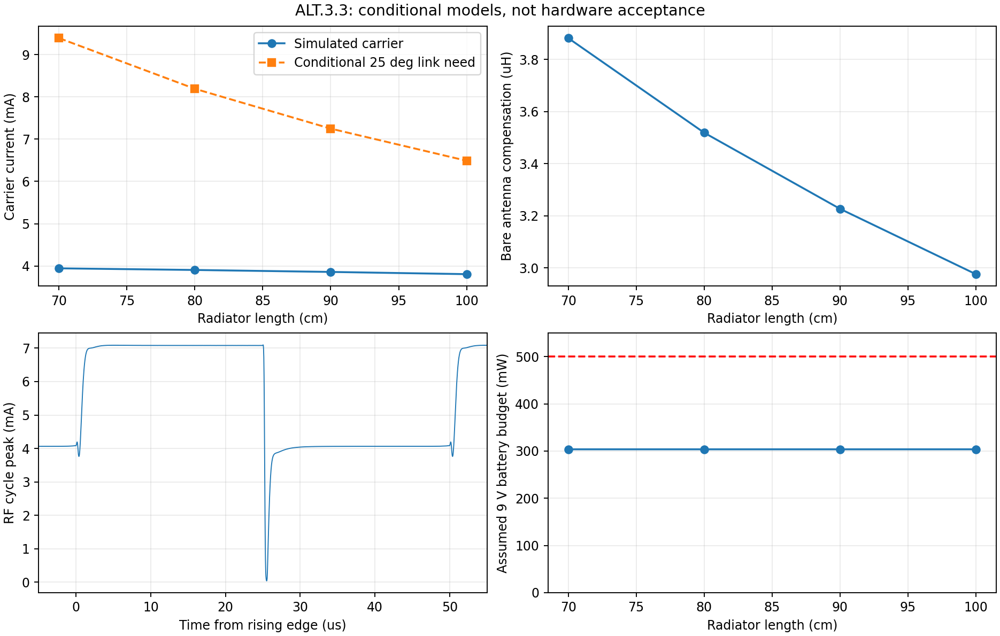

# AM-ALT.3.3 普通伸缩拉杆＋外购可调匹配

2026-11-17。**结论：条件性可行；采购定版与6m验收未放行。** 已建立独立初始模型，保持旧调制、晶体载波、QCE/QEF拓扑和偏置电阻，旧天线证据保留。

## 三个优先问题

1. **可以调谐吗？可以，条件明确。** 70–100cm代理几何的裸天线补偿需求约2.98–3.88µH；杆径/地网/安装会移动此范围。含损耗的4.7µH固定RF电感＋串联微调电容在初始模型中可覆盖，不需要厂商提供“已匹配31MHz”的拉杆。
2. **找到可靠可购买的高Q可调件了吗？商品身份与量程已闭合，Q31/SRF 数据仍缺。** 2026-11-17 已在用户已登录浏览器中逐一核验四条短链（见[02 §购物车三款的实际裁定](02_商品选型与BOM.md)）：拉杆确认是 **BJ宝嘉 ¥15+¥6运费**单一SKU；可调电感确认 **万品佳 26T 2.1–6.8µH ¥0.42/只**（另有硕骑士多档页 ¥5.55/5只）；**"5.9–82MHz中周"实为 5.9–82 mH 毫亨级件，已排除**（原文档误读标题单位）。退路上已做同族定量比较：**1812CS-472（Q31≈59.7）＋BFC280905217（2–18pF）覆盖80/90/100cm，70cm需并约10pF C0G**；同族3.9µH/3.3µH件虽Q31更高，但所需串联电容升到22–311pF，超出微调量程，故排除。**"Q更高"不等于更优，但也不能反过来说它更差**——按同一定义复算，332/392 的含取样效率（3.12%／2.93%）确实**高于**472（2.45%）。**且若目标固定为90–100cm，此前"472唯一可选"的结论已作废**：天线装好后一次性微调，不需要覆盖70–100cm全段，392只需额外并3.8–8.8pF C0G即可用，效率反高约20%。详见[04 §若只做90–100cm](04_联合仿真结果.md)。仍未闭合的是：可调电感 Q31/SRF 无厂家数据（影响载波电流约25%，见[04 §元件Q值的影响](04_联合仿真结果.md)）、拉杆机械尺寸与含底座总长、伸缩节接触可靠性、替代件供货，以及 6m/V2 实际链路。**已向卖家索要参数但未获任何数据**（回复"不行哈／频率对不上"，详见[02 §卖家问询结果](02_商品选型与BOM.md)）；该回复不等于路线被否决，但确认了无法在采购前取得技术确认，故只能"先买后测"。
3. **现有驱动与0.5W能支持吗？电流与功耗量级有依据，链路余量未闭合。但更该先修的是匹配效率——90cm端口30.44Ω中，线圈占52.3%、10Ω取样占32.9%，真正辐射等效仅2.4%。** 移除取样电阻可把载波从3.86mA提到4.93mA（+27.7%），代价是调制度降4.9%；按90–100cm固定使用，改用392电感可把效率从2.46%提到2.93%（含取样）。 四长度名义载波电流约3.81–3.94mA、总RMS约3.97–4.11mA、9V整机预算约303.76mW；按新NEC方向图和假设RX转换系数重算，名义情况未证明V2≥4Vpp。原驱动边沿欠冲仍存在，不能宣称6m达标。

## 交付索引

| 交付 | 文件 |
|---|---|
| 旧模型、历史指标及驱动审查 | [01_历史审查.md](01_历史审查.md) |
| 拉杆和购物车候选、原厂替代、BOM、商品链接 | [02_商品选型与BOM.md](02_商品选型与BOM.md) |
| 四长度模型、损耗分解、匹配电路与计算公式 | [03_模型与匹配设计.md](03_模型与匹配设计.md) |
| 新联合仿真、应力、频率、边沿、效率、链路预算 | [04_联合仿真结果.md](04_联合仿真结果.md) |
| 参数对比/环境扫描 | `length_comparison.csv`、`antenna_all.json`、`antenna_nominal.json` |
| 元件公差、寄生与可重调性 | `retune_sensitivity.csv`、`joint_summary.json` |
| 同族固定电感选型对比（472/392/332） | `fixed_inductor_coverage.csv`、[04 §固定电感选型对比](04_联合仿真结果.md) |
| 辐射效率及其不确定度 | [03 §辐射效率及其不确定度](03_模型与匹配设计.md)、`efficiency_uncertainty.csv` |
| 元件Q值影响（含外推压力工况） | [04 §元件Q值的影响](04_联合仿真结果.md)、`q_corners.csv` |
| 管理文档正文更新建议 | [07 §管理文档更新建议](07_项目状态与下一步.md) |
| 四条淘宝短链实测核验（标题/店铺/价格/全部SKU） | `evidence/taobao_verified_20261117.json` |
| 全部NEC输入/输出 | `runs/*.nec`、`runs/*.out` |
| 完整联合SPICE网表、原始波形和日志 | `joint/*.cir`、`joint/*.raw`、`joint/*.log`、`joint/*_metrics.json` |
| 实物测量/调试/6m和V2验收规程 | [06_实物测量调试规程.md](06_实物测量调试规程.md) |
| 管理文件更新及采购前门槛 | [07_项目状态与下一步.md](07_项目状态与下一步.md) |
| 求解版本、复验及证据哈希 | `verification.json`、`frozen_driver_hash.json`、`evidence_sha256.json` |
| 厂家PDF、用户截图、商品访问记录 | `evidence/` |



## 复现

在项目根目录用Python3执行（NumPy、SciPy、Matplotlib；版本见verification.json）：

依赖顺序（**make_results.py 需执行两次**，勿省略）：

```powershell
# 1) 电磁模型：生成 antenna_all.json / antenna_nominal.json
py -3 simulation/v4_hardware/stage_am_alt3_3_20261117/model_whip.py

# 2) 联合瞬态：四长度名义 + 压力工况
py -3 simulation/v4_hardware/stage_am_alt3_3_20261117/joint_sim.py

# 3) 同族电感对照：生成 fixed_inductor_coverage.csv + opt392/opt472 工况
py -3 simulation/v4_hardware/stage_am_alt3_3_20261117/compare_fixed.py

# 4) 首趟汇总：生成 retune_sensitivity.csv（216组解析扫描）
py -3 simulation/v4_hardware/stage_am_alt3_3_20261117/make_results.py

# 5) 损耗预算（loss_budget.json）与取样电阻 A/B/C 工况 rs5/rs2/rs1/rs01
py -3 simulation/v4_hardware/stage_am_alt3_3_20261117/loss_budget.py
py -3 simulation/v4_hardware/stage_am_alt3_3_20261117/sweep_rsense.py

# 6) 固定长度（90–100cm）电感选型：fixed_length_part_choice.csv
py -3 simulation/v4_hardware/stage_am_alt3_3_20261117/fixed_length_part_choice.py

# 7) 效率不确定度 + Q角点：读取上一步的 retune_sensitivity.csv，
#    生成 efficiency_uncertainty.csv、q_corners.csv 及 Qmin50m63/Qhigh119 工况
py -3 simulation/v4_hardware/stage_am_alt3_3_20261117/efficiency_q_corners.py

# 8) 第二趟汇总：此时 CSV 与 Q 工况齐全，04 文档才含效率与Q章节
py -3 simulation/v4_hardware/stage_am_alt3_3_20261117/make_results.py

# 9) 校验
py -3 simulation/v4_hardware/stage_am_alt3_3_20261117/verify_delivery.py
```

**为何要两趟**：`efficiency_q_corners.py` 的匹配后效率统计读取 `make_results.py` 产出的 `retune_sensitivity.csv`；而 `make_results.py` 要在04文档渲染效率与Q章节，又必须先有前者的输出。二者互为输入，故用"汇总→角点→再汇总"解环。缺任一步，`verify_delivery.py` 会因 `efficiency_uncertainty.csv`／`q_corners.csv` 缺失或 Q 工况不全而失败。

**从既有结果目录复跑时**：脚本会复用已有 `.raw`，但第 5–7 步仍须执行，否则 04 文档缺少损耗预算、取样电阻与效率/Q 章节，`verify_delivery.py` 也会因 CSV 缺失失败。

nec2c使用既有`stage_am_alt3_1_20261116/tools/nec2c.exe`；ngspice路径为`D:/ms_xsp/s04_crosscheck_20261017/Spice64/bin/ngspice_con.exe`，均写在脚本顶部。更换机器需设置路径。完整源网表已保存在新`joint`目录，各网表自包含原模型。

已有raw时脚本复用结果；若修改输入，请使用新案例名或新版本目录，不能让旧raw与新网表混用。本目录首次执行的精确文件哈希见证据清单。NEC按输入文本变化自动重算。普通拉杆各节尺寸缺失，因此本交付为**初始条件模型**，并非最终商品数字孪生或量产设计。

## 本轮完成状态

`verify_delivery.py`全部通过：18个联合瞬态工况、44个NEC天线算例、216组解析敏感性、12行固定电感覆盖表、8行效率不确定度、7行Q角点表。检查项包括冻结网表逐字匹配、源文件哈希不变、raw二进制布局与时间单调、RMS独立梯形积分交叉核对、名义谐振残差、自由空间能量残差。

前次会话因额度中断时有4个工况未跑完（`h90_Lminus5`、`h90_loss2`、`h90_trimplus1`、`h90_opt332`），已补齐。此后又补充了`h90_opt392`／`h90_opt472`（同族电感对照）与`h90_Qmin50m63`／`h90_Qhigh119`（Q值两侧包络）。所有对照工况都在各自重新调谐到31MHz后比较，未把同一CT硬套到不同器件上。

**三条补齐项**（对应任务书§5第9项、§7第11项、§10第9项）：
1. 效率不确定度——裸端口1.41–1.44×、匹配后3.09–3.64×，见`efficiency_uncertainty.csv`；
2. Q值影响——发现标称模型在50MHz的Q(79.4)高于厂家保证63，按保证下限反解Q31=47.3并补跑，见`q_corners.csv`；
3. 管理文档正文更新建议——见[07 §管理文档更新建议](07_项目状态与下一步.md)，仅建议未擅自改写用户既有正文。

已知未闭合项与前述一致：具体商品SKU与机械结构、装后Q31/SRF与接触重复性、真实安装阻抗回填、6m/V2实测、电池端功耗实测。`hardware_acceptance=false`仍成立。
